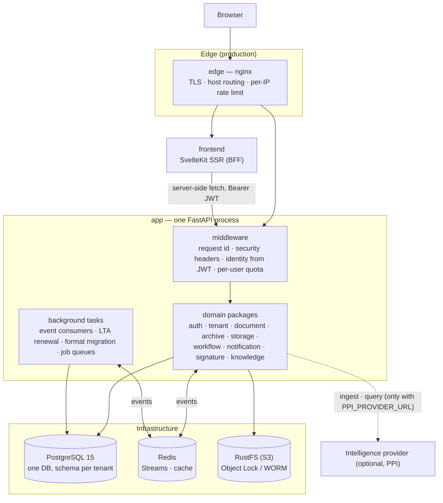
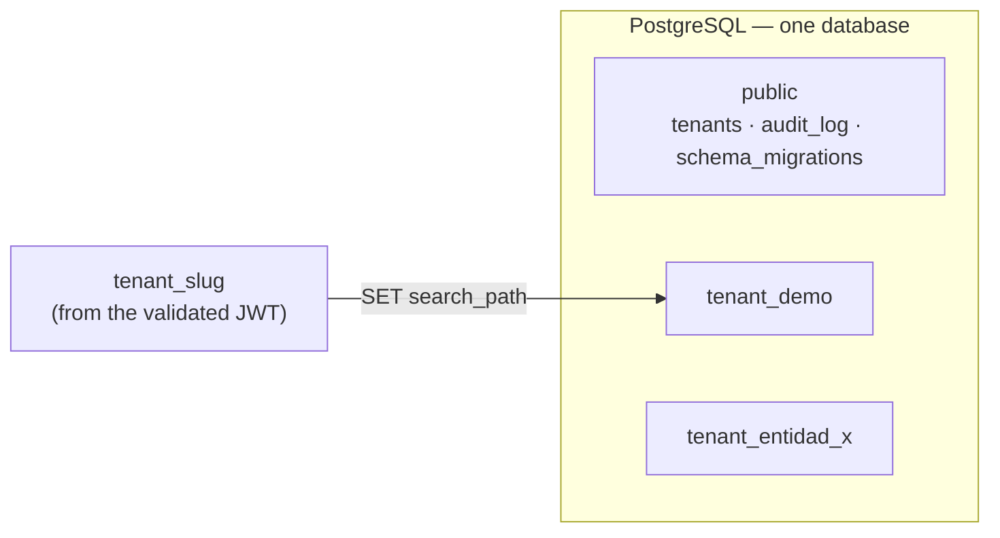
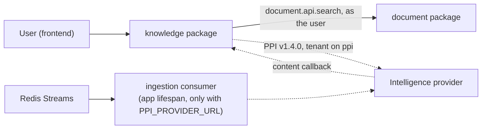

# Architecture

Docuboto is an **SGDEA** (*Sistema de Gestión Documental Electrónico de Archivo*) — an
electronic records-management system for Colombian public institutions. It covers the full
document lifecycle: registration (*radicación*), distribution, case files (*expedientes*),
retention schedules (TRD/TVD), electronic signature, physical archive, digital preservation,
public access (PQRSD, Ley 1712), and an optional outbound gateway to an intelligence provider
(PPI) — with knowledge features that do not call language models (ADR-046, ADR-051).

It is a fork of [OrpycaMCP](https://gitlab.com/orpyca/orfeo_mcp) (AGPL-3.0). Internal
identifiers still use the upstream prefix: the shared library is `orpycamcp_common`, Redis
streams are `orpycamcp.*`, the Docker network is `orpycamcp-net`. Treat `orpycamcp` as "the system" when you read the code.

This document is the map. The reasoning behind each decision lives in the ADRs under
[`docs/es/adr/`](docs/es/adr/) (Spanish) and the indexes in [`docs/en/adrs.md`](docs/en/adrs.md).
References like *ADR-035* below point there.

---

## 1. System at a glance

Docuboto runs as **one application process** (ADR-047): a single FastAPI app, `app`, that
mounts the routers of nine domain packages and runs their background loops. There is no API
gateway and no separate worker.



| Layer | Technology |
|---|---|
| Backend | Python 3.11, FastAPI, Pydantic v2, **asyncpg with raw SQL (no ORM)**, one process |
| Frontend | SvelteKit 2 (Svelte 4) with `adapter-node`, Bulma, SSR only |
| Database | PostgreSQL 15, one database, one schema per tenant (no pgvector) |
| Messaging | Redis Streams with consumer groups (until ADR-049) |
| Object storage | RustFS (S3-compatible), Object Lock for preservation (ADR-027, ADR-023; until ADR-050) |
| Identity | Issued by the app (ADR-048): argon2id passwords, ES256 JWTs with a published JWKS, OIDC discovery and `client_credentials` for service accounts; TOTP 2FA in the `auth` package as a signing step-up |
| Intelligence | None in-process (ADR-046). Optional external provider over PPI v1.4.0, off by default (ADR-045, ADR-051) |
| Packaging | Docker Compose (dev and production), GitHub Actions |

ADR-047 targets four containers (`app`, `postgres`, `edge`, `frontend`). Keycloak is gone
(ADR-048); Redis and the object store are still in the manifests until ADR-049 and ADR-050 remove them.

---

## 2. Repository layout

```
docuboto/
├── services/docuboto/        # The application process (ADR-047)
│   ├── docuboto/             # Composition root: main.py (create_app), config.py, core/, routers/
│   ├── <domain>/             # archive, auth, document, knowledge, notification,
│   │                         # signature, storage, tenant, workflow (layout in §4)
│   ├── migrations/           # One chain (ADR-053): runner.py + global/ + tenant/ + seeds/
│   ├── schemas/              # XSDs validated at runtime (archive, storage)
│   ├── tests/<domain>/       # pytest per domain; tests/docuboto/ for the composition root
│   └── requirements.{txt,lock}, pytest.ini
├── shared/
│   ├── orpycamcp_common/     # Cross-cutting library installed in the image (§6)
│   └── tests/                # Repo-wide architecture guard tests (§11)
├── frontend/                 # SvelteKit app, unit tests (vitest), e2e (Playwright)
├── infra/                    # Dockerfile.app, production compose, nginx edge, backup/restore
├── scripts/                  # Tenant provisioning, seeds, test-app/lint/ci-local, dev PKI, preflight checks
├── contracts/ppi/            # PPI contract, one frozen directory per version (v1.4.0)
├── docs/{es,en}/             # MkDocs site (Spanish is primary), ADRs in docs/es/adr/
├── docker-compose.yml        # Development stack
└── .github/workflows/        # ci (PRs, main), dependency-audit, release (tag X.Y.Z → images → deploy)
```

---

## 3. The process and its domain packages

`services/docuboto/docuboto/` is the composition root:

| Module | Role |
|---|---|
| `main.py` | `create_app()`: the only place that defines middleware and exception handlers; mounts every package's `DOMAIN_ROUTERS` plus `/health` and `/metrics`. |
| `config.py` | `pydantic-settings`: `CommonSettings` (database, pool, Redis, log level) and one `Settings` class per domain (`docuboto.config.archive`, …). Environment variable names are unchanged and carry no prefix. |
| `core/lifespan.py` | Opens the single database pool and starts the background tasks. |
| `core/tasks.py` | `BackgroundTasks` group for event consumers, LTA renewal, format migration, and the `trabajo_fuera` queues (`app` light; `worker` heavy, a name kept in the schema). Heavy work takes a slot from `heavy_slot()`, a semaphore of `HEAVY_JOBS_CONCURRENCY` (default 1). |
| `core/security.py` | `SecurityHeadersMiddleware` (`X-Request-Id`, `nosniff`, `DENY`, `no-referrer`) and `UserRateLimitMiddleware` (per-person quota, `RATE_LIMIT_PER_USER`, default 120/min, `429` with `Retry-After: 60`). |
| `routers/health.py`, `routers/metrics.py` | One liveness/readiness probe and one Prometheus exporter for the whole process. |

Each domain package owns one bounded context. Its `main.py` only exports `DOMAIN_ROUTERS`
(and, for archive and storage, the loops the lifespan starts).

| Package | Owns |
|---|---|
| `auth` | Identity issuer (login, rotating refresh sessions, ES256 JWTs, JWKS, `client_credentials`; ADR-048), RBAC (roles, permissions, CRUD levels), security clearance, TOTP, personal signing-key custody, `audit_log` queries. |
| `tenant` | The installation's entity configuration, *dependencias* (org units), catalogs, business-day calendar, PINAR. |
| `document` | The registration core: incoming/outgoing/internal *radicados*, attachments, replies, drafts, annulment, declassification, third parties, search (PostgreSQL FTS) and reports, public counter (PQRSD, ALTCHA), email intake (IMAP/OAuth), postal dispatch, import/export packages, OAI-PMH, CMIS. |
| `archive` | *Expedientes*, TRD/TVD and classification chart, electronic index (signed XML), physical archive (locations, units, loans), transfers + FUID, disposal (*eliminación*), legal holds. |
| `storage` | Bytes in the object store: upload, mediated download, rendering, digital preservation (BagIt/PREMIS AIPs, WORM, replica, format migration, veraPDF). |
| `workflow` | Distribution flows, approval chains (*vistos buenos*), routing rules. Moves the radicado's state (ADR-028). |
| `notification` | Email/alerts, signed outgoing webhooks. |
| `signature` | XAdES-B/T/LT/LTA signatures verifiable by third parties (ADR-034), institutional seals, TSA/OCSP, LTA renewal. Pluggable `SignerProvider`. |
| `knowledge` | Model-free knowledge gateway (ADR-046): `/search` and `/antecedentes` run `document` FTS as the user, or delegate to the PPI provider when the tenant is on `ppi`; outbound PPI client and the `content` callback. Gated by `asistente_habilitado` + `PERM_CONOCIMIENTO` (ADR-037). |

The `frontend` container (SvelteKit SSR, port 3000 / host 19300) is the only other
application container.

Routing is FastAPI's own router: every package mounts its routes with `include_router`.
Storage downloads aren't exposed; bytes go through `document`, which rechecks clearance first.

---

## 4. Anatomy of a domain package

Every domain package follows the same layered layout:

```
<domain>/             # document, workflow, archive, storage, auth, tenant,
                      # notification, signature, knowledge
├── main.py           # Exports DOMAIN_ROUTERS (no FastAPI app of its own)
├── api.py            # The package's door for other packages: keyword-only functions
├── core/             # Domain-specific glue and constants (config lives in docuboto/config.py)
├── routers/          # HTTP layer — one file per resource; permission gates as dependencies
├── schemas/          # Pydantic request/response models
├── services/         # Business logic; orchestrates repositories, clients, events
├── repositories/     # Raw SQL over asyncpg; the only layer that talks to the database
├── models/           # Domain value objects / enums
├── clients/          # Clients to external systems (IMAP, PPI)
├── workers/          # Redis Streams consumers started by the app lifespan
├── jobs/             # Periodic/background tasks (retention, sweeps, reclaim)
├── providers/        # Pluggable adapters (signature)
└── ops/              # Operational commands (`python -m auth.ops.…`)
```

Every package follows the same layers (ADR-003, ADR-047 §4). The request path is:

```
UsuarioActualMiddleware  →  request.state.usuario (resolved once from the JWT)
router  ──Depends──▶  get_tenant_conn / get_vetted_conn (search_path to the tenant)
        ──Depends──▶  require_permission("PERM_X")      (RBAC + CRUD level, resolved in DB)
        ──call────▶  service  →  repository (SQL)  /  <other package>.api  /  outbox (events)
```

Conventions that apply everywhere:

- **Async I/O only.** No blocking calls inside handlers.
- **Raw SQL, no ORM** (ADR-003). Queries live in `repositories/`; flexible metadata uses
  JSONB (ADR-007).
- **Errors** are `HTTPException` with a body of `{"error": <code>, "detail": <Spanish
  message>, "status": <int>}`; a global handler turns anything unexpected into a 500 without
  leaking a traceback.
- **Secrets have no working defaults.** `config.py` defaults secrets to empty, and
  `orpycamcp_common.secrets.require_secrets` refuses to start without them.
- **Containers** run as a non-root user with a read-only `/app`, and uvicorn's access log is
  disabled because query strings carry document data; `request_log` writes a structured,
  content-free line per request instead.
- **Code and messages are in Spanish** (domain vocabulary, user-facing errors). Every source
  file carries the AGPL header.

---

## 5. Cross-cutting design

### 5.1 Multi-tenancy: schema per tenant (ADR-002, ADR-012, ADR-044)



- One installation serves one entity (ADR-047 §3), and that entity still gets its own schema
  `tenant_{slug}`. The slug comes from the validated token,
  never from the body or a client header, and is validated once in
  `orpycamcp_common.tenant` (max 54 characters, so `tenant_` + slug fits PostgreSQL's
  63-byte identifier limit).
- `get_tenant_conn` (in `orpycamcp_common.database`) checks that the entity row and schema
  exist, then sets `search_path` to **only** the tenant schema. Global tables are always qualified as
  `public.` in SQL.
- Background tasks never reuse a request-scoped connection; they use `acquire_tenant(slug)`
  to get their own, so a pooled connection can't leak into another tenant.
- Object storage mirrors the split with per-tenant buckets
  (`…-{slug}-documents`, `…-{slug}-preservation`, `…-preservation-replica`).
- `public.tenants` is the configuration row of the installation's entity. It has no lifecycle
  states (`status`, `provisioning_status` were removed with ADR-047): no suspended-entity veto,
  no conservation exemptions.
- The entity is provisioned with `scripts/init-tenant.sh` / `scripts/init_tenant.py`, which
  apply the tenant migrations to the new schema and register the intelligence service account
  in `public.auth_service_accounts`. The per-tenant buckets stay until ADR-050.

### 5.2 Authentication and identity (ADR-013, ADR-036, ADR-047, ADR-048)

```mermaid
sequenceDiagram
    participant U as Browser
    participant FE as frontend (SSR)
    participant MW as app — UsuarioActualMiddleware
    participant R as router (domain package)

    U->>FE: username + password (login form)
    FE->>MW: POST /api/v1/auth/login
    MW-->>FE: ES256 access JWT + opaque rotating refresh (stored in httpOnly cookies)
    U->>FE: page request
    FE->>MW: Authorization: Bearer <JWT>
    MW->>MW: drop client X-User-Id, X-Username, X-User-Roles, X-Canal, X-Tenant-Slug
    MW->>MW: verify the JWT with the app's own keys (iss, aud, ES256); put the caller in request.state;<br/>re-set X-Tenant-Slug from the token
    MW->>R: request
    R->>R: resolve permission + clearance in tenant DB
```

Key points:

- **One identity per request.** `UsuarioActualMiddleware` (`orpycamcp_common.usuario`)
  resolves the caller once and leaves it in `request.state`; no package resolves it again.
  Identity headers a client sends are discarded. The nonce-signed identity headers, the
  internal tokens, and the gateway's validation cache are gone: without network hops there's
  nothing to sign. The token's `sub` is `auth_users.id`, so verifying it needs no database
  lookup beyond the cached public keys.
- **The app is the issuer** (ADR-048). People log in with argon2id passwords (12-character
  minimum, history of 5, lockout after 5 failures); the refresh token rotates on every use and
  reuse revokes the whole session. Signing keys live in `public.auth_jwt_keys` and rotate with an
  overlap window. Per-entity service accounts (`public.auth_service_accounts`) get tokens through
  `POST /oauth/token`; the PPI gateway mints its own in-process. The PPI provider verifies them
  against `/.well-known/jwks.json`.
- **Permissions and clearance are resolved against the database** on every request and
  deliberately **not cached**, so a revoked permission takes effect on the next call. The
  gates live once, in `orpycamcp_common.clearance` (`require_permission`,
  `require_actor_permission`, `require_vetted_permission`, `enforce_permission`), on top of
  `orpycamcp_common.rbac`, and are fail-closed.
- The client IP is derived server-side from trusted hops (`TRUSTED_PROXIES`, checked at
  startup in production), never from client headers, because it's sealed into the audit log.
- **Clearance (RF-SEG-08)**: users and objects carry a security level; reads follow a
  no-read-up rule, computed as `max(live level, embedded level)` with unknowns treated as
  *classified* (fail-closed).

### 5.3 Communication between domain packages

| Mechanism | Use |
|---|---|
| HTTP API | Every user operation, including an agent acting through a scoped service account (ADR-051 §5). |
| `<package>/api.py` function calls | Synchronous calls between packages, in-process: keyword arguments with explicit `tenant_slug` and actor. `storage/api.py` is the one storage client; `signature/api.py` holds the seals, which are no longer reachable over HTTP. `enforce_permission` applies the same check to a route and to an `api.py` function. A package may import another package's `api` and nothing else (`shared/tests/test_contrato_api.py`). |
| Redis Streams events | Domain events consumed asynchronously by one or more packages. |

Outbound calls to user-configurable destinations (webhooks, IMAP servers, TSA) pass through
`orpycamcp_common.red_interna`, which blocks internal network ranges (SSRF protection).

### 5.4 Events: Redis Streams with an outbox (ADR-009, ADR-010, ADR-021)

```mermaid
sequenceDiagram
    participant DOC as document
    participant DB as tenant schema
    participant R as Redis Streams
    participant C as consumers (workflow, signature, notification)

    DOC->>DB: BEGIN; write radicado; INSERT eventos_salientes; COMMIT
    DOC->>R: XADD orpycamcp.document.events (signed envelope)
    Note over DOC,R: if XADD fails the row stays pending;<br/>a sweep re-sends it (SKIP LOCKED)
    R->>C: XREADGROUP (one group per consumer)
    C->>C: verify signature · dedupe by event_id · process
    C->>R: XACK only on success
    Note over C,R: repeated failure → dead-letter table + orpycamcp.{svc}.deadletter
```

- **Streams**: `orpycamcp.{service}.events`, dead-letter `orpycamcp.{service}.deadletter`.
  Domain streams have a bounded retention.
- **Envelope** (`orpycamcp_common.events`): `event_id`, `event_type`
  (`document.radicado.created`, …), `version`, `tenant_slug`, `occurred_at`, `actor`,
  `correlation_id`, `dedup_key`, `payload`, and an HMAC `firma`. Unsigned envelopes are
  rejected.
- **Delivery is at-least-once.** Producers use a transactional outbox
  (`eventos_salientes`) so an event can't be lost after commit; consumers deduplicate on
  `(origin_group, event_id)`.
- **Failures**: messages stay in the pending list for retry, stale ones are reclaimed, and
  exhausted ones go to the shared `evento_dead_letter` table. Admins with `PERM_DLQ_ADMIN`
  inspect, replay, or discard them through each package's `admin_deadletter` router;
  visibility is filtered by clearance inside the SQL (`orpycamcp_common.deadletter`).
- Consumer loops run under `spawn_supervised`, so a crashed worker restarts and readiness
  reports it.

### 5.5 Immutable audit (ADR-008)

`public.audit_log` is append-only, partitioned, and hash-chained **per tenant**:
`hash = sha256(prev_hash || canonical_content)`, serialized with a per-tenant advisory lock.
`orpycamcp_common.audit` is the only writer (`append`, `append_denial`, `verify_chain`); a
database trigger rejects `UPDATE`/`DELETE`, and the application role only has
`INSERT, SELECT`. Denials are audited too.

### 5.6 Database roles and migrations (ADR-012, ADR-041, ADR-053)

- Two roles: the **owner** runs migrations; the app connects as the **application role**
  (`DB_APP_USER`, member of `orpycamcp_app`) with only the grants they need. A guard test
  fails if the app connects as the owner.
- One migration chain lives in `services/docuboto/migrations/` (ADR-053): named files, one
  per table or coherent group. `runner.py` applies `global/` to `public` and `tenant/` to
  every `tenant_*` schema, each file in its own transaction, and records them in the ledger
  `public.schema_migrations`, keyed by schema + file. The runner and `scripts/init_tenant.py`
  share a global lock.
- In Compose, `app` waits on the one-shot `migrate-docuboto` container (same image); if
  migrations fail, the app doesn't start.
- The chains each service had before ADR-053 are archived, not executable, in
  `docs/es/historia/esquema/`.

### 5.7 Files, signatures, and preservation

- **Storage** never exposes the object store. Upload goes through
  `POST /api/v1/storage/upload`; download is mediated by `document`, which revalidates
  clearance and then reads the bytes through `storage/api.py`.
- **Preservation** (ADR-023, ADR-042): AIPs are BagIt packages with PREMIS metadata, written
  to an Object Lock bucket in `COMPLIANCE` mode and replicated. AIPs are versioned, never
  rewritten.
- **Signatures** (ADR-016, ADR-030, ADR-034): the `signature` package produces XAdES signatures
  with timestamps from a TSA and OCSP evidence, so third parties can verify them. Personal
  keys are custodied in the `auth` package, encrypted at rest with a versioned KEK
  (`orpycamcp_common.kek`, AES-256-GCM with AAD). Signing requires 2FA.

### 5.8 Observability

- `/health` is liveness only (never touches dependencies); `/health/ready` checks
  the database and Redis and returns 503 when the app can't serve; the object store,
  SMTP, next month's `audit_log` partition, and each supervised consumer are reported without
  deciding (`orpycamcp_common.health`).
- `SecurityHeadersMiddleware` generates `X-Request-Id`; the app logs it in one JSON line per request
  (`orpycamcp_common.request_log`), without query strings or bodies.
- `/metrics` exposes Prometheus gauges through a closed registry
  (`orpycamcp_common.metricas`): no tenant, user, or document labels, and "not measured" is
  reported explicitly instead of as 0 (ADR-041).

---

## 6. Shared library — `orpycamcp_common`

Installed into the app image (`pip install /shared`). Anything security-sensitive that more than
one package needs is defined **once** here (ADR-010), and guard tests fail if a copy reappears
in a package.

| Module | Responsibility |
|---|---|
| `audit` | Hash-chained, append-only audit log writer and verifier. |
| `events` | Signed event envelope, publish/consume helpers, consumer groups, reclaim, supervised workers. |
| `deadletter` | Clearance-filtered queries over the shared dead-letter table. |
| `usuario` | `UsuarioActualMiddleware`: the caller from the JWT, once per request, into `request.state`. |
| `database` | One pool; `get_conn`, `get_vetted_conn`, `get_tenant_conn`, `acquire_tenant`. |
| `clearance` | `require_permission`, `require_actor_permission`, `require_vetted_permission`, `enforce_permission`. |
| `rbac` | `check_permission`, `check_any_permission`, `resolve_caller_clearance`, `nivel_efectivo` — fail-closed. |
| `tenant` | Slug validator, schema naming, entity existence check and public-access rules. |
| `migrations` | Shared migration ledger and global lock. |
| `kek` | Versioned envelope encryption at rest (AES-256-GCM + AAD). |
| `red_interna` | Blocks outbound connections to internal networks (SSRF). |
| `secrets` | Startup check that secrets come from the environment. |
| `health`, `request_log`, `metricas` | Probes, structured request logging, Prometheus exporter. |

---

## 7. Frontend

`frontend/` is a SvelteKit app rendered on the server; it acts as a **backend-for-frontend**:

- The browser never calls the API directly. Pages load data in `+page.server.js` /
  `+layout.server.js`, and the few client-side calls go to SvelteKit `+server.js` endpoints
  that proxy to the app. CORS is off by default for that reason.
- Tokens live in httpOnly cookies. `hooks.server.js` refreshes the access token
  transparently, exposes `locals.user`, propagates the client IP, applies security headers,
  and enforces fetch timeouts.
- Route groups: `(app)/` for authenticated screens (inbox, registration, expedientes,
  signatures, transfers, admin, …) and `(public)/` for the citizen-facing portal
  (PQRSD registration with ALTCHA, inquiry, public indexes, disposal notices).
- Server-only helpers live in `src/lib/server/`; HTML from rich content is sanitized there.
- Rich editing (TipTap/Yjs), surveys, and ALTCHA are optional dependencies.
- Tests: vitest for units (including guard tests such as "every proxy requires a session")
  and Playwright with axe for e2e and accessibility.

See ADR-011 and ADR-020 (design system).

---

## 8. Knowledge and intelligence (ADR-037, ADR-045, ADR-046, ADR-051)



Docuboto does **not** call language models (ADR-046), and it is **not a tool server for
agents** (ADR-051 §5): there is no MCP layer. An agent that has to act on Docuboto uses the
HTTP API with a scoped service account (ADR-048), or the provider through PPI. External MCP
clients (Claude Desktop, IDEs) can't operate the SGDEA; that capability isn't available.

- **Knowledge without models.** The `knowledge` package exposes `/search` and `/antecedentes`:
  `document` full-text search as the user, or delegated to the PPI provider when the
  tenant is on `ppi`. There is no generation route (`/rag` was retired with ADR-051).
  Knowledge features stay gated per entity by `asistente_habilitado` + `PERM_CONOCIMIENTO`
  (ADR-037).
- **PPI is outbound and opt-in.** A tenant starts at `intelligence_provider = 'local'`, which
  sends nothing anywhere. The ingestion consumer starts in the app's single lifespan
  (`services/docuboto/docuboto/core/lifespan.py`) only when `PPI_PROVIDER_URL` is set; with it
  empty nothing is registered and no call leaves.
- **The contract is frozen per version.** PPI v1.4.0 lives in `contracts/ppi/v1.4.0/`
  (OpenAPI, schemas, fixtures, `SHA256SUMS`); a test fails if the frozen copy changes.

---

## 9. Main domain flow

Registering an incoming document (*radicación de entrada*):

1. The user (or the public portal, or the email poller) submits the document to the
   `document` package. Attachments are uploaded first through `POST /api/v1/storage/upload`,
   and the radicado references their `file_id`s.
2. `document` assigns the tracking number atomically per tenant, year, and type
   (`SELECT … FOR UPDATE` on the sequence table), computes the due date in business days via
   `tenant/api.py`, writes the radicado and the outbox row in one transaction, and audits.
3. `document.radicado.created` is published. In parallel, consumers in the same process:
   - `workflow` creates the distribution flow and assigns the *dependencia*.
   - `signature` checks whether a signature is required.
   - `notification` alerts the recipient and fires subscribed webhooks.
   Full-text search is a generated column in `document`; `knowledge` doesn't index content
   (ADR-046).
4. The radicado then moves through the inbox, approvals, response, and is filed into an
   *expediente* in `archive`, governed by the TRD until transfer, preservation, or disposal.

Domain vocabulary (radicado, expediente, TRD, FUID, PINAR, …) is defined in
[`docs/en/domain.md`](docs/en/domain.md); the lifecycle in
[`docs/en/lifecycle.md`](docs/en/lifecycle.md).

---

## 10. Deployment

- **Development** — `docker compose up -d` from the repo root starts `migrate-docuboto`
  (one-shot), `postgres`, `redis`, `minio` (RustFS), `app` (host port 19000), and
  `frontend` (19300) on `orpycamcp-net`. Mailpit (`--profile dev`) captures email.
- **Production** — `infra/docker-compose.prod.yml` runs the same containers without Mailpit,
  plus `edge` (nginx from [`infra/nginx/orpyca.conf.template`](infra/nginx/orpyca.conf.template)),
  which terminates TLS, applies the per-IP rate limits (`limit_req`), and routes by hostname to
  the frontend and the app (which also serves the OIDC issuer). Only the edge is published. The `app`
  image (`infra/Dockerfile.app`) carries the JRE, veraPDF, and Ghostscript for preservation.
  Required secrets are enforced with `${VAR:?}` and checked by `scripts/preflight-prod.sh`.
  Backups and restores (`infra/backup.sh`, `infra/restore.sh`) are fail-closed and respect
  Object Lock retention.
- **CI** (`.github/workflows/`): `ci.yml` runs lint (`scripts/lint.sh`, ruff + mypy over
  `services/docuboto`), shared guards, security smoke and npm audit on every PR and push; unit
  and integration (`scripts/test-app.sh unit|integration`, one pytest invocation per
  `tests/<domain>/`), frontend, real WORM, veraPDF and the strict MkDocs build on PRs and tags.
  `scripts/ci-local.sh` mirrors `ci.yml` locally. `dependency-audit.yml` runs weekly and on
  PRs. `release.yml` (tag `X.Y.Z`, ADR-053 §3) builds and scans the images, pins them by digest
  in `release-<version>.yml` and deploys over SSH behind a blocking backup.

Full details in [`docs/en/deployment.md`](docs/en/deployment.md).

---

## 11. Architecture guard tests

`shared/tests/` holds repository-wide tests that read the source, compose files, and
migrations to enforce the architecture instead of documenting it. Examples:

- every route has a permission gate, and every declared permission exists
  (`test_toda_ruta_lleva_gate.py`, `test_permisos_existen.py`);
- the app is one process with one database layer and one gate
  (`test_un_solo_proceso.py`, `test_una_sola_base_de_datos.py`, `test_el_gate_se_define_una_vez.py`);
- a package reaches another only through its `api.py` (`test_contrato_api.py`);
- slug validation is defined once and `search_path` is tenant-only;
- the middleware reads what token validation emits
  (`test_el_middleware_lee_lo_que_validate_emite.py`); event envelopes are signed;
- the app doesn't connect as the database owner;
- the production manifest is safe and immutable; CI runs every domain of the app
  (`test_ci_corre_la_app.py`);
- every source file carries the license header, and user-facing messages are in Spanish.

When you add a package, route, permission, or migration, expect these tests to tell you what
else has to change.

---

## 12. Adding to the system

- **New endpoint**: add a router file in the owning package, export it in `DOMAIN_ROUTERS`,
  gate it with `require_permission(...)`, take `get_tenant_conn`, and keep SQL in a
  repository. Update `docs/es/api.md`.
- **Call into another package**: add a keyword-only function to that package's `api.py`;
  don't import its services or repositories.
- **New table or column**: add a file to `services/docuboto/migrations/tenant/` (or
  `global/`). Never edit an applied migration.
- **New event**: publish through the outbox with the shared envelope; consumers must be
  idempotent on `event_id` and route failures to the dead-letter.
- **New setting**: add it to the domain's `Settings` class in `docuboto/config.py` and to both
  compose files and `infra/.env.example`.
- **Architecture-level change**: write an ADR in `docs/es/adr/`.
