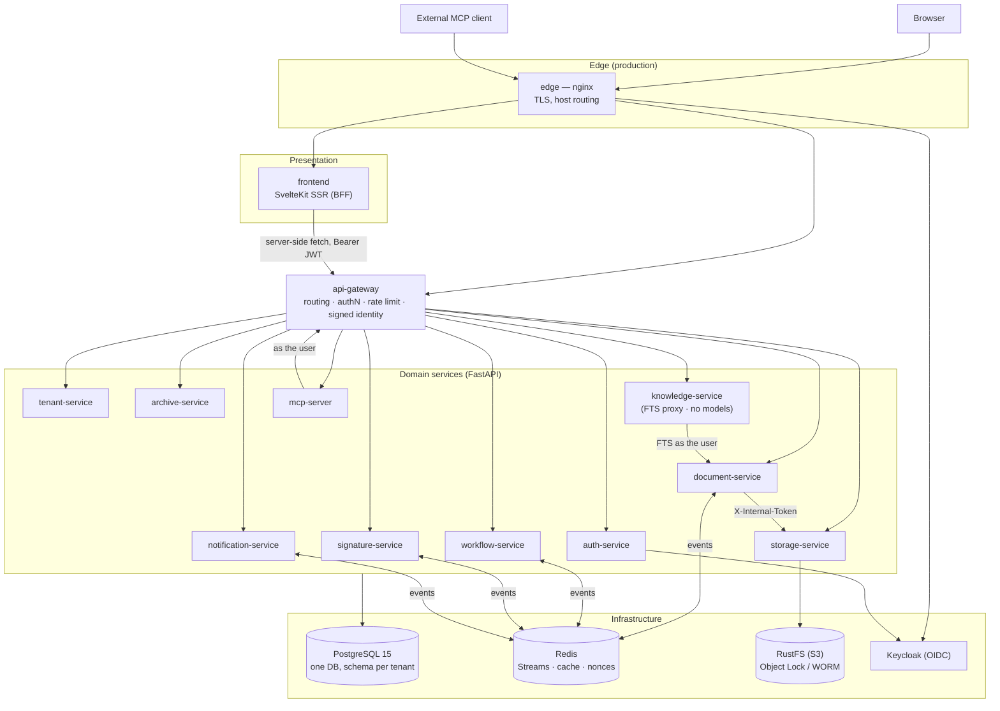
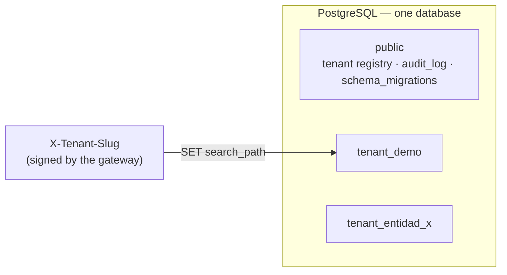
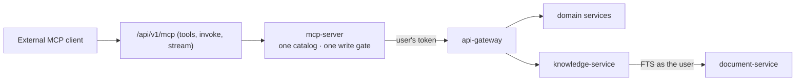

# Architecture

Docuboto is an **SGDEA** (*Sistema de Gestión Documental Electrónico de Archivo*) — an
electronic records-management system for Colombian public institutions. It covers the full
document lifecycle: registration (*radicación*), distribution, case files (*expedientes*),
retention schedules (TRD/TVD), electronic signature, physical archive, digital preservation,
public access (PQRSD, Ley 1712), and an MCP layer for external clients — with knowledge
features that do not call language models (ADR-046).

It is a fork of [OrpycaMCP](https://gitlab.com/orpyca/orfeo_mcp) (AGPL-3.0). Internal
identifiers still use the upstream prefix: the shared library is `orpycamcp_common`, Redis
streams are `orpycamcp.*`, the Docker network is `orpycamcp-net`, the Keycloak realm is
`orpycamcp`. Treat `orpycamcp` as "the system" when you read the code.

This document is the map. The reasoning behind each decision lives in the ADRs under
[`docs/es/adr/`](docs/es/adr/) (Spanish) and the indexes in [`docs/en/adrs.md`](docs/en/adrs.md).
References like *ADR-035* below point there.

---

## 1. System at a glance



| Layer | Technology |
|---|---|
| Backend services | Python 3.11, FastAPI, Pydantic v2, **asyncpg with raw SQL (no ORM)** |
| Frontend | SvelteKit 2 (Svelte 4) with `adapter-node`, Bulma, SSR only |
| Database | PostgreSQL 15, one database, one schema per tenant (no pgvector) |
| Messaging | Redis Streams with consumer groups |
| Object storage | RustFS (S3-compatible), Object Lock for preservation (ADR-027, ADR-023) |
| Identity | Keycloak (OIDC, Authorization Code + PKCE), TOTP 2FA in `auth-service` |
| Intelligence | None in-process — external MCP clients + knowledge FTS fallback (ADR-046) |
| Packaging | Docker Compose (dev and production), GitLab CI |

---

## 2. Repository layout

```
docuboto/
├── services/                 # One directory per microservice (11)
│   └── <service>/
│       ├── app/              # FastAPI application (layout in §4)
│       ├── migrations/       # runner.py + global/ + tenant/ SQL files
│       ├── tests/            # pytest, one file per router/behavior
│       ├── Dockerfile        # non-root user, read-only /app
│       └── requirements.{txt,lock}
├── shared/
│   ├── orpycamcp_common/     # Cross-cutting library installed in every image (§6)
│   └── tests/                # Repo-wide architecture guard tests (§11)
├── frontend/                 # SvelteKit app, unit tests (vitest), e2e (Playwright)
├── infra/                    # Production compose, nginx edge, Keycloak realms, backup/restore
├── scripts/                  # Tenant provisioning, seeds, lint gate, dev PKI, preflight checks
├── tests/e2e/                # Cross-service end-to-end tests against a running stack
├── docs/{es,en}/             # MkDocs site (Spanish is primary), ADRs in docs/es/adr/
├── docs/templates/service-template/   # Skeleton for a new service
├── docker-compose.yml        # Development stack
└── .gitlab-ci.yml            # validate → test → review → docs → build → deploy
```

---

## 3. Services

Each service owns one bounded context. Ports are internal (container) / host in dev.

| Service | Port | Owns |
|---|---|---|
| `api-gateway` | 8080 / **19080** | Single public API entry point. Prefix routing, token validation (delegated to auth), rate limiting, path normalization, signed identity headers, tenant-status veto at the edge. No database. |
| `auth-service` | 8001 / 19001 | Keycloak integration and `/auth/validate`, user provisioning, RBAC (roles, permissions, CRUD levels), security clearance, TOTP, personal signing-key custody, `audit_log` queries. |
| `tenant-service` | 8002 / 19002 | Institutions (tenants) and their lifecycle state, *dependencias* (org units), catalogs, entity configuration, business-day calendar, PINAR. |
| `document-service` | 8003 / 19003 | The registration core: incoming/outgoing/internal *radicados*, attachments, replies, drafts, annulment, declassification, third parties, search (PostgreSQL FTS) and reports, public counter (PQRSD, ALTCHA), email intake (IMAP/OAuth), postal dispatch, import/export packages, OAI-PMH, CMIS. |
| `archive-service` | 8004 / 19004 | *Expedientes*, TRD/TVD and classification chart, electronic index (signed XML), physical archive (locations, units, loans), transfers + FUID, disposal (*eliminación*), legal holds. |
| `storage-service` | 8005 / 19005 | Bytes in the object store: upload, mediated download, rendering, digital preservation (BagIt/PREMIS AIPs, WORM, replica, format migration, veraPDF). |
| `workflow-service` | 8006 / 19006 | Distribution flows, approval chains (*vistos buenos*), routing rules. Moves the radicado's state (ADR-028). |
| `notification-service` | 8007 / 19007 | Email/alerts, signed outgoing webhooks. |
| `signature-service` | 8008 / 19008 | XAdES-B/T/LT/LTA signatures verifiable by third parties (ADR-034), institutional seals, TSA/OCSP, LTA renewal. Pluggable `SignerProvider`. |
| `knowledge-service` | 8011 / 19011 | Model-free knowledge gateway (ADR-046): `/search` and `/antecedentes` proxy `document-service` FTS as the user; `/rag` returns 503 `rag_unavailable` without a PPI provider; `/availability` reports generation availability. Gated by `asistente_habilitado` + `PERM_CONOCIMIENTO` (ADR-037). |
| `mcp-server` | 8009 / 19009 | Thin MCP facade for external clients (ADR-019): tool catalog, write gate, transports (HTTP, streamable, stdio). **No database**, no assistant router — every call goes through the gateway as the user. |
| `frontend` | 3000 / 19300 | SvelteKit SSR UI and backend-for-frontend. |

The routing table that maps API prefixes to services is in
[`services/api-gateway/app/routers/proxy.py`](services/api-gateway/app/routers/proxy.py).
Order matters: the first matching prefix wins (for example `/api/v1/public/archive/` is
listed before `/api/v1/public/`).

Deliberately **not** routed by the gateway: `storage-service` downloads (bytes go through
`document-service`, which rechecks clearance first) and every `internal` router.
`knowledge-service` is only routed for `/search`, `/antecedentes`, `/rag`, and
`/availability`.

---

## 4. Anatomy of a service

Every Python service follows the same layered layout (see
[`docs/templates/service-template/`](docs/templates/service-template/)):

```
app/
├── main.py           # App factory: lifespan (pools, clients, workers), middleware, routers
├── core/             # config (pydantic-settings), database, auth/clearance glue, constants
├── routers/          # HTTP layer — one file per resource; permission gates as dependencies
├── schemas/          # Pydantic request/response models
├── services/         # Business logic; orchestrates repositories, clients, events
├── repositories/     # Raw SQL over asyncpg; the only layer that talks to the database
├── models/           # Domain value objects / enums
├── clients/          # Typed HTTP clients to other services
├── workers/          # Redis Streams consumers started in lifespan
├── jobs/             # Periodic/background tasks (retention, sweeps, reclaim)
├── providers/        # Pluggable adapters (signature)
└── ops/              # Operational endpoints (metrics)
migrations/
├── runner.py         # Applies global/ then tenant/ (per tenant schema)
├── global/NNN_*.sql  # public schema
└── tenant/NNN_*.sql  # every tenant_{slug} schema
```

The request path through a service is:

```
router  ──Depends──▶  identity check (signed headers)  →  get_tenant_conn (tenant status + search_path)
        ──Depends──▶  require_permission("PERM_X")      (RBAC + CRUD level, resolved in DB)
        ──call────▶  service  →  repository (SQL)  /  client (HTTP)  /  outbox (events)
```

Conventions that apply everywhere:

- **Async I/O only.** No blocking calls inside handlers.
- **Raw SQL, no ORM** (ADR-003). Queries live in `repositories/`; flexible metadata uses
  JSONB (ADR-007).
- **Errors** are `HTTPException` with a body of `{"error": <code>, "detail": <Spanish
  message>, "status": <int>}`; a global handler turns anything unexpected into a 500 without
  leaking a traceback.
- **Secrets have no working defaults.** `config.py` defaults secrets to empty, and
  `orpycamcp_common.secrets.require_secrets` refuses to start without them.
- **Containers** run as a non-root user with a read-only `/app`, and uvicorn's access log is
  disabled because query strings carry document data; `request_log` writes a structured,
  content-free line per request instead.
- **Code and messages are in Spanish** (domain vocabulary, user-facing errors). Every source
  file carries the AGPL header.

---

## 5. Cross-cutting design

### 5.1 Multi-tenancy: schema per tenant (ADR-002, ADR-012, ADR-044)



- Each institution gets a schema `tenant_{slug}`. The slug comes from the validated token,
  never from the body or a client header, and is validated once in
  `orpycamcp_common.tenant` (max 54 characters, so `tenant_` + slug fits PostgreSQL's
  63-byte identifier limit).
- `get_tenant_conn` checks the tenant's lifecycle state, then sets
  `search_path` to **only** the tenant schema. Global tables are always qualified as
  `public.` in SQL.
- Background tasks never reuse a request-scoped connection; they use `acquire_tenant(slug)`
  to get their own, so a pooled connection can't leak into another tenant.
- Object storage mirrors the split with per-tenant buckets
  (`…-{slug}-documents`, `…-{slug}-preservation`, `…-preservation-replica`).
- **Tenant state is enforced at the edge and in every service** (ADR-035): a `suspended`
  tenant loses the authenticated API but keeps read-only public access and preservation.
- New tenants are provisioned with `scripts/init-tenant.sh` / `scripts/init_tenant.py`,
  which run every service's tenant migrations against the new schema.

### 5.2 Authentication and identity propagation (ADR-013, ADR-036, ADR-044)

```mermaid
sequenceDiagram
    participant U as Browser
    participant FE as frontend (SSR)
    participant KC as Keycloak
    participant GW as api-gateway
    participant AU as auth-service
    participant S as domain service

    U->>KC: Authorization Code + PKCE
    KC-->>FE: tokens (stored in httpOnly cookies)
    U->>FE: page request
    FE->>GW: Authorization: Bearer <JWT>
    GW->>AU: GET /api/v1/auth/validate (result cached in Redis, MAC-sealed)
    AU-->>GW: user_id, tenant_slug, roles, tenant state
    GW->>GW: veto if tenant not operational; build X-User-Id, X-Tenant-Slug,<br/>X-User-Roles, X-Canal, X-Real-Ip; HMAC-sign them bound to method + path + nonce
    GW->>S: proxied request + signed identity headers
    S->>S: IdentidadFirmadaMiddleware verifies signature, claims nonce in Redis (single use)
    S->>S: resolve permission + clearance in tenant DB
```

Key points:

- **The gateway authenticates; services authorize.** Permissions and clearance are resolved
  against the database on every request and deliberately **not cached**, so a revoked
  permission takes effect on the next call. The logic lives once, in
  `orpycamcp_common.rbac`, and is fail-closed.
- **Identity headers are signed**, bound to method and canonical route, and single-use
  (nonce claimed with `SET NX EX`). A container that can reach a service port can't forge or
  replay an identity.
- `X-Canal` (web, MCP, public, …) and `X-Real-Ip` are derived server-side from trusted
  hops, never from client headers, because they're sealed into the audit log.
- **Clearance (RF-SEG-08)**: users and objects carry a security level; reads follow a
  no-read-up rule, computed as `max(live level, embedded level)` with unknowns treated as
  *classified* (fail-closed).

### 5.3 Service-to-service communication

| Mechanism | Use |
|---|---|
| HTTP via the gateway | Every user operation, including MCP tools acting on the user's behalf. |
| Direct HTTP with `X-Internal-Token` | `internal` routers that only another service may call (for example `document-service` → `storage-service` for bytes, `signature-service` → `archive-service` for the index fingerprint it seals). The gateway never routes `/api/v1/internal/*`. |
| Redis Streams events | Domain events consumed asynchronously by one or more services. |

Outbound calls to user-configurable destinations (webhooks, IMAP servers, TSA) pass through
`orpycamcp_common.red_interna`, which blocks internal network ranges and peer services
(SSRF protection).

### 5.4 Events: Redis Streams with an outbox (ADR-009, ADR-010, ADR-021)

```mermaid
sequenceDiagram
    participant DOC as document-service
    participant DB as tenant schema
    participant R as Redis Streams
    participant C as consumers (workflow, signature, notification)

    DOC->>DB: BEGIN; write radicado; INSERT eventos_salientes; COMMIT
    DOC->>R: XADD orpycamcp.document.events (signed envelope)
    Note over DOC,R: if XADD fails the row stays pending;<br/>a sweep re-sends it (SKIP LOCKED)
    R->>C: XREADGROUP (one group per consumer service)
    C->>C: verify signature · dedupe by event_id · process
    C->>R: XACK only on success
    Note over C,R: repeated failure → dead-letter table + orpycamcp.{svc}.deadletter
```

- **Streams**: `orpycamcp.{service}.events`, dead-letter `orpycamcp.{service}.deadletter`.
  Domain streams have a bounded retention.
- **Envelope** (`orpycamcp_common.events`): `event_id`, `event_type`
  (`document.radicado.created`, …), `version`, `tenant_slug`, `occurred_at`, `actor`,
  `correlation_id`, `dedup_key`, `payload`, and an HMAC `firma`. Unsigned envelopes are
  rejected.
- **Delivery is at-least-once.** Producers use a transactional outbox
  (`eventos_salientes`) so an event can't be lost after commit; consumers deduplicate on
  `(origin_group, event_id)`.
- **Failures**: messages stay in the pending list for retry, stale ones are reclaimed, and
  exhausted ones go to the shared `evento_dead_letter` table. Admins with `PERM_DLQ_ADMIN`
  inspect, replay, or discard them through each service's `admin_deadletter` router;
  visibility is filtered by clearance inside the SQL (`orpycamcp_common.deadletter`).
- Consumer loops run under `spawn_supervised`, so a crashed worker restarts and readiness
  reports it.

### 5.5 Immutable audit (ADR-008)

`public.audit_log` is append-only, partitioned, and hash-chained **per tenant**:
`hash = sha256(prev_hash || canonical_content)`, serialized with a per-tenant advisory lock.
`orpycamcp_common.audit` is the only writer (`append`, `append_denial`, `verify_chain`); a
database trigger rejects `UPDATE`/`DELETE`, and the application role only has
`INSERT, SELECT`. Denials are audited too.

### 5.6 Database roles and migrations (ADR-012, ADR-041)

- Two roles: the **owner** runs migrations; services connect as the **application role**
  (`DB_APP_USER`, member of `orpycamcp_app`) with only the grants they need. A guard test
  fails if a routed service connects as the owner.
- `migrations/runner.py` in each service applies `global/` then `tenant/` files and records
  them in a single ledger, `public.schema_migrations`, keyed by schema + service + file. All
  runners share a global lock, so they can start concurrently.
- In Compose, each service with a database waits on a one-shot `migrate-<service>` container
  that runs the runner on the same image; if migrations fail, the service doesn't start.

### 5.7 Files, signatures, and preservation

- **Storage** never exposes the object store. Upload goes through
  `POST /api/v1/storage/upload`; download is mediated by `document-service`, which revalidates
  clearance and then fetches from `storage-service` with an internal token.
- **Preservation** (ADR-023, ADR-042): AIPs are BagIt packages with PREMIS metadata, written
  to an Object Lock bucket in `COMPLIANCE` mode and replicated. AIPs are versioned, never
  rewritten.
- **Signatures** (ADR-016, ADR-030, ADR-034): `signature-service` produces XAdES signatures
  with timestamps from a TSA and OCSP evidence, so third parties can verify them. Personal
  keys are custodied in `auth-service`, encrypted at rest with a versioned KEK
  (`orpycamcp_common.kek`, AES-256-GCM with AAD). Signing requires 2FA.

### 5.8 Observability

- `/health` is liveness only (never touches dependencies); `/health/ready` checks
  dependencies and returns 503 when the service can't serve (`orpycamcp_common.health`).
- The gateway generates `X-Request-Id`; every service logs it in one JSON line per request
  (`orpycamcp_common.request_log`), without query strings or bodies.
- `/metrics` exposes Prometheus gauges through a closed registry
  (`orpycamcp_common.metricas`): no tenant, user, or document labels, and "not measured" is
  reported explicitly instead of as 0 (ADR-041).

---

## 6. Shared library — `orpycamcp_common`

Installed into every image (`pip install /shared`). Anything security-sensitive that more than
one service needs is defined **once** here (ADR-010), and guard tests fail if a copy reappears
in a service.

| Module | Responsibility |
|---|---|
| `audit` | Hash-chained, append-only audit log writer and verifier. |
| `events` | Signed event envelope, publish/consume helpers, consumer groups, reclaim, supervised workers. |
| `deadletter` | Clearance-filtered queries over the shared dead-letter table. |
| `identidad` | Sign/verify gateway identity headers; `IdentidadFirmadaMiddleware`; single-use nonces. |
| `rbac` | `check_permission`, `check_any_permission`, `resolve_caller_clearance`, `nivel_efectivo` — fail-closed. |
| `tenant` | Slug validator, schema naming, tenant state verdict and public-access rules. |
| `migrations` | Shared migration ledger and global lock. |
| `kek` | Versioned envelope encryption at rest (AES-256-GCM + AAD). |
| `red_interna` | Blocks outbound connections to internal networks (SSRF). |
| `secrets` | Startup check that secrets come from the environment. |
| `health`, `request_log`, `metricas` | Probes, structured request logging, Prometheus exporter. |

---

## 7. Frontend

`frontend/` is a SvelteKit app rendered on the server; it acts as a **backend-for-frontend**:

- The browser never calls the API directly. Pages load data in `+page.server.js` /
  `+layout.server.js`, and the few client-side calls go to SvelteKit `+server.js` endpoints
  that proxy to the gateway. CORS on the gateway is off by default for that reason.
- Tokens live in httpOnly cookies. `hooks.server.js` refreshes the access token
  transparently, exposes `locals.user`, propagates the client IP, applies security headers,
  and enforces fetch timeouts.
- Route groups: `(app)/` for authenticated screens (inbox, registration, expedientes,
  signatures, transfers, admin, …) and `(public)/` for the citizen-facing portal
  (PQRSD registration with ALTCHA, inquiry, public indexes, disposal notices).
- Server-only helpers live in `src/lib/server/`; HTML from rich content is sanitized there.
- Rich editing (TipTap/Yjs), surveys, and ALTCHA are optional dependencies.
- Tests: vitest for units (including guard tests such as "every proxy requires a session")
  and Playwright with axe for e2e and accessibility.

See ADR-011 and ADR-020 (design system).

---

## 8. MCP layer (ADR-019, ADR-037, ADR-046)



Docuboto does **not** call language models (ADR-046). External MCP clients bring their own
models; the installation only exposes tools and a model-free knowledge gateway.

- **One tool catalog and one write gate** for external MCP clients and the stdio transport
  (`app/tools/catalog.py`, `app/services/write_gate.py`). There is no conversational
  assistant router.
- **Runs as the user.** `mcp-server` has no database and no privileged credentials; every tool
  call is a gateway request with the user's own token, so normal RBAC, clearance, and audit
  apply. Calls are marked with a signed origin so the audit channel records *MCP*.
- **Writes are proposed, not executed.** Invoking a write tool returns a signed proposal with a
  confirmation card generated from the catalog. Executing it requires that token, bound to the
  user and a time window.
- **Knowledge without models.** `knowledge-service` proxies `/search` and `/antecedentes` to
  `document-service` full-text search as the user; `/rag` returns 503 `rag_unavailable`
  without a PPI provider; `/availability` reports whether generation is available for the
  entity. Knowledge features stay gated per entity by `asistente_habilitado` +
  `PERM_CONOCIMIENTO` (ADR-037).

---

## 9. Main domain flow

Registering an incoming document (*radicación de entrada*):

1. The user (or the public portal, or the email poller) submits the document to
   `document-service`. Attachments are uploaded first to `storage-service`, and the radicado
   references their `file_id`s.
2. `document-service` assigns the tracking number atomically per tenant, year, and type
   (`SELECT … FOR UPDATE` on the sequence table), computes the due date in business days via
   `tenant-service`, writes the radicado and the outbox row in one transaction, and audits.
3. `document.radicado.created` is published. In parallel:
   - `workflow-service` creates the distribution flow and assigns the *dependencia*.
   - `signature-service` checks whether a signature is required.
   - `notification-service` alerts the recipient and fires subscribed webhooks.
   Full-text search is a generated column on `document-service`; `knowledge-service` no
   longer indexes content (ADR-046).
4. The radicado then moves through the inbox, approvals, response, and is filed into an
   *expediente* in `archive-service`, governed by the TRD until transfer, preservation, or
   disposal.

Domain vocabulary (radicado, expediente, TRD, FUID, PINAR, …) is defined in
[`docs/en/domain.md`](docs/en/domain.md); the lifecycle in
[`docs/en/lifecycle.md`](docs/en/lifecycle.md).

---

## 10. Deployment

- **Development** — `docker compose up -d` from the repo root. Everything runs on
  `orpycamcp-net`, with host ports in the 19xxx range. Mailpit captures email.
- **Production** — `infra/docker-compose.prod.yml` adds the `edge` container (nginx from
  [`infra/nginx/orpyca.conf.template`](infra/nginx/orpyca.conf.template)) that terminates TLS
  and routes by hostname to the frontend, the gateway, and Keycloak's realm paths. Only the
  edge is published. Required secrets are enforced with `${VAR:?}` and checked by
  `scripts/preflight-prod.sh`. Backups and restores (`infra/backup.sh`, `infra/restore.sh`)
  are fail-closed and respect Object Lock retention.
- **CI** (`.gitlab-ci.yml`): `validate` (ruff + mypy through `scripts/lint.sh`, dependency
  and npm audits) → `test` (unit per service, shared guards, integration, frontend, real WORM,
  veraPDF, security smoke) → `review` → `docs` → `build` (images, MkDocs site) → `deploy`.

Full details in [`docs/en/deployment.md`](docs/en/deployment.md).

---

## 11. Architecture guard tests

`shared/tests/` holds repository-wide tests that read the source, compose files, and
migrations to enforce the architecture instead of documenting it. Examples:

- every route has a permission gate, and every declared permission exists;
- gates, slug validation, and clearance logic are defined only once;
- every `get_tenant_conn` checks tenant state, and `search_path` is tenant-only;
- identity headers and event envelopes are signed; identity is single-use;
- routed services don't connect as the database owner;
- the production manifest is safe and immutable; the CI matrix covers every service;
- every source file carries the license header, and user-facing messages are in Spanish.

When you add a service, route, permission, or migration, expect these tests to tell you what
else has to change.

---

## 12. Adding to the system

- **New endpoint**: add a router file in the owning service, gate it with
  `require_permission(...)`, take `get_tenant_conn`, keep SQL in a repository, and add the
  gateway prefix in `proxy.py` if it's a new path family. Update `docs/es/api.md`.
- **New table or column**: add the next numbered SQL file under `migrations/tenant/` (or
  `global/`) of the owning service. Never edit an applied migration.
- **New event**: publish through the outbox with the shared envelope; consumers must be
  idempotent on `event_id` and route failures to the dead-letter.
- **New service**: start from `docs/templates/service-template/`, add it to both compose files
  and its `migrate-<service>` job; the lint gate and CI matrix pick up `services/*/`
  automatically, and the guard tests check the rest.
- **Architecture-level change**: write an ADR in `docs/es/adr/`.
