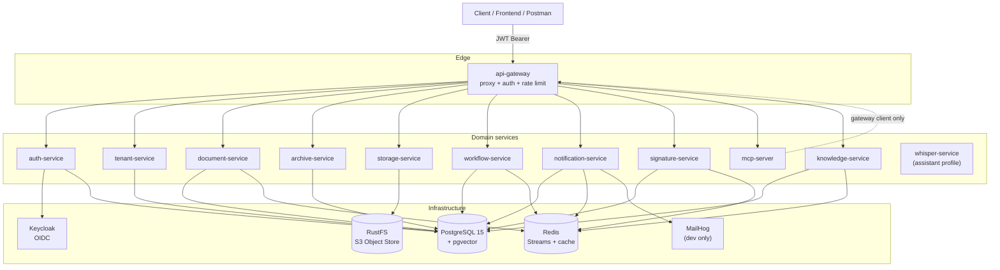
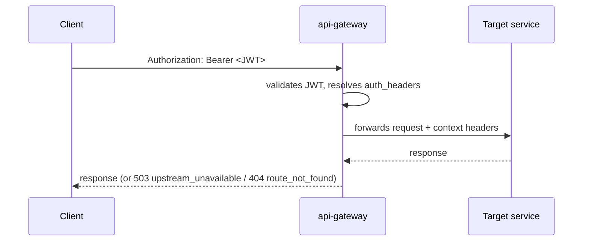
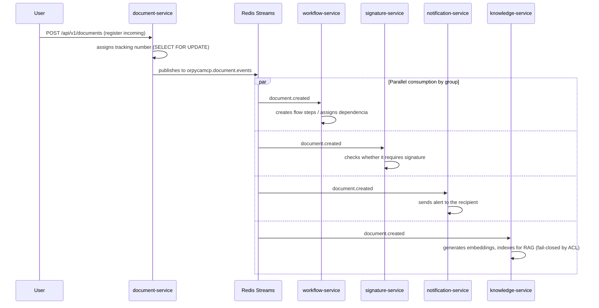
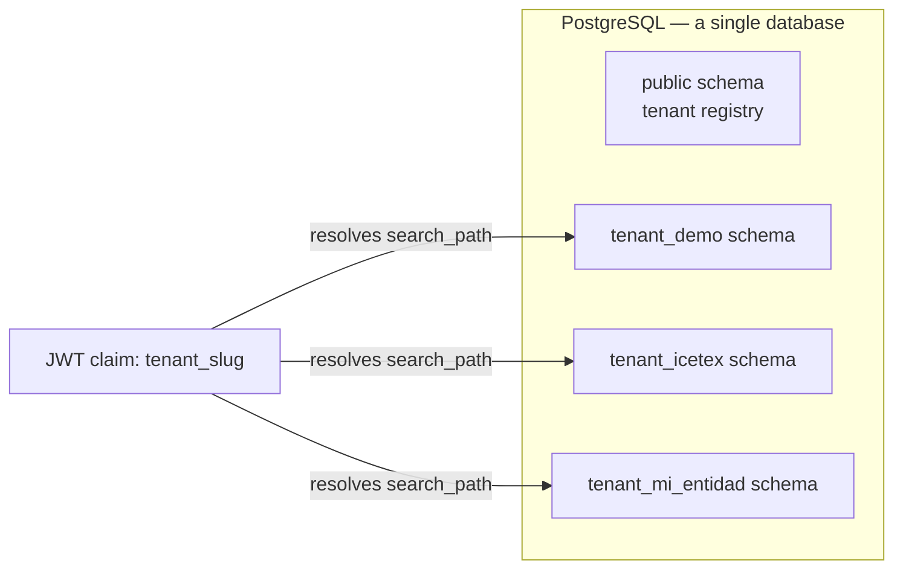

# Architecture

## Overview

OrpycaMCP uses a **microservices** architecture, where each service is responsible
for one bounded context of the document-management domain. All of them are
independent **FastAPI** applications, each with its own data schema, and they
communicate in two ways:

- **Synchronous (HTTP/REST)**, always through the `api-gateway` — never directly
  between services from the client.
- **Asynchronous (Redis Streams)**, for domain events (a radicado created, a flow
  assigned, a document signed, etc.).



`mcp-server` is a **thin facade** (ADR-019): it has no database of its own and no
business logic — it translates MCP protocol calls (or the conversational assistant)
into requests to the `api-gateway`, exactly like any other authenticated client
would. The assistant is the exception as far as inference goes: it calls **Anthropic’s API
directly** (`ANTHROPIC_API_KEY`) and, before sending anything, replaces the content of every
object with `nivel_seguridad >= 2` (residency barrier, ADR-006); without a key it answers 503.

The gateway signs the identity it forwards to each service (HMAC with timestamp, method and
canonical route, [ADR-036](adr/ADR-036-identidad-atada-a-metodo-y-ruta.md)) and enforces the
institution's status at the edge: a `suspended` institution loses the authenticated API and keeps
its public portal read-only and the preservation of its records
([ADR-035](adr/ADR-035-estado-de-la-entidad-cumplimiento-en-el-borde.md)).

## Services and ports

| Service | Internal port (Docker) | Published port (host) | Responsibility |
|---|---|---|---|
| `api-gateway` | 8080 | **19080** | Central proxy, prefix-based routing, JWT validation, rate limiting |
| `auth-service` | 8001 | **19001** | Keycloak integration, JWT issuance/validation, RBAC, security clearance (RF-SEG-08) |
| `tenant-service` | 8002 | **19002** | Institution/tenant onboarding, dependencias, catalogs, PINAR |
| `document-service` | 8003 | **19003** | E/S/I registration, attachments, replies, annulment, import/export, IMAP intake, OAI-PMH/CMIS |
| `archive-service` | 8004 | **19004** | Expedientes, TRD/CCD, electronic index, physical archive, transfers |
| `storage-service` | 8005 | **19005** | Upload/download of files in the object store, preservation (WORM/Object-Lock) |
| `workflow-service` | 8006 | **19006** | Distribution flows, approvals (vistos buenos), rules, dead-letter |
| `notification-service` | 8007 | **19007** | Email/alerts, outgoing webhooks, dead-letter |
| `signature-service` | 8008 | **19008** | XAdES-B/T/LT/LTA electronic signature verifiable by third parties (ADR-034): personal, institutional seal of the index/transfer minutes, and LTA archive time-stamp renewal |
| `mcp-server` | 8009 | **19009** | Model Context Protocol layer + conversational assistant (E18, ADR-019) |
| `knowledge-service` | 8011 | **19011** | pgvector, RAG with ACL, semantic retrieval with citations (E21) |
| `whisper-service` | 8012 | _not published_ | Speech transcription **inside the installation** (`faster-whisper` on CPU). Profile `assistant`: starts **off** and is **not routed through the gateway** — only mcp-server talks to it (ADR-020) |
| `frontend` | 3000 | **19300** | SvelteKit SSR — presentation layer (E22) |
| PostgreSQL | 5432 | **15432** | Single database, multi-schema |
| Redis | 6379 | **16379** | Event streams + cache |
| RustFS | 9000 | **19900** | S3 object store (replaced MinIO, ADR-027). No web console: inspect with `aws-cli` |
| Keycloak | 8080 | **19180** | Identity Provider (OIDC) |
| MailHog | 1025 (SMTP) / 8025 (web) | 1025 / 8025 | Email capture in development |

> There is no port gap for a "missing" service: the 19xxx/15432/16379 range avoids
> clashing with other development stacks on the same machine; the internal port is
> what services see from each other inside the `orpycamcp-net` network.

## Resource inventory per service

Each service follows the standard layout (`app/routers/`, one file per resource).
Summary of what each one exposes:

### `auth-service`
| Router | What it manages |
|---|---|
| `auth` | Login/token against Keycloak |
| `clearance` | Security clearance levels (user/document classification) |
| `rbac` | Roles and permissions (admin) |
| `urd` | User management (admin) |
| `context` | Session context (tenant, roles, permissions of the current user) |
| `audit` | `audit_log` queries (admin) |
| `totp` | Two-factor TOTP |
| `signing_key` | Custody of personal signing keys (PKI signature epic) |

### `tenant-service`
| Router | What it manages |
|---|---|
| `tenants` | Institution onboarding/lookup (schema provisioning) |
| `dependencias` | Organizational units |
| `catalogos` | General catalogs (document types, etc.) |
| `pinar` | Institutional Archives Plan (Ac. 003/2015) |

### `document-service` (the largest — the registration core)
| Router | What it manages |
|---|---|
| `documents` | CRUD for E/S/I radicados, attachments |
| `anulacion` | Annulment of radicados |
| `respuesta` | Replies to radicados (E↔S antecedent) |
| `signatures` | Radicado signature status |
| `borradores` | Drafts prior to registration |
| `import_` / `export` | Interoperability (E11 INT-01/INT-05) — ZIP packages with fixity |
| `ingest` | Email intake (IMAP) |
| `batch` | Bulk operations |
| `search` / `reports` | FTS search and reports |
| `public` | Public inquiry endpoints (Ley 1712) |
| `metadata` / `metadata_elements` | Document metadata templates |
| `postal` | Postal shipments (incoming webhook, E20) |
| `cmis` / `oai` | CMIS interoperability and OAI-PMH harvesting |
| `internal` | Inter-service endpoints sealed with `X-Internal-Token` |

### `archive-service`
| Router | What it manages |
|---|---|
| `expedientes` | Expediente lifecycle (open/close/transfer) |
| `indice` | Signed electronic index XML (E15) |
| `fisico` | Physical archive: locations, conservation units, loans |
| `transferencias` | Document transfers + FUID |
| `tipos_documentales` / `trd` | TRD/CCD (series, subseries, retention, disposition) |
| `metadata` | Expediente metadata templates |
| `oai` | Multi-level OAI-PMH harvesting (fonds→series→file) |

### `storage-service`
| Router | What it manages |
|---|---|
| `storage` | Mediated upload / download of attachments in the object store |
| `preservacion` | WORM/Object-Lock, BagIt/PREMIS AIP packaging |

### `workflow-service`
| Router | What it manages |
|---|---|
| `workflow` | Flow steps, distribution, tracking |
| `visto_bueno` | Approvals (sign-off chains) |
| `rules` | Flow routing rules |
| `admin_deadletter` | Inspection/replay/discard of failed events (DLQ) |

### `notification-service`
| Router | What it manages |
|---|---|
| `notifications` | Sending notifications (email/alerts) |
| `webhooks` | Subscription and delivery of signed outgoing webhooks (HMAC) |
| `admin_deadletter` | Notification DLQ |

### `signature-service`
| Router | What it manages |
|---|---|
| `signature` | Personal XAdES signature and institutional seal |
| `cadena` | Signature chain/batch |
| `admin_deadletter` | Signature DLQ |

### `mcp-server`
| Router | What it manages |
|---|---|
| `mcp` | MCP catalog/protocol (**not** exposed by the gateway) |
| `assistant` | Conversational assistant (exposed via `/api/v1/assistant`) |

### `knowledge-service`
| Router | What it manages |
|---|---|
| `knowledge` | `/search`, `/antecedentes`, `/rag` (exposed); `/ingest` internal, event-driven |

### `whisper-service`

| Router | What it manages |
|---|---|
| `main` | `GET /health`, `GET /ready` (is the model loaded?), `POST /transcribe` (audio → text) |

**The twelfth service, and the only one that never touches the gateway.** It exists because the
browser's own speech recogniser **does not meet the sovereignty decision**: in Chrome and Edge
the classic Web Speech API ships the audio to a Google service, so the dictation button is only
offered where the browser recognises *on the device*. For everyone else the voice arrives here
and never leaves the installation.

Three traits set it apart from the other services, all deliberate:

- **It starts switched off** (`assistant` profile, ADR-020). A minimal install runs without it
  and without downloading any model; `POST /api/v1/assistant/transcribe` answers `503`
  explaining how to enable it. **There is no transcription `stub`** — it would have to invent
  what was said.
- **It is neither routed through the gateway nor published to the host**: only `mcp-server`
  talks to it, with `INTERNAL_SERVICE_TOKEN`. Same criterion as `storage-service`, which serves
  bytes only to `document-service`'s mediator (D-02): network surface nobody needs is surface
  somebody will eventually use.
- **It is the only service with no database and no per-tenant schema.** It takes audio, returns
  text and stores nothing; hence its absence from the migration and write censuses.

Measured: ~9 s per ~5 s of audio on 4 CPUs with the `small` model. **Unverified**: quality on
human speech — the test used synthetic voice.

## Gateway proxy pattern

The `api-gateway` exposes a single catch-all endpoint:
`/api/v1/{path:path}` (all HTTP methods). An ordered table of
`(prefix, target_service)` decides where to forward each request — the first
prefix that matches wins, so order matters (e.g. `/public/archive/` must be listed
before the generic `/public/` prefix of `document-service`).



Security rules **by design** in the proxy (not accidental):

- **Mediated attachment download**: the gateway only exposes
  `POST /api/v1/storage/upload`. Downloading bytes **always** goes through
  `document-service` (`GET /api/v1/documents/{id}/anexos/{file_id}/download`), which
  revalidates the user's clearance before requesting the file from
  `storage-service` — the object store is never reached directly from outside.
- **`mcp-server` scoped down**: only `/api/v1/assistant/*` is routed; the raw
  MCP catalog/protocol (`/api/v1/mcp`, `/mcp`) is deliberately kept out of the
  gateway — the assistant is the only entry point for external clients.
- **`knowledge-service` scoped down**: only `/search`, `/antecedentes` and `/rag`
  are routed; `/ingest` is an internal endpoint consumed only by the service's own
  event-driven worker.

## Asynchronous orchestration — Redis Streams

Stream naming pattern: `orpycamcp.{service}.events`
(dead-letter: `orpycamcp.{service}.deadletter`). Every consumer worker uses a Redis
consumer group (`XREADGROUP`) and only issues `XACK` after successful processing; if
it fails, the message stays in the PEL for retry and, after exhausting retries, is
moved to the dead-letter stream (ADR-021).

Real end-to-end example — **registering an incoming document**:



**If a consumer fails** (e.g. `notification-service` cannot send the email): the
message stays in its PEL, is retried with backoff and, if it keeps failing, is
moved to the `orpycamcp.notification.deadletter` stream. An administrator with
`PERM_DLQ_ADMIN` can inspect, retry (`replay`), or discard those entries via each
service's `admin_deadletter.py` (ADR-021).

## Multi-tenancy: schema isolation



On every request, each service's middleware switches the asyncpg connection's
`search_path` according to the JWT's `tenant_slug` claim — the tenant is never
taken from the body nor from a client-manipulable header. The object store mirrors the same
separation with prefixed buckets: `orpycamcp-{slug}-documents`.

## Authentication flow

```mermaid
sequenceDiagram
    participant U as User/Frontend
    participant KC as Keycloak
    participant GW as api-gateway
    participant SVC as Target service

    U->>KC: Authorization Code + PKCE
    KC-->>U: JWT (claims: tenant_slug, user_id, roles[], permissions[])
    U->>GW: request + Authorization: Bearer <JWT>
    GW->>GW: validates JWT signature/issuer/kid (PyJWT)
    GW->>SVC: forwards + resolved claims
    SVC->>SVC: search_path = tenant_{slug}; validates permission/clearance in DB
```

Authorization is **not** decided solely at the gateway: each service revalidates
the permission and the clearance level (RF-SEG-08) against the database at request
time (ADR-013) — the gateway only authenticates.

## Inter-service communication — summary

| Type | Mechanism | When it's used |
|---|---|---|
| Synchronous | HTTP/REST via `api-gateway` | User operations that need an immediate response |
| Asynchronous | Redis Streams (`orpycamcp.{service}.events`) | Domain events consumed by one or more services |
| Sealed inter-service | Direct HTTP with `X-Internal-Token` | `internal.py` endpoints only another microservice should call (never exposed to the client via the gateway behind just a permission — they're sealed with a shared token) |

## Shared library — `orpycamcp_common`

Installed in every image (`pip install /shared`, built with the repo root as
context). It provides two modules used by every service that audits or publishes
events:

- **`audit.py`** — the single write point for `public.audit_log`, with a per-tenant
  hash chain (ADR-008): `compute_hash`, `append`, `append_denial`, `verify_chain`.
- **`events.py`** — canonical event envelope over Redis Streams (ADR-010):
  `build_event`, `publish`, `emit`, `ensure_group`, `trim_deadletter`,
  `reclaim_stale`.

## See also

- [System screens](pantallas.md) — how the frontend consumes this architecture.
- [Multi-tenancy](multi-tenancy.md) — schema-isolation detail.
- [Architecture Decision Records (ADRs)](adrs.md) — the reasoning behind every
  decision summarized here.
