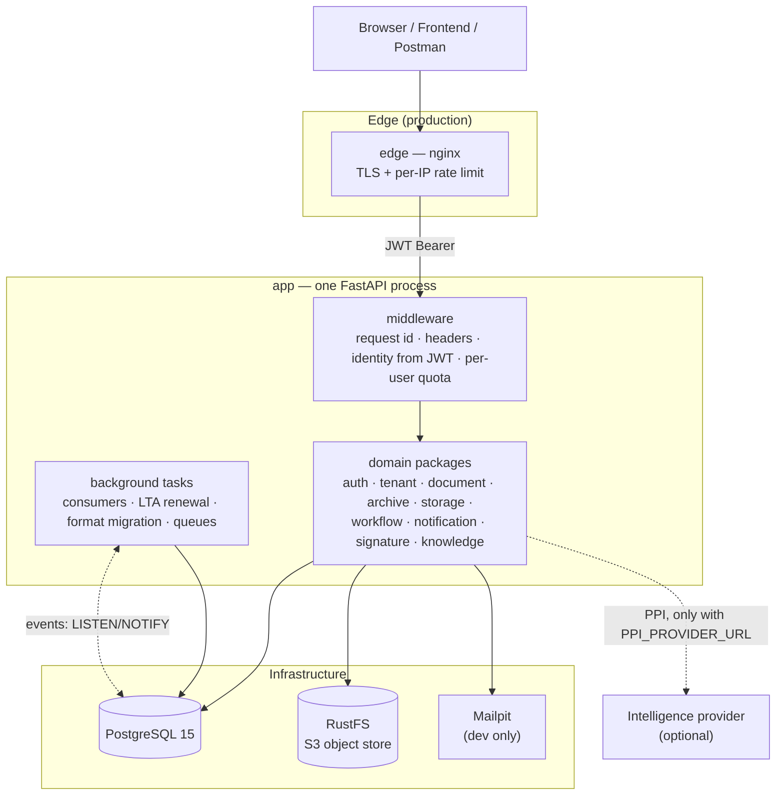
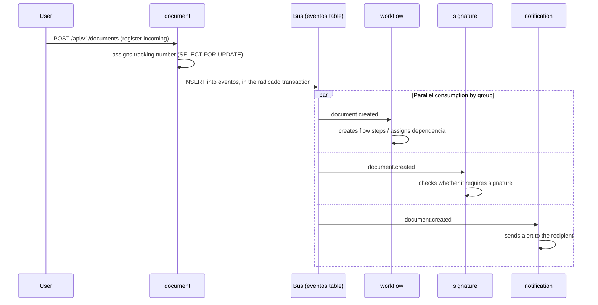
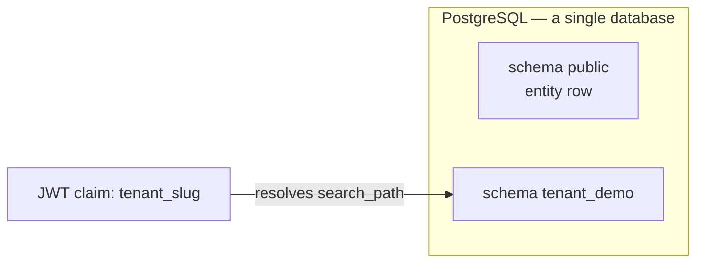

# Architecture

## Overview

Docuboto is **one process** ([ADR-047](adr/ADR-047-un-proceso-y-cuatro-contenedores.md),
which amends [ADR-001](adr/ADR-001-microservices-architecture.md)): a single **FastAPI**
application, the `app` container, mounts the routers of nine domain packages, each
responsible for one bounded context, and runs their background loops. There is no
`api-gateway` and no `worker` container. Packages talk to each other in two ways:

- **Synchronous, by function call**: each package exposes its door in `<package>/api.py`
  and the others import it. There are no HTTP hops between domains.
- **Asynchronous (event bus in PostgreSQL, ADR-049)**, for domain events (a radicado created, a flow
  assigned, a document signed, etc.).



ADR-047 targets four containers (`app`, `postgres`, `edge`, `frontend`). **That target isn't
reached yet**: Keycloak is gone ([ADR-048](adr/ADR-048-identidad-emitida-por-docuboto.md): the
app issues identity itself) and so is Redis ([ADR-049](adr/ADR-049-eventos-en-postgresql-sin-redis.md):
events live in PostgreSQL), but the object store stays in the manifests until
[ADR-050](adr/ADR-050-bytes-en-disco-y-archivo-sellado.md) removes it.

Docuboto does not call any language model
([ADR-046](adr/ADR-046-conocimiento-sin-modelos.md)) and is **not a tool server for
agents** ([ADR-051](adr/ADR-051-ppi-reducido-vive-en-la-app.md) §5): there is no MCP layer.
An agent that has to act on Docuboto uses the HTTP API with a scoped service account, or
the provider through PPI. Having an external MCP client (Claude Desktop, an IDE) operate the
SGDEA is **not available**.

The only outbound path to intelligence is PPI v1.4.0 (contract frozen in
`contracts/ppi/v1.4.0/`): the ingestion consumer starts in the app's single lifespan only
when `PPI_PROVIDER_URL` is set; with it empty, nothing is registered and no call leaves. A
tenant starts at `intelligence_provider = 'local'`, which sends nothing.

Identity is resolved **once per request** in `UsuarioActualMiddleware`, from the JWT, and
travels in `request.state`; identity headers sent by the client are dropped. The nonce-signed
identity, `X-Internal-Token`, the HTTP tenant registry, the entity's lifecycle states, and
their veto at the edge are retired (ADR-047 §1 and §3).

## The process and its containers

`services/docuboto/docuboto/` is the composition root:

| Module | What it does |
|---|---|
| `main.py` | `create_app()`: the only place with middleware and exception handlers; mounts each package's `DOMAIN_ROUTERS`, `/health`, and `/metrics` |
| `config.py` | `CommonSettings` (database, pool, log) and one `Settings` class per domain; environment variable names are unchanged and carry no prefix |
| `core/lifespan.py` | One database pool and the start of the background tasks |
| `core/tasks.py` | `BackgroundTasks`: consumers, LTA renewal, format migration, and the `trabajo_fuera` queues (`app`, light; `worker`, heavy, a name kept in the schema). Heavy work takes a slot from `heavy_slot()`, a semaphore of `HEAVY_JOBS_CONCURRENCY` (default 1) |
| `core/security.py` | `SecurityHeadersMiddleware` (`X-Request-Id`, `nosniff`, `DENY`, `no-referrer`) and `UserRateLimitMiddleware` (`RATE_LIMIT_PER_USER`, 120/min per person) |

The nine packages live side by side (`services/docuboto/<package>/`), with their tests in
`services/docuboto/tests/<package>/`. Each package's `main.py` only exports
`DOMAIN_ROUTERS`.

| Container | Internal port (Docker) | Published port (host) | Responsibility |
|---|---|---|---|
| `app` | 8000 | **19000** (`127.0.0.1` only) | The process: API, background tasks, event consumers |
| `migrate-docuboto` | — | — | Applies the migration chain (ADR-053) and exits; `app` waits for it |
| `frontend` | 3000 | **19300** | SvelteKit SSR — presentation layer (E22) |
| PostgreSQL | 5432 | **15432** | Single database, multi-schema |
| RustFS (`minio`) | 9000 | **19900** | S3 object store (replaces MinIO, ADR-027; until ADR-050). No web console: inspect it with `aws-cli` |
| Mailpit | 1025 (SMTP) / 8025 (web) | 1025 / 8025 | Email capture in development (`dev` profile) |
| `edge` | 80 / 443 | 80 / 443 | Production only: nginx with TLS, per-IP rate limiting, and proxying to `app` and `frontend` |

> The 19xxx/15432/16379 range avoids clashing with other development stacks on the same machine.

| Package | Responsibility |
|---|---|
| `auth` | Identity issuer (login, sessions, ES256 JWTs, JWKS and `client_credentials`, ADR-048), RBAC, clearance (RF-SEG-08), TOTP, signing-key custody |
| `tenant` | Configuration of the installation's entity, dependencias, catalogs, PINAR |
| `document` | E/S/I registration, attachments, replies, annulment, import/export, IMAP ingestion, OAI-PMH/CMIS |
| `archive` | Case files, TRD/CCD, electronic index, physical archive, transfers, disposal |
| `storage` | Upload and read of files in the object store, preservation (WORM/Object-Lock) |
| `workflow` | Distribution flows, approvals (vistos buenos), rules, dead-letter |
| `notification` | Email/alerts, outgoing webhooks, dead-letter |
| `signature` | XAdES-B/T/LT/LTA electronic signature verifiable by third parties (ADR-034): personal, institutional seal of the index/record, and LTA archive-timestamp renewal |
| `knowledge` | Model-free knowledge gateway: full-text search and antecedentes, as the user (ADR-046) |

## Resource inventory per package

Each package follows the standard layout (`<package>/routers/`, one per resource).
Summary of what each one exposes:

### `auth`
| Router | What it manages |
|---|---|
| `auth` | Login, refresh, logout and password change (ADR-048) |
| `oidc` | OIDC discovery, JWKS and `POST /oauth/token` (`client_credentials`) for service accounts |
| `clearance` | Security levels (classification of users/documents) |
| `rbac` | Roles and permissions (admin) |
| `urd` | User management (admin) |
| `context` | Session context (tenant, roles, permissions of the current user) |
| `audit` | `audit_log` queries (admin) |
| `totp` | TOTP second factor |
| `signing_key` | Custody of personal signing keys (PKI signature epic). You activate a certificate issued offline with `python -m auth.ops.activar_certificado` inside the container |

### `tenant`
| Router | What it manages |
|---|---|
| `config` | Entity configuration |
| `dependencias` | Organizational units |
| `catalogos` | General catalogs (document types, etc.) |
| `pinar` | Institutional Archives Plan (Ac. 003/2015) |

You provision the entity with `scripts/init-tenant.sh`; there's no HTTP route for it.

### `document` (the largest — the registration core)
| Router | What it manages |
|---|---|
| `documents` | CRUD of E/S/I radicados, attachments |
| `anulacion` | Radicado annulment |
| `respuesta` | Replies to radicados (E↔S antecedent) |
| `signatures` | Signature status of the radicado |
| `borradores` | Drafts before registration |
| `import_` / `export` | Interoperability (E11 INT-01/INT-05) — ZIP packages with fixity |
| `ingest` | Email ingestion (IMAP) |
| `batch` | Bulk operations |
| `search` / `reports` | FTS search and reports |
| `public` | Public-query endpoints (Ley 1712) |
| `metadata` / `metadata_elements` | Document metadata templates |
| `postal` | Postal dispatch/operator (inbound webhook E20) |
| `cmis` / `oai` | CMIS interoperability and OAI-PMH harvesting |

### `archive`
| Router | What it manages |
|---|---|
| `expedientes` | Case-file lifecycle (open/close/transfer) |
| `indice` | Signed XML electronic index (E15) |
| `fisico` | Physical archive: locations, storage units, loans |
| `transferencias` | Document transfers + FUID |
| `tipos_documentales` / `trd` | TRD/CCD (series, subseries, retention, disposition) |
| `metadata` | Case-file metadata templates |
| `oai` | Multilevel OAI-PMH harvesting (fonds→series→file) |

### `storage`
| Router | What it manages |
|---|---|
| `storage` | `POST /upload` (used by the frontend); reading bytes is `storage/api.py`, with no route |
| `preservacion` | WORM/Object-Lock, BagIt/PREMIS AIP packaging |

### `workflow`
| Router | What it manages |
|---|---|
| `workflow` | Flow steps, distribution, tracking |
| `visto_bueno` | Approvals (approval chain) |
| `rules` | Flow routing rules |

### `notification`
| Router | What it manages |
|---|---|
| `notifications` | Notifications (email/alerts); other packages request a send through `notification/api.py` |
| `webhooks` | Subscription and delivery of signed (HMAC) outgoing webhooks |

### `signature`
| Router | What it manages |
|---|---|
| `signature` | Personal XAdES signature (`/sign-personal`), verification; the institutional seal is reachable only through `signature/api.py` |
| `cadena` | Signature chain/batch |

### `knowledge`
| Router | What it manages |
|---|---|
| `knowledge` | `/search` and `/antecedentes` (full text, or delegated to PPI when the entity is on `ppi`) |
| `retorno` | PPI `content` callback: the provider requests a document's content |

## Routing and the edge

FastAPI's own router does the prefix routing: each package mounts its routes with
`include_router`. What the gateway used to do is now split this way:

- **Per-IP rate limiting** → `edge` (nginx `limit_req`, no external store): general, login, anonymous
  counter/PQRS submissions, and OAI-PMH/CMIS harvesting, with the budgets the gateway had
  (`infra/nginx/orpyca.conf.template`).
- **Per-person quota** → `UserRateLimitMiddleware` in the app (`RATE_LIMIT_PER_USER`).
- **`X-Request-Id` and hardening headers** → `SecurityHeadersMiddleware`, the outermost
  middleware of the app.

Security rules **by design** (not accidental):

- **Mediated attachment download**: the only storage route is `POST /api/v1/storage/upload`.
  Downloading bytes **always** goes through `document`
  (`GET /api/v1/documents/{id}/anexos/{file_id}/download`), which revalidates the user's
  clearance before reading the file through `storage/api.py` — the object store is never
  reached directly from outside.
- **`knowledge` is scoped**: it exposes only `/search`, `/antecedentes`, and the PPI callback.

## Asynchronous orchestration — the PostgreSQL bus (ADR-049)

Events live in the `eventos` table of each entity's schema; the stream is a column
(`orpycamcp.{document,workflow,signature}.events`). Publishing is an `INSERT` in the
**same transaction** as the change, with a `NOTIFY eventos` that only wakes consumers: if
the transaction rolls back, the event doesn't exist. One loop (`docuboto/core/bus.py`)
serves the four consumer groups: it claims each event by inserting its row in
`evento_entregas` (`ON CONFLICT DO NOTHING`), processes it and confirms only on success;
an unconfirmed delivery is reclaimed after 60 s (`FOR UPDATE SKIP LOCKED`) and, on the
fifth delivery, parked in `evento_dead_letter` (ADR-021). The document sweep purges
confirmed events older than `EVENTOS_RETENCION_DIAS` (30).

Real end-to-end example — **registering an incoming document**:



**If a consumer fails** (e.g. `notification` cannot send the email): the
delivery stays unconfirmed, the reclaim sweep retries it and, on the fifth delivery,
parks it in `evento_dead_letter` with its last error. An administrator with
`PERM_DLQ_ADMIN` can inspect, retry (`replay`), or discard those entries in the
single console `/api/v1/admin/deadletter/{grupo}` (`docuboto/routers/admin_deadletter.py`,
ADR-021, ADR-049 §4), intelligence included.

## Multi-tenancy: schema isolation



One installation serves **one entity** (ADR-047 §3), and that entity keeps its schema
`tenant_{slug}`. On every request, `get_tenant_conn` (`orpycamcp_common.database`) sets the
asyncpg connection's `search_path` from the JWT's `tenant_slug` — the tenant never comes from
the body or from a client-controlled header. `public.tenants` is the entity's configuration
row, with no lifecycle states. The object store still uses per-entity bucket names
(`orpycamcp-{slug}-documents`) until ADR-050.

## Authentication flow

```mermaid
sequenceDiagram
    participant U as User/Frontend
    participant L as app — POST /api/v1/auth/login
    participant MW as app — UsuarioActualMiddleware
    participant R as package router

    U->>L: username + password + entity (from the SSR)
    L-->>U: ES256 access JWT (sub = auth_users.id, tenant_slug) + opaque refresh
    U->>MW: request + Authorization: Bearer <JWT>
    MW->>MW: drops client X-User-Id, X-Username, X-User-Roles, X-Canal, X-Tenant-Slug
    MW->>MW: checks signature, iss and aud with the app's own keys; puts the user in request.state; re-sets X-Tenant-Slug
    MW->>R: request
    R->>R: search_path = tenant_{slug}; checks permission/clearance in the DB
```

Each route decides authorization: permission and clearance level (RF-SEG-08) are
revalidated against the database at request time (ADR-013), with the gates in
`orpycamcp_common.clearance` (`require_permission`, `require_actor_permission`,
`require_vetted_permission`). The same check (`enforce_permission`) applies to a route and
to a function in `<package>/api.py`.

## Communication between packages — summary

| Type | Mechanism | When it's used |
|---|---|---|
| HTTP | The app's REST API | User operations that need an immediate response |
| Function call | `<package>/api.py` (keyword arguments, explicit `tenant_slug` and actor) | One package needs something from another: bytes (`storage/api.py`, the one object-store client), a seal (`signature/api.py`), sending email (`notification/api.py`), business days (`tenant/api.py`)… A package may import only another package's `api` (`shared/tests/test_contrato_api.py`) |
| Asynchronous | Event bus in PostgreSQL (`orpycamcp.{service}.events`) | Domain events consumed by one or more packages |

## Shared library — `orpycamcp_common`

Installed in the app image (`pip install /shared`, built with the repo root as context).
Anything more than one package needs is defined once here; among others:

- **`audit.py`** — the single write point for `public.audit_log`, with a per-tenant
  hash chain (ADR-008): `compute_hash`, `append`, `append_denial`, `verify_chain`.
- **`events.py`** — canonical event envelope and its PostgreSQL bus (ADR-010, ADR-049):
  `build_event`, `publish`, `emit`, `leer`, `ack`, `reclaim_stale`, `purgar`.
- **`database.py`** — one pool; `get_conn`, `get_vetted_conn`, `get_tenant_conn`, and
  `acquire_tenant` for work outside a request.
- **`clearance.py`** — the permission gates: `require_permission`,
  `require_actor_permission`, `require_vetted_permission`, `enforce_permission`.
- **`usuario.py`** — `UsuarioActualMiddleware`: the caller, once per request.

## See also

- [System screens](pantallas.md) — how the frontend consumes this architecture.
- [Multi-tenancy](multi-tenancy.md) — schema-isolation detail.
- [Architecture Decision Records (ADRs)](adrs.md) — the reasoning behind every
  decision summarized here.
