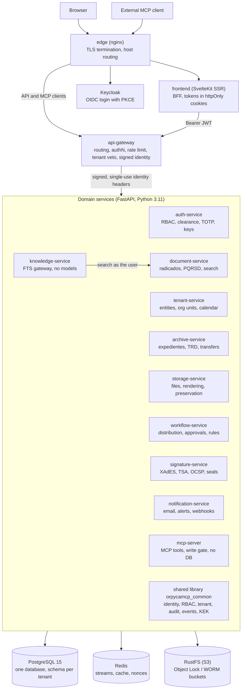
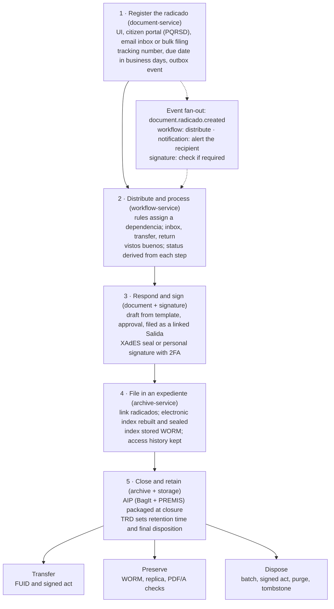

# Docuboto — Technical Reference

Updated as of 2026-10-28 (ADR-046 D0: model layer and conversational assistant withdrawn).

## Purpose and audience

This is the map of what Docuboto already does and how it is built, so tech leads and managers can scope new features, refactors and fixes without reading the code first. Historical line counts below are from commit `7510257` on `main`; CURRENT behavior matches ADR-046 (no in-process models).

- **Managers**: read System overview and the Features catalog to see what is shipped, then Tech debt for open risks.
- **Tech leads**: read Architecture and Core modules to find the owning service of any change, then How to plan new work.
- **Deeper reasons** behind each decision live in the ADRs under `docs/es/adr/` (Spanish). References like ADR-035 point there.

Naming note: internal identifiers still use the upstream prefix `orpycamcp` (shared library `orpycamcp_common`, Redis streams `orpycamcp.*`, Keycloak realm `orpycamcp`). Read `orpycamcp` as "the system".

## System overview

Docuboto is an SGDEA (Sistema de Gestión Documental Electrónico de Archivo): a multi-tenant records-management platform for Colombian public institutions, built as 11 FastAPI microservices behind one API gateway, with a SvelteKit server-rendered UI. It covers the full document lifecycle: registration (radicación), distribution, case files (expedientes), retention schedules (TRD/TVD), electronic signature, physical archive, digital preservation, citizen requests (PQRSD, Ley 1712), a model-free knowledge gateway (full-text search as the user), and an MCP tool facade for external clients. Docuboto itself does not call language models; external MCP clients supply any intelligence (ADR-046).

It is a fork of [OrpycaMCP](https://gitlab.com/orpyca/orfeo_mcp) under AGPL-3.0. Running a modified version as a network service obliges you to offer its source to users (AGPL §13).

### Technology stack

| Layer | Technology |
| --- | --- |
| Backend services | Python 3.11, FastAPI, Pydantic v2, asyncpg with raw SQL (no ORM, ADR-003) |
| Frontend | SvelteKit 2 (Svelte 4), `adapter-node`, Bulma, SSR only, acts as backend-for-frontend |
| Database | PostgreSQL 15, one database, one schema per tenant |
| Messaging | Redis Streams with consumer groups and a transactional outbox |
| Object storage | RustFS (S3-compatible) with Object Lock / WORM for preservation |
| Identity | Keycloak (OIDC, Authorization Code + PKCE), TOTP 2FA in auth-service |
| Intelligence | No in-process models (ADR-046). knowledge-service falls back to document-service FTS; `/rag` returns 503 `rag_unavailable` in `local`. External MCP clients bring their own models |
| Packaging and CI | Docker Compose (dev and prod), GitLab CI, MkDocs bilingual docs |

### Code size by area

Lines of `.py`, `.ts` and `.svelte` source per area, tests included, on `main` @ `7510257` (pre–ADR-046 sizes; knowledge-service and mcp-server are smaller after D0). archive-service alone held about a quarter (24%) of the 416k lines.

| Area | Lines |
| --- | --- |
| archive-service | 100,917 |
| frontend | 70,314 |
| document-service | 62,756 |
| signature-service | 41,665 |
| storage-service | 32,852 |
| auth-service | 22,013 |
| workflow-service | 19,760 |
| mcp-server | 18,186 |
| knowledge-service | 14,116 |
| notification-service | 12,417 |
| tenant-service | 10,450 |
| api-gateway | 5,931 |
| shared library | 4,088 |

`whisper-service` was removed in ADR-046 D0 (former ~413 lines).

The four largest areas (archive, frontend, document, signature) hold about two thirds of the code, so most feature work and most debt will land there.

### Environments

- **Development**: `docker compose up -d` from the repo root. Host ports in the 19xxx range (gateway on 19080, API docs on `/docs`, Keycloak admin on 19180). Mailpit captures email.
- **Production**: `infra/docker-compose.prod.yml` adds an nginx `edge` container that terminates TLS and routes by hostname; only the edge is published. `scripts/preflight-prod.sh` checks required secrets. Backup and restore scripts in `infra/` are fail-closed and respect Object Lock retention.
- **New tenant**: `scripts/init-tenant.sh` / `scripts/init_tenant.py` create the schema and run every service's tenant migrations.

## Architecture and design patterns

The gateway authenticates, each service authorizes against its own tenant schema, and everything security-sensitive is written once in a shared library that guard tests protect. Every request from the browser goes through the SvelteKit server, then the gateway, then one domain service; services talk to each other through Redis Streams events or narrow internal HTTP routes.



Only the edge is published in production. storage-service downloads and every `internal` router are deliberately not routed by the gateway; mcp-server calls back through the gateway with the user's own token. knowledge-service only exposes `/search`, `/antecedentes`, `/rag`, and `/availability`.

### Design patterns in use

| Pattern | Where | What it buys you |
| --- | --- | --- |
| Microservice per bounded context | `services/*` (ADR-001) | Each team area has one owner service and its own tables |
| API gateway with prefix routing | `api-gateway`, routing table in `app/routers/proxy.py` | One public entry point; first matching prefix wins, so order matters |
| Backend-for-frontend | `frontend` (SvelteKit SSR) | The browser never calls the API; tokens stay in httpOnly cookies; gateway CORS off by default |
| Layered service (router → service → repository) | Every Python service, template in `docs/templates/service-template/` | Same layout everywhere; SQL only in `repositories/` |
| Raw SQL over asyncpg, JSONB for flexible metadata | ADR-003, ADR-007 | Full control of queries; no ORM migrations to reconcile |
| Schema per tenant | `tenant_{slug}` schemas, `orpycamcp_common.tenant` (ADR-002, ADR-044) | Hard data isolation; `search_path` is set to the tenant schema only |
| Signed, single-use identity headers | `orpycamcp_common.identidad` (ADR-036, ADR-044) | A container that reaches a service port cannot forge or replay a user |
| Authorization resolved in the DB, not cached | `orpycamcp_common.rbac` (ADR-013) | A revoked permission takes effect on the next call; fail-closed |
| Clearance with no-read-up | `rbac.nivel_efectivo` (RF-SEG-08) | Effective level = max(live level, embedded level); unknown = classified |
| Transactional outbox + Redis Streams | `eventos_salientes` table, `orpycamcp_common.events` (ADR-009, ADR-021) | No event lost after commit; at-least-once delivery |
| Idempotent consumers + dead-letter queue | Consumer groups per service, `evento_dead_letter`, `admin_deadletter` routers | Safe retries; admins can inspect, replay or discard failed events |
| Hash-chained, append-only audit | `public.audit_log`, `orpycamcp_common.audit` (ADR-008) | Tamper-evident audit per tenant; DB trigger blocks UPDATE/DELETE |
| Pluggable providers (adapter) | `SignerProvider` in signature-service | Swap signing vendors without touching business code |
| Facade that runs as the user | `mcp-server` (ADR-019) | No DB and no privileged credentials; normal RBAC and audit apply to MCP tool calls |
| Propose-then-confirm writes | `mcp-server/app/services/write_gate.py` | A write tool returns a signed proposal; the user confirms with a time-bound token |
| Supervised workers | `spawn_supervised` in `orpycamcp_common.events` | A crashed consumer restarts and readiness reports it |
| Architecture as tests | `shared/tests/` guard tests | Rules are enforced in CI, not only documented |

### Cross-cutting conventions

- **Async I/O only.** No blocking calls inside handlers.
- **Error contract.** Every error body is `{"error": <code>, "detail": <Spanish message>, "status": <int>}`; a global handler turns anything unexpected into a 500 without a traceback.
- **Secrets have no working defaults.** `orpycamcp_common.secrets.require_secrets` refuses to start without them.
- **Containers** run as non-root with a read-only `/app`. Uvicorn's access log is off because query strings carry document data; `request_log` writes one content-free JSON line per request with `X-Request-Id`.
- **Health.** `/health` is liveness only; `/health/ready` checks dependencies and returns 503; `/metrics` exposes Prometheus gauges with no tenant, user or document labels (ADR-041).
- **SSRF protection.** Calls to user-configured destinations (webhooks, IMAP, TSA) go through `orpycamcp_common.red_interna`, which blocks internal ranges.
- **Language.** Domain vocabulary, code identifiers and user-facing messages are in Spanish; every source file carries the AGPL header.

### Request path inside a service

1. Router dependency verifies the signed identity headers and claims the nonce in Redis.
2. `get_tenant_conn` checks the tenant lifecycle state and sets `search_path` to the tenant schema.
3. `require_permission("PERM_X")` resolves RBAC permission and CRUD level in the tenant DB.
4. The router calls a service function, which uses repositories (SQL), clients (HTTP to other services) and the outbox (events).
5. The audit log records the action, including denials.

### Communication between services

| Mechanism | Use |
| --- | --- |
| HTTP through the gateway | Every user operation, including MCP tools acting as the user |
| Direct HTTP with `X-Internal-Token` | `internal` routers only another service may call, for example document-service → storage-service for bytes. The gateway never routes `/api/v1/internal/*` |
| Redis Streams events | Domain events, for example `document.radicado.created`, consumed by workflow, signature and notification (knowledge no longer ingests in D0) |

Event envelope fields: `event_id`, `event_type`, `version`, `tenant_slug`, `occurred_at`, `actor`, `correlation_id`, `dedup_key`, `payload` and an HMAC `firma`. Unsigned envelopes are rejected. Streams are named `orpycamcp.{service}.events`, dead letters `orpycamcp.{service}.deadletter`.

### Database roles and migrations

- The **owner** role runs migrations; services connect as the **application role** (`DB_APP_USER`) with only the grants they need. A guard test fails if a routed service connects as owner.
- Each service's `migrations/runner.py` applies `global/` then `tenant/` SQL files, recorded in `public.schema_migrations` under a shared lock (ADR-041).
- In Compose, each service waits on a one-shot `migrate-<service>` container; if migrations fail, the service does not start.

## Core modules

Each entry below lists what the module owns, its API surface, the functions that carry the business logic, its events and jobs, its tables, and the flags or gaps a planner should know. Paths are relative to `services/<name>/app/`. `[int]` marks internal routes guarded by `X-Internal-Token` that the gateway never routes.

### Shared library: `orpycamcp_common`

Installed into every image. Anything security-sensitive that more than one service needs is defined once here (ADR-010); guard tests fail if a copy reappears in a service.

| Module | Responsibility |
| --- | --- |
| `audit` | Hash-chained, append-only audit writer and verifier: `append`, `append_denial`, `verify_chain` |
| `events` | Signed event envelope, publish/consume helpers, consumer groups, reclaim, `spawn_supervised` |
| `deadletter` | Clearance-filtered queries over the shared dead-letter table |
| `identidad` | Sign and verify gateway identity headers; `IdentidadFirmadaMiddleware`; single-use nonces |
| `rbac` | `check_permission`, `check_any_permission`, `resolve_caller_clearance`, `nivel_efectivo`, all fail-closed |
| `tenant` | Slug validator (max 54 chars), schema naming, tenant state verdict, public-access rules |
| `migrations` | Shared migration ledger and global lock |
| `kek` | Versioned envelope encryption at rest (AES-256-GCM with AAD) |
| `red_interna` | Blocks outbound connections to internal networks (SSRF) |
| `secrets` | `require_secrets` startup check |
| `health`, `request_log`, `metricas` | Probes, structured request log, Prometheus exporter |

### api-gateway

The single public entry point: normalizes paths, rate-limits, validates the JWT through auth-service, vetoes suspended tenants, signs identity headers and reverse-proxies by an explicit prefix allowlist. No database. 30 Python files, 13 test files.

**Middleware chain, outermost first** (`main.py`):

1. `RequestContextMiddleware`: assigns and sanitizes `X-Request-Id`, writes the access line.
2. `CORSMiddleware`: only when `CORS_ALLOW_ORIGINS` is set.
3. `PathNormalizationMiddleware`: rejects `..` segments and forbidden characters.
4. `RateLimitMiddleware`: Redis per-minute window per IP and global, with separate limits for login, PQRS and harvesting. Skipped if Redis is down.
5. `JWTValidationMiddleware`: public paths pass; otherwise calls `GET /api/v1/auth/validate`, caches the result in Redis under an HMAC seal, vetoes by tenant state and injects `X-User-Id`, `X-Username`, `X-Tenant-Slug`, `X-User-Roles`, `X-Canal`, `X-Real-Ip`.
6. `RateLimitPorUsuarioMiddleware`: per-user and per-tenant limits once identity is known.

**Routers**: `proxy.py` (catch-all `/api/v1/{path}` with per-area body caps and a longer MCP timeout), `openapi.py` (merges 7 service specs into `/api/v1/openapi.json`), `health.py` (ready aggregates downstream status).

**Routing table** (`routers/proxy.py`, first match wins):

| Service | Prefixes under `/api/v1/` |
| --- | --- |
| auth-service | `auth/`, `audit/` |
| tenant-service | `dependencias/`, `catalogos/`, `config/`, `business-days/`, `pinar/` (`tenants/` deliberately not routed) |
| document-service | `documents/`, `metadata/`, `search/`, `reports/`, `public/`, `email/`, `envios/`, `terceros`, `anulaciones`, `desclasificaciones`, `plantillas/`, `borradores/`, `batch/documents`, `export`, `import` |
| archive-service | `public/archive/` (before `public/`), `archive/`, `expedientes/`, `expediente-metadata/`, `tipos-documentales/`, `trd/`, `tvd/`, `ubicaciones/`, `unidades/`, `prestamos/`, `fuid`, `transferencias/`, `eliminacion/`, `batch/expedientes` |
| storage-service | only `storage/upload` and `preservacion/{estado, plan, eventos, migrar-formato, migraciones}` |
| workflow-service | `workflows/`, `workflow/rules/`, `workflow/admin/` |
| notification-service | `notifications/`, `webhooks/`, `notification/admin/` |
| signature-service | `signature/` |
| mcp-server | `mcp/` |
| knowledge-service | `knowledge/{search, antecedentes, rag, availability}` |

### auth-service

Authentication facade over Keycloak plus RBAC, user-role-dependency assignments (URD), security clearance, TOTP 2FA, custody of personal signing keys and the global audit log. 102 Python files, 41 test files.

| Router | Prefix | Capabilities |
| --- | --- | --- |
| `auth.py` | `/api/v1/auth` | `POST /token`, `POST /refresh` (public), `POST /logout`, `GET /validate` (gateway), `GET /me` |
| `rbac.py` | `/api/v1/auth` | Users, groups, members, group permissions with CRUD level, `GET /users/pickable` |
| `urd.py` | `/api/v1/auth/users` | Assign a user a role in a dependencia |
| `context.py` | `/api/v1/auth/context` | Read and `POST /switch` the active dependencia/role |
| `clearance.py` | `/api/v1/auth` | Security levels, group clearance, `GET /clearance/check` |
| `totp.py` | `/api/v1/auth/me/totp`, admin, `[int] /internal/totp` | Enroll, activate, recovery codes, revoke, `verify` |
| `signing_key.py` | `/api/v1/auth/me/signing-key`, admin, `[int] /internal/signing-key` | Enroll, revoke, `sign-digest`, revocation status |
| `audit.py` | `/api/v1/audit` | Query the audit log, `GET /verify` the hash chain |

Permissions used: `USUA_PERM_ADMIN`, `USUA_PERM_ROOT`, `PERM_FIRMA`.

**Key functions** (`services/`):

- `AuthService`: `login`, `refresh(refresh_token, conn)`, `logout`, `validate`, `get_current_user`.
- `RBACService`: `resolve_effective_permissions(user_id)`, `create_user`, `create_group`, `add_member`, `set_group_permission`; helper `has_permission(perms, name, min_crud)`.
- `URDService`: `list`, `create`, `delete`, `context`, `switch`.
- `TotpService`: `enroll`, `activate`, `verify` (constant-time), `regenerate_recovery_codes`, `revoke_as_admin`.
- `SigningKeyService`: `enroll`, `load_and_sign_digest`, `revoke_admin`, `revocation_status`. Keys are envelope-encrypted under a rotating KEK.
- Ops CLIs in `app/ops/`: `grant_root`, `rewrap_signing_keys`, `purge_revoked_signing_keys`, `verify_audit_chains` (used by backup and restore).

**Jobs**: `signing_key_maintenance.maintenance_loop` every 6 hours purges revoked key material and re-wraps keys to the active KEK. No Redis streams.

**Tables** (20 tenant, 9 global migrations): `auth_users`, `auth_groups`, `auth_memberships`, `auth_permissions`, `auth_group_permissions`, `urd_usuaroldep`, `security_levels`, `role_clearance`, `auth_user_totp`, `auth_user_signing_key`; global `public.audit_log` (partitioned, mutation guard), `public.audit_chain_runs`.

### tenant-service

Registry of institutions and their per-tenant configuration: holidays and business-day calculator, parameters, the knowledge gate flag (ADR-037), the dependencia tree, operational catalogs and the PINAR plan. 54 Python files, 17 test files.

| Router | Prefix | Capabilities |
| --- | --- | --- |
| `tenants.py` | `/api/v1/tenants` | Internal only: create, list, get, patch tenants. Not routed after a cross-tenant finding |
| `config.py` | `/api/v1` | Holidays, `GET /business-days/calculate`, parameters, knowledge gate (`/config/asistente`, ADR-037) |
| `dependencias.py` | `/api/v1/dependencias` | Org-unit CRUD, tree, lookup by code, name history |
| `catalogos.py` | `/api/v1/catalogos` | Generic catalog CRUD (causales, formas de envío, medios de recepción, tipos de anexo, …) |
| `pinar.py` | `/api/v1/pinar` | 32 endpoints: plan lifecycle (approve, execute, close), aspects, objectives, projects, follow-up, dashboard, roadmap |

**Key functions**: `TenantService.create/get_by_slug/update`; `PinarService.create_plan`, `aprobar`, `ejecutar`, `cerrar`, `tablero`, `mapa_ruta`; business days in `core/calendar.py`.

**Tables** (16 tenant, 5 global): `public.tenants`; `dependencias` and its history tables; `non_business_days`, `sgd_param_admin`, `admin_audit`; nine catalog tables; nine `pinar_*` tables. No workers or Redis use.

### storage-service

Stores bytes in RustFS with versioning, fixity and soft delete, and owns long-term preservation: BagIt + PREMIS AIPs, WORM objects, legal holds, PDF/A validation, format migration and HTML-to-PDF/A rendering. 128 Python files, 67 test files.

| Router | Prefix | Capabilities |
| --- | --- | --- |
| `storage.py` | `/api/v1/storage` | `POST /upload` (only route the gateway exposes), versions, replace, `verify` fixity; `[int]` content, purge on disposal, orphan purge |
| `preservacion.py` | `/api/v1/preservacion` | Plan and events, AIP create and versions, WORM protect index/artifact, format migration; `[int]` legal holds, retention renewal, export ZIP, AIP repackaging |
| `render.py` | `/api/v1/render` | `[int] POST /documento-internal` renders HTML to PDF/A |

**Key functions**:

- `StorageService`: `upload`, `replace`, `list_versions`, `verify_integrity`, `delete`, `purge_for_disposition`, `purge_orphan`. Refuses deletes under WORM lock or when an attachment is cited by a signature record.
- `AipService.empaquetar_aip(payload, actor)`, `reempaquetar_aip(...)`; builders `build_premis_v3`, `build_bag`, `build_zip`.
- `PreservationWormService`: `proteger_indice`, `renovar_retencion`, `fijar_retencion_diferida` (COMPLIANCE-mode bucket per tenant).
- `LegalHoldService`: `fijar`, `levantar`, `listar` (many holds per object).
- `replicate_aip`, `FormatMigrationService.migrar_a_pdfa` (Ghostscript), veraPDF validator, WeasyPrint renderer, PRONOM format identification.

**Jobs**: `jobs/format_migration.py` daily loop, only when `FORMAT_MIGRATION_ENABLED`. No Redis.

**Tables** (25 tenant migrations): `files`, `aip`, `preservacion_plan`, `preservacion_evento`, `preservacion_worm_objeto`, `preservacion_legal_hold`, `preservacion_migracion`.

**Off by default** (`core/config.py`): `preservation_enabled`, `preservation_replica_enabled`, `preservation_pdfa_validation_enabled`, `format_migration_enabled`; `pdfa_validator="stub"` (returns `not_evaluated`); `format_migrator` and `render_engine` are `"none"`, so those endpoints answer 503 until configured.

### signature-service

Electronic signing: institutional XAdES seal (B/T/LT/LTA), HMAC "nativa" signatures, personal PKI signatures through auth-service, sequential signature chains with 2FA, verification and LTA timestamp renewal. 139 Python files, 77 test files.

| Router | Prefix | Capabilities |
| --- | --- | --- |
| `signature.py` | `/api/v1/signature` | `POST /sign-xml` (seal), `POST /sign-personal`, `POST /verify`, `GET /firmas/{id}`; `[int]` sign index, invalidate chains |
| `cadena.py` | `/api/v1/signature` | Signature requests, `GET /pending` inbox, `challenge`, `sign`, `vobo`, `reject`, `POST /batch` |
| `admin_deadletter.py` | `/api/v1/signature/admin/deadletter` | List, replay, discard failed events (`PERM_DLQ_ADMIN`) |
| `admin_sellos.py` | `/api/v1/signature/admin/sellos-archivo` | State and warnings of LTA archive timestamps |

**SignerProvider contract** (`providers/base.py`), a structural protocol:

```
prepare(...) -> PreparedDoc
sign(prepared, signer: SignerRef) -> SignedDoc
check_status(ref) -> str
download(ref) -> bytes
```

Registry `get_provider(name)`; default `signer_provider="xades_local"`. Implemented: `LocalSigner` (`xades_local`: signxml, tenant seal, TSA, CRL/OCSP, LTA) and `NativeSigner` (`nativa`: HMAC-SHA256). `check_status` and `download` are placeholders for future asynchronous providers. ONAC-accredited providers (Certicámara, Camerfirma, HSM) are out of scope today.

**Key functions**: `CadenaFirmaService` (`crear`, `pendientes`, `emitir_challenge`, `firmar`, `rechazar`, `dar_visto_bueno`, `firmar_lote`) enforces turn order and takes the signer from the JWT; `signing_service.sign_payload` is the shared sealing core; `invalidacion.invalidar_por_contenido` voids chains when content changes; `core/tsa.py` (RFC 3161), `core/ocsp.py` (RFC 6960).

**Events**: consumes `document.radicado.reclassified` and `documento.contenido_cambiado` from `orpycamcp.document.events`; produces `firma.challenge.emitido`, `firma.indice.firmado`, `firma.lta_renovada`. **Jobs**: daily LTA renewal, dead-letter retention.

**Tables** (27 tenant migrations): `firma`, `firma_solicitud`, `firma_cadena`, `firma_challenge`, `firma_sello_archivo`, `signer_provider_config`, `evento_dead_letter`.

**Calls**: auth (identity, TOTP, sign-digest), notification (OTP email), document (hashes, draft approval), archive (index hash), storage (signed XML upload), TSA and OCSP.

**Flags**: `firma_2fa_required=True`, `signer_timestamp_enabled=True` (falls back to XAdES-B without a TSA); `signer_lt_enabled`, `signer_ocsp_enabled` off by default. LT/LTA use a local, non-accredited development CA.

### document-service

Owns the radicado: incoming (Entrada), outgoing (Salida) and internal filings with atomic tracking numbers, attachments, third parties, classification and reserve, annulment, drafts and templates, email intake, the public window (ventanilla/PQRSD), postal shipments and interoperability (export/import, OAI-PMH, CMIS). It is the only service that publishes through a transactional outbox. 113 app files (28k lines), 129 test files.

| Router | Prefix | Capabilities |
| --- | --- | --- |
| `documents.py` | `/api/v1/documents` | Create, list, get by id or tracking number, access history, attachments, disposition, publication, `PATCH /{id}/security-level` (reclassify) |
| `anulacion.py` | `/api/v1/documents`, `/api/v1/anulaciones` | Two-step annulment: request, approve, reject; approver queue |
| `desclasificacion.py` | `/api/v1/documents`, `/api/v1/desclasificaciones` | Reserve grounds catalog; declassification request with second-person approval |
| `borradores.py` | `/api/v1/plantillas`, `/api/v1/borradores` | Templates (import `.docx`/`.odt`, merge), drafts (edit, preview, approve, return, `POST /{id}/radicar`) |
| `respuesta.py` | `/api/v1/documents` | `POST /{id}/respuesta` creates a Salida linked to an Entrada |
| `terceros.py` | `/api/v1/terceros` | Third-party directory: search, create, DIVIPOLA lookups, duplicates, reconcile, merge |
| `batch.py` | `/api/v1/batch` | Bulk filing, job status, reprocess |
| `search.py` | `/api/v1/search` | PostgreSQL full-text + trigram + `meta.<field>` JSONB filters (ADR-014) |
| `metadata.py`, `metadata_elements.py` | `/api/v1/metadata/*` | JSON-Schema metadata templates and reusable elements |
| `reports.py` | `/api/v1/reports` | Filing statistics and CSV; Ley 1712 index of classified information |
| `ingest.py` | `/api/v1/email/*` | Mailbox accounts and OAuth apps; shared inbox: sync, reserve, release, file, discard |
| `postal.py` | `/api/v1/envios`, `/api/v1/documents/{id}/envios` | Shipments, tracking, operator credential rotation, public signed operator callback |
| `public.py` | `/api/v1/public` | No auth: `POST /{tenant}/pqrs`, `GET /{tenant}/verify/{code}`, ventanilla with ALTCHA challenge |
| `export.py`, `import_.py` | `/api/v1/export`, `/api/v1/import` | Interoperable ZIP package out and in (fixity + schema, all-or-nothing) |
| `oai.py`, `cmis.py` | `/api/v1/public/oai/{tenant}`, `/api/v1/public/cmis/{tenant}` | OAI-PMH 2.0 and read-only CMIS 1.1 for public radicados (`public_interop_enabled`) |
| `internal.py` | `/api/v1/internal/documentos` | `[int]` attachments, classified list, purge on disposal, draft and radicado fingerprints |

Permissions used: `PERM_RADI`, `PERM_RADI_SALIDA`, `PERM_SOL_ANULAR`, `PERM_PANU_CODI`, `PERM_RECLASIFICAR`, `PERM_RESPUESTA_VINCULADA`, `PERM_FIRMA`, `USUA_PERM_EXPEDIENTE`, `USUA_PERM_TRD`, `USUA_PERM_ADMIN`, `SGD_PERM_ESTADISTICA`.

**Key functions** (`services/`):

- `DocumentService` (1,573 lines): `create(payload, registered_by, submission_key, procedencia, remitente_provisional)`, `list(...)`, `get_by_id(document_id, max_clearance, user_id, canal)`, `reclassify(document_id, nuevo_nivel, motivo, actor, causal_reserva, ...)`, `set_disposition`, `crear_respuesta`, `indice_clasificados`.
- `BorradorService`: `crear_plantilla`, `combinar_plantilla(plantilla_id, payload, ...)`, `aprobar`, `devolver_a_borrador`, `radicar(borrador_id, ...)`.
- `PostalService`: `create`, `update_estado`, `apply_operator_callback(raw_body, signature_header, tenant_slug, suspendida)`, `enviar_pendientes()`.
- `TerceroService`: `buscar`, `crear_o_recuperar`, `crear_provisional`, `conciliar`, `fusion`, `resolver_por_email`.
- `VentanillaService.radicar(payload, document_service, ficheros, idempotency_key, ip)`; `antirrobots.py` (ALTCHA, Redis anti-replay).
- `EmailCuentaService`, `EmailBandejaService` (`sincronizar`, `reservar`, `radicar`), `email_sondeo.bucle_de_sondeo(pool, tenant_slug)`.
- `AnulacionService` and `DesclasificacionService`: `solicitar`, `aprobar`, `rechazar` (second person required).
- `outbox`: `encolar(conn, stream, event_type, tenant_slug, actor, dedup_key, payload)`, `enviar`, `retransmitir`.
- `PurgaService.purgar_radicados`: the only destructive path, triggered by archive-service disposal batches.
- `ExportService`, `ImportService`, `OaiService`, `CmisService`.

**Background loops** (in `main.py` lifespan): `barrido.bucle_de_barrido` every 300 s per tenant retries orphan purges, resumes batches, relays the outbox and drains postal callbacks; `email_sondeo` is off by default and covers one tenant per deployment.

**Events produced** on `orpycamcp.document.events`: `document.radicado.created`, `.annulled`, `.reclassified`, `.purged`; `document.envio.en_transito`, `.entregado`, `.devuelto`, `.fallido`; `documento.contenido_cambiado`. Consumers: workflow, signature, notification.

**Tables** (51 tenant, 5 global migrations): `radicados`, `tracking_sequences`, `anexos`, `signatures`, `metadata_templates`, `metadata_elements`, `batch_jobs`, `eventos_salientes` (outbox), `borrador`, `plantilla`, `radicado_anulacion`, `reclasificacion_solicitudes`, `tercero`, `radicado_actor`, `email_*` (5 tables), `postal_*` (5 tables); global DIVIPOLA tables.

**Calls**: tenant (business days, params, dependencias), storage (upload, content, purge, render), signature (draft chains), notification (filing receipt), IMAP/OAuth mail providers.

**Gaps**: the postal operator connector is a stub (deterministic tracking number, `consultar_estado` returns nothing); export is a synchronous in-memory ZIP capped at 5,000 radicados; import is capped at 20,000 entries and 256 MiB.

### archive-service

Owns the expediente and the archival instruments: TRD and TVD with a versioned approval lifecycle, the derived classification chart, document types, the electronic index (Acuerdo AGN 001/2024) sealed with XAdES and stored WORM, the AIP at closure, legal holds, transfers with signed FUID acts, disposal batches and the physical archive. It publishes no stream events; traceability goes to `audit_log`. 84 app files (41k lines), 147 test files.

| Router | Prefix | Capabilities |
| --- | --- | --- |
| `expedientes.py` | `/api/v1/expedientes` | Create, search, update, `close`, `transfer`, publish, legal holds, AIP and retry, export ZIP, foliation, link/unlink radicados |
| `indice.py` | `/api/v1/expedientes` | Electronic index: JSON, XML, versions, `verify`, `firmar`, `rebuild`; queues pending signature and renewal |
| `trd.py` | `/api/v1/trd` | Series CRUD, `GET /cuadro`, retention, overdue disposition; versions: approve, return, register RUSD, convalidate, derogate |
| `tvd.py` | `/api/v1/tvd` | TVD groupings with the same lifecycle, plus valuation and selection |
| `tipos_documentales.py` | `/api/v1/tipos-documentales` | Document type CRUD |
| `eliminacion.py` | `/api/v1/eliminacion` | Disposal batches: propose, publish, endorse, annul, act and signing, `ejecutar`, tombstones |
| `transferencias.py` | `/api/v1/transferencias` | Create, send, receive, reject; FUID; act signing (institutional and personal with TOTP); unobtainable-signature records; delivery package |
| `fisico.py` | `/api/v1` | Locations, storage units, loans and returns, movements, FUID XML |
| `public_eliminacion.py`, `public_indice.py` | `/api/v1/public/archive/*` | Public disposal notices; public index of classified information |
| `oai.py` | `/api/v1/public/archive/oai/{tenant}` | OAI-PMH with EAD/ISAD(G) for public expedientes |
| `internal_firma.py` | `/api/v1/internal/expedientes` | `[int]` index fingerprint for signature-service |

Permissions used: `USUA_PERM_EXPEDIENTE`, `USUA_PERM_TRD`, `USUA_PERM_ADMIN`, `PERM_FIRMA`, `PERM_RECLASIFICAR`.

**Key functions** (`services/`):

- `ArchiveService` (6,921 lines): `create_expediente(payload, opened_by)`, `close_expediente(expediente_id, firmante, actor_id)`, `link_radicado(...)`, `compute_retention(serie_id, base_date, base_date_origen)`, TRD/TVD version lifecycle (`create`, `aprobar`, `devolver`, `convalidar`, `derogar`, `registrar_rusd`), `get_cuadro_clasificacion`, disposal (`proponer_lote_eliminacion`, `avalar_lote_eliminacion`, `ejecutar_lote_eliminacion(lote_id, actor)`), `decidir_disposicion`.
- `TransferenciaService` (5,680 lines): `create`, `enviar`, `recibir`, `rechazar`, `fuid`, `firmar_personal(transferencia_id, actor, totp_code, ...)`, `declarar_firma_inobtenible`, `paquete_entrega`.
- `IndexService`: `create_version_zero`, `regenerate(expediente_id, ...)`, `firmar_indice`, `verify`, `fixity`, `proteger_worm_indice`; `index_builder.build_xml`, `index_xsd.validar_indice_xml`.
- `AipWiringService`: `intentar_empaquetar`, `renovar_worm_aip`, `reempaquetar_por_renovacion`.
- `FisicoService`: units, `create_prestamo`, `devolver_prestamo`, `generate_fuid_xml`.
- `ValoracionService` (reversible holds until TVD valuation), `RetencionLegalService` (holds per reason; ADR-043), `retention_math`, `cuadro_clasificacion.armar_cuadro`.

**Periodic jobs** (each with a kill-switch): index reconciliation every 300 s (sealing, WORM, renewals, PREMIS fixity, AIP, repackaging, valuation holds); act reconciliation every 900 s; weekly overdue-disposition email alert. Retries use exponential backoff.

**Tables** (76 tenant migrations): `expedientes`, `expediente_radicados`, `expediente_eventos`, `expediente_indice`, `expediente_indice_item`, `expediente_aip_version`, `trd_series` (also holds TVD), `tipos_documentales`, `tvd_valoracion`, `disposicion_decisiones`, `eliminacion_*` (5 tables), `transferencias` and act/signature tables, `ubicacion`, `unidad_conservacion`, `prestamo`, `movimiento_fisico`, `batch_jobs`.

**Calls**: document (attachments, metadata, classified list, purge), storage (preservation, WORM, AIP, legal holds, hashes), signature (seal, verify, personal sign, index sign), notification (`/send`).

### workflow-service

Routes radicados between dependencias: assignment, transfer, return, rollback, finalize, cascade reassignment, legacy-style transactions, inbox and pending views, a rules engine for automatic distribution, and sequential approvals (vistos buenos). It derives the radicado's status and location in the same transaction as each step (ADR-028). 38 app files (7.4k lines), 28 test files.

| Router | Prefix | Capabilities |
| --- | --- | --- |
| `workflow.py` | `/api/v1/workflows` | `POST /assign`, `POST /transfer`, `GET /inbox`, `GET /pending`; per radicado: transactions, `devolver`, `rollback`, `finalizar`, history, current step; admin `reassign/cascade`, `overdue/scan` |
| `rules.py` | `/api/v1/workflow/rules` | Rules CRUD, `POST /evaluate`, `POST /evaluate/batch` |
| `visto_bueno.py` | `/api/v1/workflows` | Create and decide approval chains |
| `admin_deadletter.py` | `/api/v1/workflow/admin/deadletter` | Dead-letter list, replay, discard |

**Key functions**: `WorkflowService` (1,444 lines): `assign(payload, assigned_by, sistema)`, `transfer`, `execute_transaction(radicado_id, payload, actor)`, `complete_step`, `inbox(box, dept_code, ...)`, `devolver`, `rollback`, `finalizar`, `reassign_cascade`, `scan_overdue()`. Pure functions: `rules_engine.eval_condition(cond, context)`, `matches_conditions`, `estado_radicado.derivar_estado_radicado(...)`. `distribution.auto_distribute(conn, tenant_slug, payload)` is idempotent.

**Events**: consumes `document.radicado.created` (auto-distribution, dead-letter after 5 deliveries); produces `workflow.step.created`, `.completed`, `.overdue`, `workflow.radicado.estado_cambiado` on `orpycamcp.workflow.events`, best-effort after commit with no outbox.

**Tables** (21 tenant migrations): `flow_steps`, `flow_events`, `transaction_types`, `workflow_rules`, `workflow_rule_activations`, `visto_bueno`, `evento_dead_letter`.

**Coupling to note**: no HTTP clients, but it writes document-service's `radicados` table directly (`status`, `flujo_dept`, `flujo_usuario`). Overdue detection runs only when something calls `POST /overdue/scan`.

### notification-service

Sends institutional email (SMTP) in response to workflow and document events and delivers signed outbound webhooks. Also exposes an internal `/send` that signature-service uses for OTP codes. 43 app files (5.4k lines), 25 test files.

| Router | Prefix | Capabilities |
| --- | --- | --- |
| `notifications.py` | `/api/v1/notifications` | `[int] POST /send`; `GET /history`, `GET /{id}` (`USUA_PERM_ADMIN`) |
| `webhooks.py` | `/api/v1/webhooks` | Create, list, delete subscriptions; `GET /{id}/entregas` delivery log |
| `admin_deadletter.py` | `/api/v1/notification/admin/deadletter` | Dead-letter list, replay, discard |

**Key functions**: `event_consumer.process_event`, `build_workflow_notifications`, `build_document_notifications`; `notification_service.send_notification` (3 attempts with backoff); `buzones.resolver_buzon_dependencia` (ASCII mailboxes from dependencia codes); `devolucion.build_devolucion_notifications` (postal returns); `webhook_service.dispatch(envelope)`, `sign` (HMAC-SHA256), `recortar_si_clasificado`; `webhook_security.validate_webhook_target` (SSRF); `webhook_secrets.encrypt_secret` (AES-256-GCM, versioned KEK).

**Events**: one worker reads `orpycamcp.workflow.events` and `orpycamcp.document.events`; handles `workflow.step.created` (assign), `workflow.step.overdue`, `document.radicado.created`, `document.envio.devuelto`; webhooks fan out to any subscribed type. Daily jobs purge dedup rows (7 days) and resolved dead letters (90 days).

**Tables** (13 tenant migrations): `notifications`, `notification_processed_events`, `webhook_subscription`, `webhook_entregas`, `evento_dead_letter`.

### knowledge-service

Model-free knowledge gateway (ADR-046). In local mode it does not embed, generate, or keep a vector index: `/search` and `/antecedentes` call document-service full-text search as the user (`app/clients/document_search.py`); `/rag` answers `503 rag_unavailable`; `GET /availability` reports `{generation: false, mode: "local"}` so the UI can hide «Sugerir texto». Enabled per tenant (ADR-037).

| Router | Prefix | Capabilities |
| --- | --- | --- |
| `knowledge.py` | `/api/v1/knowledge` | `POST /search`, `POST /antecedentes`, `POST /rag` (503 without a PPI provider), `GET /availability` |

Permissions: `PERM_CONOCIMIENTO` plus the tenant's `asistente_habilitado` flag (the flag name is historical; it gates knowledge, not a chat UI).

**Key modules**: `clients/document_search.py` (gateway call as the user); `core/clearance.py` (`require_asistente_habilitado`, `require_permission`, `get_actor`).

**Events / tables**: no ingest consumer and no `knowledge_chunk` / `kb_suggestions` tables after the drop migrations (`015_drop_model_layer`, global `003_drop_vector`).

### mcp-server

A thin MCP facade over the gateway (ADR-019) that exposes the REST API as MCP tools for external clients. No database, no domain logic, no in-app conversational assistant (ADR-046).

| Router / mount | Prefix | Capabilities |
| --- | --- | --- |
| `mcp.py` | `/api/v1/mcp` | `GET /tools` (visible to caller), `POST /tools/{name}/invoke` (writes return a proposal), `POST /proposals/execute` |
| streamable HTTP | `/mcp`, `/api/v1/mcp/stream` | MCP protocol, stateless JSON responses |
| stdio | `python -m app.mcp_stdio` | Local MCP clients |

**Tool catalog**: 217 tools (139 read, 78 write, 27 flagged destructive) grouped by epic E01–E23, each mapped 1:1 to a gateway endpoint with `method`, `path`, `permission`, `min_crud`, `write`, `destructive`, `confirmar_con`. One `Param` definition feeds the MCP schema, the argument whitelist and the confirmation card. 8 server-side procedures chain several calls (for example `tramitar_peticion_ciudadana`, `conformar_expediente`, `preparar_transferencia`); they are not atomic by design.

**Write gate** (`services/write_gate.py`, `services/proposals.py`): `preparar(tool, args, sub, ten)` returns an HMAC-signed proposal valid for 120 s; `ejecutar(...)` reads arguments only from the token. Irreversible acts require a typed phrase bound to an argument. The service refuses to start without `MCP_PROPOSAL_SECRET`.

**Other modules**: `dispatcher.dispatch` (tool call to gateway HTTP), `identity.resolve_identity` (via `/auth/me`), `scope.build_scope`, `origen.cabeceras_de_origen` (signed `X-Origen-Canal` so audit records `mcp`), MCP resources `orfeo://radicado/{id}`, `orfeo://expediente/{id}`.

**Gaps**: proposal `jti` replay tracking lives in process memory, so it is not safe across replicas; `Idempotency-Key` is sent but no service honors it.

### frontend

SvelteKit 2 on Svelte 4 with Bulma, server-rendered, acting as backend-for-frontend: 124 `.svelte` files, 49 `+page.server.js` loaders and 270 `+server.js` proxy endpoints to the gateway.

| Area | Screens (`src/routes`) |
| --- | --- |
| Public `(public)` | `/` landing, `/login` (Keycloak PKCE), `/radicacion` (citizen PQRSD with ALTCHA), `/consulta` (status check), `/eliminacion` (published disposal inventories), `/indice-clasificados` |
| Operations `(app)` | `/dashboard`, `/radicar`, `/bandeja` (inbox and workflow), `/borradores` (drafts, rich editor), `/firmas`, `/anulaciones`, `/desclasificaciones`, `/envios`, `/correo`, `/busqueda`, `/reportes`, `/perfil` (2FA, signing key) |
| Archive `(app)` | `/expedientes`, `/expedientes/[id]` (index, disposition, publication), `/transferencias`, `/archivo-fisico` |
| Knowledge (gated) | Search / antecedentes tabs and «Sugerir texto» appear only when the entity flag and `PERM_CONOCIMIENTO` allow it; generation stays hidden while `/availability` reports none |
| Admin `(app)/admin` | `usuarios`, `grupos`, `auditoria`, `seguridad/claves`, `dependencias`, `trd`, `tvd`, `eliminacion`, `preservacion`, `pinar`, `metadatos`, `plantillas`, `catalogos`, `parametros` (includes the knowledge flag card), `flujos/reglas`, `flujos/reasignacion`, `correo`, `notificaciones`, `colas` (dead letters), `interoperabilidad`, `terceros` |

**`src/lib`**: `components/` (116 files: `ui/` such as `DataTable`, `Modal`, `Stepper`; `layout/`; `workflow/`; about 30 `features/` widgets; `editor/RichEditor` lazy-loads TipTap), `server/` (client IP, fetch timeouts, security headers, HTML sanitizer), `services/auth.server.js` (PKCE, refresh, cookies), `stores/`, `utils/`, `guardianes/` (contract tests against backend gates).

**Session**: `hooks.server.js` keeps `op_access_token` and `op_refresh_token` in httpOnly cookies, refreshes 15 s before expiry, sets `locals.user`, propagates the client IP, applies security headers and fetch timeouts; `(app)/+layout.server.js` redirects to `/login?next=` without a session.

**Unwired dependencies**: Yjs, Hocuspocus and SurveyJS are declared but not imported, so collaborative editing and surveys are not built.

## Features catalog

The core of all 21 functional epics (138 functional requirements in the specDrive plan) is implemented; what remains is mostly capabilities that ship switched off, partial integrations and stubs. Status below is read from the code defaults and the roadmap as of the as-of date; update the Status column as things change.



Every capability in the table below sits on one stage of this path; the event published at registration is what starts distribution, alerts and the signature check in parallel.

| Capability | What is implemented | Services | Status |
| --- | --- | --- | --- |
| Registration (radicación) | Entrada, Salida, Interno; atomic tracking numbers per tenant, year and type; due date in business days; attachments; bulk filing | document, storage, tenant | Live |
| Drafts and templates | `.docx`/`.odt` import, field merge, preview, approval, file a draft as a radicado, linked responses | document | Live |
| Annulment | Request, approve, reject with approver queue; roadmap notes one person can still decide it end to end | document | Partial |
| Classification and reserve | Reclassification with legal grounds, two-person declassification, Ley 1712 index of classified information (internal and public) | document, archive | Live |
| Distribution and processing | Assign, transfer, return, rollback, finalize, transactions, rules engine for auto-distribution, cascade reassignment | workflow | Live |
| Overdue detection | `scan_overdue` and `workflow.step.overdue` alerts, triggered manually through `POST /overdue/scan` | workflow, notification | Partial |
| Approvals (vistos buenos) | Sequential approval chains on radicados | workflow | Live |
| Electronic signature | Institutional XAdES seal with TSA, personal PKI signature with TOTP, signature chains with turn order, batch signing, LTA renewal; LT/OCSP off by default, CA not accredited | signature, auth | Partial |
| Case files (expedientes) | Create, link radicados, close, foliation, electronic index (XML, XSD-validated, sealed, WORM), access history | archive | Live |
| Retention instruments | TRD and TVD with versioned lifecycle (approve, convalidate, derogate, RUSD), derived classification chart, document types, valuation | archive | Live |
| Disposal | Disposal batches: propose, publish, endorse, signed act, execute purge, tombstones, public notice; separation of duties | archive, document, storage | Live |
| Transfers | Primary/secondary transfers with FUID, signed acts (institutional and personal), unobtainable-signature records, delivery package | archive | Live |
| Physical archive | Locations, storage units, loans and returns, movements, FUID XML | archive | Live |
| Legal holds | Holds per reason on expedientes and objects (ADR-043) | archive, storage | Live |
| Digital preservation | BagIt + PREMIS AIPs (versioned), WORM Object Lock, replica, PDF/A validation (veraPDF), format migration, rendering | storage, archive | Off by default |
| Search and reports | Full-text + trigram + metadata filters; filing statistics with CSV export | document | Live |
| Metadata | JSON-Schema templates and reusable elements for radicados and expedientes | document, archive | Live |
| Citizen portal | PQRSD filing with ALTCHA and provisional record, status inquiry by code, public disposal and classified indexes | document, archive, frontend | Live |
| Postal shipments | Shipment states, tracking, signed operator callback, return alerts; operator connector is a stub | document, notification | Partial |
| Email intake | IMAP and OAuth mailboxes, shared inbox (reserve, file, discard), filing receipt; automatic polling off by default, one tenant per deployment | document | Live |
| Notifications and webhooks | Email on assignment, overdue, filing and returns; HMAC-signed webhooks with SSRF guard and encrypted secrets | notification | Live |
| Interoperability | Export/import packages are live; OAI-PMH and CMIS are off by default (`public_interop_enabled`) | document, archive | Off by default |
| Identity and access | Keycloak login, RBAC with CRUD levels, user-role-dependency (URD), context switch, clearance, TOTP, signing keys | auth | Live |
| Audit | Hash-chained audit with denials, query and chain verification UI | auth, all | Live |
| Tenant administration | Tenants with lifecycle state and suspension, dependencias tree, catalogs, holidays and business days, parameters, PINAR plan | tenant | Live |
| MCP for external agents | 217 tools over HTTP, streamable HTTP and stdio with propose-then-confirm writes; 85 backend operations still have no tool | mcp | Partial |
| Knowledge search | Full-text `/search` and `/antecedentes` as the user; `/rag` 503 until a PPI provider; `/availability` for the UI; per-tenant flag (ADR-037, ADR-046) | knowledge, document | Off by default |
| Event operations | Dead-letter inspect, replay and discard per service, clearance-filtered | workflow, signature, notification | Live |
| Collaborative editing, surveys | Yjs, Hocuspocus and SurveyJS declared in `package.json` but not wired | frontend | Not built |

Planned beyond the current plan and not started: native mobile app, corporate SSO (Entra ID, Okta, LDAP), advanced dashboard and indicators.

## Data model and integrations

All services share one PostgreSQL database: global tables live in `public`, and each institution's data lives in its own `tenant_{slug}` schema that every service migrates into. Ownership is by service, but several services read or write each other's tables inside the tenant schema, which is the main coupling to watch when refactoring.

### Stores

| Store | Holds | Notes |
| --- | --- | --- |
| PostgreSQL `public` | `tenants`, `audit_log` (partitioned, hash-chained), `schema_migrations`, `audit_chain_runs`, DIVIPOLA | Global tables are always written as `public.` in SQL |
| PostgreSQL `tenant_{slug}` | Every domain table (radicados, expedientes, flows, signatures, files, …) | `search_path` is set to the tenant schema only |
| Redis | Streams (`orpycamcp.{service}.events`, `.deadletter`), gateway auth cache, rate-limit windows, identity nonces, ALTCHA anti-replay | Domain streams have bounded retention |
| RustFS (S3) | Per-tenant buckets `…-{slug}-documents`, `…-{slug}-preservation` (Object Lock COMPLIANCE), `…-preservation-replica` | Never exposed directly; bytes go through storage-service |

### Migrations by service

| Service | Tenant migrations | Global migrations |
| --- | --- | --- |
| archive | 76 | 0 |
| document | 51 | 5 |
| signature | 27 | 0 |
| storage | 25 | 0 |
| workflow | 21 | 0 |
| auth | 20 | 9 |
| tenant | 16 | 5 |
| knowledge | through `015` (drop model layer) | through `003` (drop `vector`) |
| notification | 13 | 0 |

Rule: add the next numbered file under `migrations/tenant/` or `migrations/global/` of the owning service; never edit an applied one.

### Cross-service table access

| Table (owner) | Accessed by | Access |
| --- | --- | --- |
| `radicados` (document) | workflow-service | Writes `status`, `flujo_dept`, `flujo_dept_code`, `flujo_usuario` |
| `radicados` (document) | archive-service, workflow `visto_bueno` | Reads |
| `flow_steps` (workflow) | document-service | Updates during annulment; reads for drafts |
| `dependencias` (tenant) | document, archive | Reads |
| `public.tenants` (tenant) | document, archive, knowledge (ADR-037 flag), all `get_tenant_conn` | Reads tenant state |

### Event catalog

| Event | Producer | Consumers | Delivery |
| --- | --- | --- | --- |
| `document.radicado.created` | document | workflow (auto-distribution), notification (filing notice) | Outbox |
| `document.radicado.reclassified` | document | signature (re-evaluate) | Outbox |
| `document.envio.devuelto` | document | notification (return alert) | Outbox |
| `document.envio.en_transito`, `.entregado`, `.fallido` | document | webhooks only | Outbox |
| `documento.contenido_cambiado` | document (drafts) | signature (invalidate chains) | Outbox |
| `workflow.step.created`, `.overdue` | workflow | notification | Best-effort, no outbox |
| `workflow.step.completed`, `workflow.radicado.estado_cambiado` | workflow | webhooks only | Best-effort, no outbox |
| `firma.challenge.emitido`, `firma.indice.firmado`, `firma.lta_renovada` | signature | none today | Best-effort |

archive-service, storage-service, auth-service and tenant-service publish no stream events; they talk over internal HTTP and write to the audit log.

### External integrations

| System | Used by | Purpose | Default |
| --- | --- | --- | --- |
| Keycloak | auth-service, frontend, gateway | OIDC login, PKCE, token validation | Required |
| TSA (RFC 3161), OCSP | signature-service | Timestamps and revocation evidence | Local in-process TSA in dev |
| veraPDF, Ghostscript, WeasyPrint | storage-service | PDF/A validation, migration, rendering | Stub validator; migrator and renderer `none` |
| SMTP | notification-service | Email | Mailpit in dev |
| IMAP / OAuth mail providers | document-service | Mailbox intake | Polling off |
| Postal operators (4-72, Servientrega) | document-service | Shipment dispatch and tracking | Stub provider |
| Customer webhooks | notification-service | Outbound event delivery | Per subscription |

## Security, compliance and quality

Security is enforced in layers and checked by 81 architecture guard tests, but the full test suites do not gate commits: since 2026-08-17 only `lint` and `test-unit-shared` run automatically on push, and commits go straight to `main`.

### Security controls in place

| Control | How it works | Where |
| --- | --- | --- |
| Authentication | Keycloak OIDC with PKCE; tokens in httpOnly cookies; gateway validates every call | frontend `hooks.server.js`, gateway `JWTValidationMiddleware` |
| Authorization | Permission + CRUD level resolved in the tenant DB on every request, never cached | `orpycamcp_common.rbac`, `require_permission` on every route |
| Clearance (no-read-up) | Users and objects carry a security level; filters live in the SQL `WHERE` | `rbac.nivel_efectivo`, DLQ, inboxes, knowledge, audit |
| Tenant isolation | Schema per tenant, `search_path` tenant-only, suspended tenants vetoed at edge and in each service | `get_tenant_conn`, ADR-035, ADR-044 |
| Identity propagation | HMAC-signed headers bound to method, route and a single-use nonce | `orpycamcp_common.identidad` |
| Second factor | TOTP with recovery codes; required to sign | auth-service `totp.py`, `firma_2fa_required` |
| Separation of duties | Declassification needs a second person; disposal proposer cannot endorse, endorser cannot execute | archive-service, document-service (ADR-039) |
| Audit | Append-only, partitioned, hash-chained per tenant; denials audited | `public.audit_log`, `GET /api/v1/audit/verify` |
| Keys at rest | Personal signing keys envelope-encrypted with a versioned KEK (AES-256-GCM) | `orpycamcp_common.kek`, auth-service |
| SSRF | Outbound calls to user-set URLs block internal ranges | `orpycamcp_common.red_interna` |
| Public forms | ALTCHA proof-of-work and provisional record for PQRSD | document-service, ADR-038 |
| Supply chain | Images pinned by tag and digest, Trivy scans, `pip-audit` threshold (fail-closed), `npm audit` | `.gitlab-ci.yml`, `scripts/audit_umbral.py` |

Accepted residual risks: the rate limiter fails open without Redis; invalid tokens are not cached (one IP can force about 1,200 validations a minute); webhook deliveries are logged but have no durable table; no HSM/KMS, and the signing CA and TSA are local, verifiable but not accredited.

### Tests by service

| Service | Unit test files | Integration test files | App lines | Test lines |
| --- | --- | --- | --- | --- |
| archive | 103 | 44 | 40,966 | 59,771 |
| document | 82 | 47 | 28,171 | 34,269 |
| signature | 61 | 16 | 16,126 | 25,359 |
| storage | 52 | 15 | 13,157 | 19,515 |
| mcp-server | 26 | 0 | 11,887 | 6,299 |
| auth | 24 | 17 | 9,908 | 11,925 |
| workflow | 20 | 8 | 7,420 | 11,999 |
| knowledge | 20 | 15 | 5,144 | 8,792 |
| notification | 18 | 7 | 5,181 | 7,056 |
| tenant | 11 | 6 | 5,323 | 4,947 |
| api-gateway | 13 | 0 | 2,410 | 3,521 |

mcp-server and api-gateway are the thinnest: no integration tests, and mcp-server has about half a test line per app line where archive, signature and storage have 1.5. Other suites: 81 guard test files in `shared/tests`, 7 system tests in `tests/e2e`, 301 Vitest files and 10 Playwright specs in the frontend (3 public, 7 authenticated). No Playwright job exists in CI. Integration tests skip unless `RUN_INTEGRATION=1`, so unit runs show large skipped counts (document: 741 passed, 219 skipped).

### Architecture guard tests

`shared/tests/` reads source, compose files and migrations to enforce the rules above. The ones a planner hits most:

- `test_toda_ruta_lleva_gate.py`: every route has a permission gate or a declared exception (400+ routes).
- `test_permisos_existen.py`, `test_permisos_declarados.py`: every required permission is seeded and matches the MCP catalog.
- `test_el_search_path_es_solo_el_tenant.py`, `test_todo_get_tenant_conn_mira_el_estado.py`: tenant isolation and suspension.
- `test_identidad_un_solo_uso.py`, `test_sobre_de_evento_va_firmado.py`: signed identity and events.
- `test_servicio_enrutado_no_conecta_como_propietario.py`: no routed service connects as DB owner.
- `test_manifiesto_prod_seguro.py`, `test_prod_inmutable.py`, `test_matriz_ci_cubre_servicios.py`: production manifest and CI matrix.
- `test_la_documentacion_dice_lo_que_hay.py`, `test_mensajes_en_espanol.py`, `test_todo_archivo_de_codigo_lleva_su_licencia.py`: docs facts, Spanish messages, license headers.

Several guard tests carry ratchet allowlists (`EXCEPCIONES`, `SIN_NIVEL_DECLARADAS`) that are themselves a debt register: each entry is a known exception that should shrink.

### CI pipeline

Stages: `validate` (ruff + mypy via `scripts/lint.sh`, dependency and npm audits) → `test` (unit matrix over the domain services, shared guards, integration on PostgreSQL, frontend lint/svelte-check/vitest/build, real WORM on RustFS, veraPDF, security smoke) → `review` (LLM review jobs) → `docs` (MkDocs) → `build` (images + Trivy) → `deploy`.

Cost policy: after 391 of 400 runner minutes were used in August, everything except `lint` and `test-unit-shared` runs only on tags and merge requests, otherwise manually with `allow_failure: true`. The stated mitigation is running the full suite locally and in Docker before each commit.

## Tech debt, risks and open items

The biggest risks are not missing features but production readiness: CI does not gate on the full suites, backup/restore and the full stack on RustFS were never validated end to end, and the preservation and accredited-signature stack ships switched off or on a development CA. After that come two structural debts: a handful of very large files, and per-service copies of security-sensitive code that have started to diverge.

Priority below is a suggested starting point from this review, not a decision; leads should re-rank it. Sources: code, `docs/es/roadmap.md`, `docs/es/security-audit.md`, `docs/es/plan-pruebas.md` and the CHANGELOG "Deuda / No se hizo" notes.

### Debt register

| Item | Area | Why it matters | Suggested action | Priority | Status |
| --- | --- | --- | --- | --- | --- |
| Full suites do not gate commits; commits go straight to `main`; no Playwright job; authenticated e2e lane has no runner | CI | Regressions reach `main` unseen; the guard tests only protect what runs | Merge-request flow on `main`; budget runner minutes for unit + integration on MR; add a nightly e2e job | High | Open |
| Backup/restore never tested end to end against the live store; full stack never validated on RustFS (only the WORM battery); `nginx -t` never run | Ops | Recovery and the object store are unproven before go-live | Scheduled restore drill on staging; full regression on RustFS | High | Open |
| Preservation off by default (`preservation_enabled`, replica, PDF/A validation), PDF/A validator is a stub returning `not_evaluated` | storage | Compliance features look present but do nothing until configured | Production config profile that enables and verifies them; fail readiness if a tenant requires them and they are off | High | Open |
| No HSM/KMS; CA and TSA are local and not accredited; LT/OCSP off; `FIRMA_PERSONAL_REQUIRE_XADES` off, so classified material can be signed with HMAC | signature | Signatures may not hold legal weight with third parties | Pick an ONAC-accredited provider behind `SignerProvider`; enable LT/OCSP and XAdES-only for classified | High | Open |
| COMPLIANCE WORM retention (about 400 days, irreversible) on documents already past their schedule | storage, archive | Irreversible data decision still open | Product and legal decision before first production tenant | High | Open |
| Signature verification gap: `/verify` reads the empty `signatures` table, not `firma`; no screen answers "is this PDF the one that was signed" | document, signature, frontend | Core trust question has no answer in the product | Point verification at `firma`; build the verification view on the existing endpoint | High | Open |
| Diverged per-service copies: `core/clearance.py` (7 variants, 110–292 lines), `internal_auth.py`, `database.py`, `health.py`, migrations `runner.py` (9 copies) | All services | Security logic drifting apart is how bypasses appear | Move into `orpycamcp_common` and add a "defined once" guard test per module | High | Open |
| mcp-server keeps proposal replay (`jti`) in process memory | mcp | A proposal could run twice when scaled past one replica | Move replay tracking to Redis with TTL | High | Open |
| Very large files: `archive_service.py` 6,921 lines, `transferencia_service.py` 5,680, `mcp tools/catalog.py` 6,612; screens `bandeja` 3,380 and `expedientes/[id]` 3,243 | archive, mcp, frontend | Slow reviews, merge conflicts, hard onboarding | Split by subdomain (TRD, disposal, expediente lifecycle; catalog per epic; screen into components) behind current tests | Medium | Open |
| Cross-service table writes: workflow writes `radicados`; document updates `flow_steps` | workflow, document | Hidden coupling blocks independent schema changes | Replace with internal API or events owned by the table's service | Medium | Open |
| Uneven event reliability: workflow publishes best-effort with no outbox; `firma.*` events have no consumer | workflow, signature | Lost notifications after a Redis blip | Reuse the document-service outbox pattern in workflow | Medium | Open |
| No Prometheus in the production manifest, no alerts; DLQ list loses the oldest above 1,000 pending; missing `phase=sealing` signals | Ops | Failures surface only when users complain | Add Prometheus + alert rules to prod compose; cursor-paginate DLQ | Medium | Open |
| Thin tests where risk is high: mcp-server and api-gateway have no integration tests | mcp, gateway | The auth edge and MCP write path are least tested | Integration suite for gateway auth/veto and MCP proposal flow | Medium | Open |
| Overdue detection only on manual `POST /overdue/scan` | workflow | Legal response deadlines can pass without alert | Add a periodic job like the archive loops | Medium | Open |
| Annulment can be decided by one person end to end | document | Separation-of-duties gap flagged in roadmap | Require approver ≠ requester, as in declassification | Medium | Open |
| Bloque C residue: reserve term does not expire automatically; `GET /trd/cuadro` has no `require_permission`; rolling renewal ignores S series marked `conservar`; `agotada` hold row cannot be reactivated | document, archive | Known compliance edge cases | Work the roadmap list (`docs/es/roadmap.md` L120–128) as a batch | Medium | Open |
| Postal operator connector is a stub (deterministic tracking, no status query) | document | Shipments cannot be tracked with real carriers | Implement 4-72 / Servientrega providers behind `postal_provider` | Medium | Open |
| Export/import are synchronous and in memory (export cap 5,000 radicados; import 20,000 entries / 256 MiB) | document | Large institutions hit 422s | Background job + streaming ZIP | Medium | Open |
| Knowledge local mode only reuses document FTS; `/rag` stays 503 until a PPI provider | knowledge | Generation and provider-backed retrieval are not available in D0 | Wire PPI (plan-inteligencia D1+) behind `/availability` | Medium | Open |
| `Idempotency-Key` sent by mcp-server but honored by no service | mcp, all | Retries of writes can duplicate | Honor it on create endpoints (document first) | Medium | Open |
| Signing chains can only be created from the UI on a draft; radicado, expediente and document chains have a proxy no view calls | frontend | Built capability users cannot reach | Add entry points on radicado and expediente screens | Medium | Open |
| Frontend stack: Svelte 4 (Svelte 5 current), ESLint 8 (EOL), Bulma 0.9, ALTCHA 3.x needed for PBKDF2 v2 | frontend | Upgrade cost grows with the 70k-line UI | Plan a Svelte 5 migration, starting with shared `ui/` components | Medium | Open |
| Fork rename: about 7,000 `orpycamcp`/`orpyca` occurrences (package, DB, realm, streams, metrics); URNs inside signed/WORM artifacts cannot change; dev credentials still `orpycamcp_dev` | All | Branding confusion; default credentials leak into new environments | Keep internal prefixes; rename only user-visible branding and change all default credentials | Low | Open |
| 85 backend operations have no MCP tool (`sign-xml`, PINAR approve/close, DLQ, workflow rules, import/export) | mcp | External MCP clients cannot do everything the UI can | Prioritize by user demand using `scripts/censo_mcp.py` | Low | Open |
| Duplicated `oai_service.py` in archive and document; inconsistent event name `documento.contenido_cambiado` | archive, document | Small drift risks | Extract shared OAI helpers; alias the event name | Low | Open |
| Stale comments and docs: `signing_service.py:144` TODO, archive `main.py:234` "ejecutar no existe", storage veraPDF comment, roadmap "\~14k LOC" | Docs | Misleads planners | Clean up in one docs pass; extend `test_la_documentacion_dice_lo_que_hay.py` | Low | Open |
| Expediente metadata not editable (`ExpedienteUpdate` forbids extra); metadata without an active template is saved unvalidated | archive, document | Data quality | Allow versioned metadata edits; require a template per document type | Low | Open |
| Dependency drift: pydantic, cryptography, uvicorn, lxml patch versions differ across services; CI pins mypy 1.11; LLM CI jobs install Claude Code unpinned | Build | Non-reproducible builds | One shared constraints file; pin CI tools | Low | Open |

Accepted residuals (documented, no action planned): no permission cache by design (ADR-013), rate limiter fails open without Redis, invalid tokens not cached.

### Ratchet lists to shrink

Guard tests track debt as explicit allowlists that should only get shorter. Reviewing them per sprint is a cheap way to measure progress:

- `EXCEPCIONES` in `shared/tests/test_toda_ruta_lleva_gate.py` (routes without a permission gate).
- `SIN_NIVEL_DECLARADAS` in `shared/tests/test_escritura_exige_nivel.py` (writes without a declared level).
- Lists in `test_actores_pasan_por_el_catalogo.py`, `test_sondeo_no_finge_actividad.py`, `test_el_historial_de_acceso_dice_quien.py`.
- `EXCLUIDAS_A_PROPOSITO` versus real gaps in `scripts/censo_mcp.py`.

## How to plan new work

Start every estimate by naming the owning service and the guard tests the change will trip; in this codebase the tests tell you what else must change, so a change that touches a route, permission, migration or event costs more than its diff suggests.

### Where a change belongs

| If the change is about… | Owning service | Start in |
| --- | --- | --- |
| Filing, attachments, third parties, PQRSD, email intake, postal, drafts, search, reports | document-service | `app/services/document_service.py`, `borrador_service.py`, `routers/` |
| Expedientes, TRD/TVD, disposal, transfers, physical archive, electronic index | archive-service | `app/services/archive_service.py`, `transferencia_service.py`, `index_service.py` |
| Routing, inbox, approvals, distribution rules, radicado status | workflow-service | `app/services/workflow_service.py`, `rules_engine.py` |
| Signatures, seals, timestamps, signature chains | signature-service | `app/services/cadena_service.py`, `app/providers/` |
| Files, AIPs, WORM, PDF/A, rendering | storage-service | `app/services/storage_service.py`, `aip_service.py` |
| Users, roles, permissions, clearance, 2FA, audit | auth-service | `app/services/` + permission seed migrations |
| Institutions, dependencias, catalogs, holidays, parameters, PINAR | tenant-service | `app/routers/`, `core/calendar.py` |
| Email and webhooks | notification-service | `services/event_consumer.py`, `webhook_service.py` |
| Knowledge search / availability | knowledge-service | `app/routers/knowledge.py`, `app/clients/document_search.py` |
| MCP tools for external clients | mcp-server | `app/tools/catalog.py`, `services/write_gate.py` |
| Anything cross-cutting and security-sensitive | `orpycamcp_common` | `shared/orpycamcp_common/` + a guard test |
| Screens | frontend | `src/routes/(app)/<area>/`, `src/lib/components/` |

### Checklists

**New endpoint**

- [ ] Router file in the owning service, gated with `require_permission("PERM_X", min_crud=n)` and taking `get_tenant_conn`.
- [ ] SQL only in `repositories/`; business logic in `services/`; Pydantic schemas in `schemas/`.
- [ ] If it is a new path family, add the prefix to `api-gateway/app/routers/proxy.py` (order matters).
- [ ] Read endpoints apply clearance in the SQL `WHERE`, not in Python.
- [ ] Audit the action through `orpycamcp_common.audit`.
- [ ] Spanish error messages in the standard error body.
- [ ] Frontend `+server.js` proxy that requires a session, plus the screen.
- [ ] MCP tool in `catalog.py` if an external agent should do it (write tools go through the write gate).
- [ ] Update `docs/es/api.md`.

**New permission**

- [ ] Seed migration in auth-service; `test_permisos_existen.py` fails until it exists.
- [ ] Match the MCP catalog's `permission` and `min_crud` (`test_permisos_declarados.py`).

**New table or column**

- [ ] Next numbered SQL file in the owning service's `migrations/tenant/` (or `global/`); never edit an applied file.
- [ ] Grants for the application role, not the owner.
- [ ] Run tenant provisioning (`scripts/init_tenant.py`) against a fresh schema to prove it applies.

**New event**

- [ ] Publish through the outbox with the shared signed envelope.
- [ ] Consumers are idempotent on `event_id`, ack only on success, and dead-letter after 5 deliveries.
- [ ] Add the event to the catalog in this document.

**New service**

- [ ] Start from `docs/templates/service-template/`.
- [ ] Add to both compose files with its `migrate-<service>` job; the lint gate and CI matrix pick up `services/*/` automatically.

**Architecture-level change**

- [ ] Write an ADR in `docs/es/adr/` (next number is ADR-047).

### Estimating tips

- Changes in archive-service and the `bandeja` and `expedientes/[id]` screens cost more: the files are large and heavily tested, so budget for test updates.
- Anything touching signatures, WORM or disposal is irreversible in production; plan a staging run against RustFS with Object Lock before merging.
- Features that "exist" may be switched off by default (see the Features catalog); enabling one in production usually needs config, secrets and a verification run rather than code.
- Run the full suite locally and in Docker before each commit until CI gates on it: unit tests per service, `RUN_INTEGRATION=1` integration tests, `shared/tests`, and the frontend's `vitest run`.
