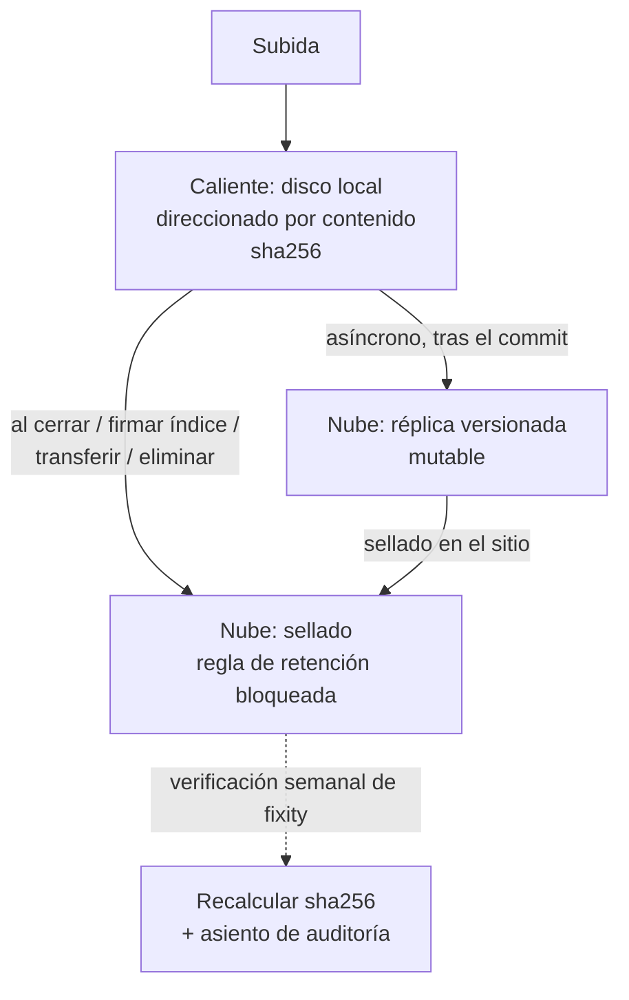

# ADR-050: Los bytes viven en disco; el archivo sellado vive en la nube de la entidad

**Estado**: Aceptado
**Fecha**: 2026-11-07
**Autores**: Camilo Romero
**Relacionados**: [ADR-023](ADR-023-worm-object-lock-preservacion.md) (WORM / Object Lock; **se reubica**), [ADR-027](ADR-027-sustitucion-almacen-objetos-rustfs.md) (sustitución del almacén; **deja de aplicar al almacén local**), [ADR-042](ADR-042-el-aip-se-versiona-no-se-reescribe.md) (el AIP se versiona; **se conserva la regla**), [ADR-043](ADR-043-retencion-legal-por-motivo-prestamo-identificado-y-soporte-citado.md) (retención legal; **se conserva**), [ADR-047](ADR-047-un-proceso-y-cuatro-contenedores.md)

---

## Contexto

`storage-service` son 13.405 líneas de producción y 19.495 de pruebas para mediar bytes contra un almacén S3: subida, descarga mediada, *presign*, bucket por entidad, réplica y preservación. Su cliente obligatorio es `miniopy-async` y su endpoint está **hardcodeado** (`minio_endpoint: str = "minio:9000"`): no hay respaldo en disco, así que sin el almacén no arranca.

Ese almacén es un contenedor RustFS en la misma máquina, con un volumen propio. La réplica que ADR-023 describe es un segundo bucket, y el propio código la documenta como *«local, no entre sitios»*. Con eso, la promesa de preservación depende de que sobreviva la misma máquina que guarda el original — que es exactamente el fallo que la preservación debe cubrir.

ADR-023 y ADR-027 eligieron Object Lock en modo **COMPLIANCE** porque el verbo «eliminado» de Acuerdo AGN 001/2024 art. 4.3.2.4 P1 tiene que ser auditable: borrar una versión retenida debe fallar **incluso con credenciales de raíz**. La batería de conformidad (`services/storage-service/tests/integration/test_worm_object_lock_real_s3.py`, 7/7 contra RustFS y MinIO, 0/7 contra Garage) mide precisamente eso.

Al mismo tiempo, la norma no pide que **todo** sea inmutable: pide que lo que se conserva no se pueda destruir sin el procedimiento. Un radicado en trámite se corrige, se anula, se reclasifica. La inmutabilidad es una propiedad de lo que ya está cerrado.

Y la residencia importa: la Ley 1581 de 2012 (arts. 26–27) restringe la transferencia internacional de datos personales a países con protección adecuada. Un archivo de una alcaldía colombiana en un almacén colombiano evita el problema entero.

## Decisión

### 1. Dos niveles, no uno



- **Nivel caliente — disco local.** Un árbol de directorios por entidad, con el contenido direccionado por su hash: `{DATA_DIR}/{slug}/{aa}/{sha256}`. PostgreSQL guarda `sha256`, tamaño, tipo de medio, nombre original y la traza de auditoría. Un archivo repetido ocupa un solo bloque (la deduplicación ya existía en `files.dedup_hit_at`; aquí sale gratis).
- **Nivel nube — réplica versionada.** Cada blob que entra se replica de forma asíncrona al almacén de objetos de la entidad (S3 compatible; Oracle Cloud en Bogotá por defecto). Es mutable y versionado: sirve para recuperar de la pérdida del disco, no para probar nada.
- **Nivel nube — sellado.** Al ocurrir un hecho que la norma considera definitivo, el artefacto se **sella**: se le fija una regla de retención que no se puede levantar antes de la fecha calculada. Los hechos que sellan son cuatro y solo cuatro:

| Hecho | Qué se sella |
|---|---|
| Cierre del expediente | El índice electrónico firmado y sus anexos |
| Firma del índice | El XML firmado y el manifiesto de fixity |
| Transferencia (primaria o secundaria) | El acta FUID congelada y el paquete de entrega |
| Ejecución de la eliminación | El acta firmada y las lápidas |

### 2. La interfaz del almacén son dos operaciones

```python
async def put(blob: bytes, *, slug: str, media_type: str) -> str: ...   # devuelve sha256
async def get(sha256: str, *, slug: str) -> bytes: ...
```

Todo lo demás —lifecycle, réplica, retención, proveedor— queda detrás. Eso permite apuntar a Oracle hoy y a cualquier S3 compatible después sin tocar el dominio, y permite probar el almacén con el sistema de archivos.

### 3. `storage-service` se convierte en un módulo

| Pieza | Destino |
|---|---|
| `storage-service` (13.405 líneas) | Un módulo de ~500 líneas: `put`, `get`, `seal`, `verify_fixity`, más el cliente S3 |
| Mediated download vía `document-service` con `X-Internal-Token` | Se retira: en un proceso, la comprobación de permiso y la lectura del blob son dos llamadas en la misma función |
| Bucket por entidad (`…-{slug}-documents`, `…-preservation`, `…-preservation-replica`) | Un prefijo por entidad en el almacén de la entidad |
| `aip_builder.py` (843), `aip_wiring_service.py` (890), `preservation_worm_service.py`, `aip_replica_service.py` | Se reducen a: sellar, verificar fixity, conservar el manifiesto |
| PDF/A con veraPDF (JVM + ghostscript en la imagen) | Se retira de la imagen. Queda como validación opcional contra un validador externo |
| `pronom.py` (tabla MIME→PUID) | Se retira. El tipo de medio declarado basta para lo que el SGDEA necesita hoy |
| `render/` con WeasyPrint | Se conserva WeasyPrint (se usa para generar documentos), se retira su envoltorio |

### 4. BagIt y PREMIS pasan a ser un manifiesto firmado

ADR-023 empaquetaba AIPs BagIt con PREMIS. Para una alcaldía, la parte que la norma mira es **qué se conserva, con qué hash, bajo qué regla y hasta cuándo**; BagIt es un envoltorio para intercambio entre repositorios, no un requisito de conservación interna.

Se conserva: un manifiesto JSON firmado por artefacto sellado, con `sha256`, tamaño, tipo, fecha, serie TRD, retención calculada, hash del índice y `pid` del asiento de auditoría. Ese manifiesto es el AIP mínimo y es verificable por un tercero con el certificado del sello.

Se difiere: empaquetado BagIt, PREMIS v3 completo y migración de formato contra obsolescencia. Si una entidad necesita exportar a otro repositorio, se genera el BagIt en ese momento desde el manifiesto.

### 5. La regla de retención es la que ya calcula la TRD

`Retention(COMPLIANCE, retain_until)` sale de `retention_math.py`, que ya existe y ya está probado contra las series. No se reimplementa: se aplica al sellar en vez de al subir.

## Alternativas consideradas

- **Todo en disco, sin nube.** Descartado. Es lo que el responsable sugirió inicialmente y no sobrevive a la pregunta de la auditoría: un disco no demuestra integridad ante un tercero, y perder la máquina pierde la entidad entera. Además, «no se puede borrar» pasaría a ser una promesa del código, no una propiedad del almacén.
- **Todo en la nube, incluidos los borradores.** Descartado: cada lectura de un radicado en trámite sería una llamada de red, y el costo de egreso se vuelve impredecible. El disco local es el conjunto de trabajo; la nube es la prueba.
- **Sellar todo al subir.** Descartado: una entidad que sella un radicado mal radicado no puede corregirlo nunca. La inmutabilidad debe empezar cuando el documento queda cerrado.
- **Guardar el objeto de Oracle en un formato propio.** Descartado: Decreto 2609/2012 art. 32 pide estándares abiertos, y el valor de la nube es que el byte sea el byte.
- **Copiar todo a la nube solo como respaldo.** Descartado: un respaldo no tiene regla de retención; cualquiera con las credenciales lo borra. La diferencia entre réplica y archivo es justamente la regla.

## Consecuencias

- **~12.900 líneas menos** y un contenedor menos.
- **La preservación mejora de verdad.** Hoy la réplica es local y se pierde con la máquina; con este ADR, el artefacto sellado está fuera de la máquina por definición.
- **Aparece una dependencia cloud con credenciales, coste y egress.** Se acota a dos operaciones para que sea sustituible.
- **El costo es bajo**: a ~16 GB al año y diez años de retención, del orden de 160 GB; el almacén de objetos es una partida menor frente al servidor.
- **Sin red, el nivel caliente sigue sirviendo; el sellado no.** Un cierre de expediente sin conexión queda encolado y se sella cuando vuelve. Hay que decidir si eso bloquea el cierre (ver preguntas abiertas).
- **Se pierde PDF/A automático.** Una alcaldía que necesite PDF/A para transferencia tendrá que convertirlo antes de radicar o esperar la validación externa. Se declara.
- **La verificación de fixity deja de ser opcional.** Un job semanal recalcula el hash de los artefactos sellados y escribe el resultado en auditoría; sin él, el sello es una promesa sin comprobación.

## Preguntas abiertas

1. **¿Bloquea el cierre de un expediente cuando la nube no responde?** Recomendación: sí para el sello (el cierre se completa, el sello queda pendiente y el estado lo dice), no para el cierre en sí. Necesita confirmación del responsable de producto porque cambia lo que ve el funcionario.
2. **Verificar las garantías reales de retención de Oracle Object Storage.** Que una regla de retención bloqueada resista a un administrador de la cuenta es la afirmación que hay que probar antes de escribirla en una declaración de conformidad, igual que se hizo con la batería WORM contra RustFS. Sin esa prueba, este ADR deja la conformidad sin evidencia.
3. **Confirmar región y residencia por defecto.** Bogotá es la razón de elegir Oracle; hay que verificar que el tipo de cuenta que se va a usar la incluye y que los datos no salen del país por defecto.
