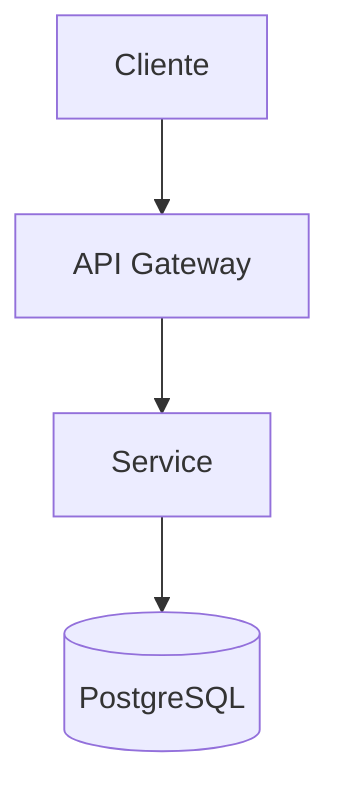

# Plan de Mejora Anti-Slop: Docuboto

**Fecha**: 2026-11-27  
**Basado en**: `diagnostico.md`  
**Horizonte**: Quick wins (esta semana) → Medio plazo (próximas 2-4 iteraciones)

---

## Resumen Ejecutivo

Este plan prioriza **mejoras incrementales y verificables** que suben de 7/12 a 10/12 en la escala anti-slop. Se enfoca en:
1. **Prevención** (gates automáticos antes de merge)
2. **Remediación** (reducir las 25 funciones E-F a <10)
3. **Cultura** (templates, AGENTS.md, visual alignment)

**NO incluye**: refactorización masiva del código de producción (fuera de scope según instrucciones).

---

## Fase 1: Quick Wins (Esta Semana)

### 1.1 Gate de Complejidad en CI ⚡

**Regla**: #2 (Know Your Enemy), #6 (Deterministic Lint)

**Objetivo**: Bloquear PRs que introduzcan funciones con complejidad >15

**Cambios**:
1. Agregar `C901` a ruff en `pyproject.toml`:
```toml
[tool.ruff.lint]
select = [
    "E", "W", "F", "I", "B", "UP",
    "C90",    # McCabe complexity
    "PLR",    # Pylint refactor (too-many-*)
]

[tool.ruff.lint.mccabe]
max-complexity = 15
```

2. Agregar reglas PLR (pylint-refactor):
```toml
# Después de select:
"PLR0911",  # too-many-return-statements (max 6)
"PLR0912",  # too-many-branches (max 12)
"PLR0913",  # too-many-arguments (max 5)
"PLR0915",  # too-many-statements (max 50)
```

3. Crear lista de excepciones temporales en `pyproject.toml`:
```toml
[tool.ruff.lint.per-file-ignores]
# Funciones E-F existentes (25 funciones) — refactorizar en Fase 2
"services/docuboto/document/services/tercero_service.py" = ["C901", "PLR0912"]
"services/docuboto/document/services/document_service.py" = ["C901", "PLR0915"]
"services/docuboto/archive/services/transferencia_service.py" = ["C901"]
"services/docuboto/signature/providers/local.py" = ["C901"]
# ... (lista completa basada en radon cc --min E)
```

**Verificación**:
```bash
ruff check services/docuboto --select C901,PLR0911,PLR0912,PLR0913,PLR0915
# Debe pasar en código existente, fallar en nuevo código complejo
```

**Esfuerzo**: 2 horas  
**Riesgo**: Bajo (excepciones cubren código existente)  
**Done when**: CI rechaza PRs con nueva función >15 de complejidad

---

### 1.2 Pre-commit Hooks 🪝

**Regla**: #1 (Back Pressure), #6 (Deterministic Lint)

**Objetivo**: Linting local antes de commit (ciclo de feedback <5s)

**Cambios**:
1. Crear `.pre-commit-config.yaml`:
```yaml
repos:
  - repo: https://github.com/astral-sh/ruff-pre-commit
    rev: v0.4.0
    hooks:
      - id: ruff
        args: [--fix, --exit-non-zero-on-fix]
      - id: ruff-format

  - repo: https://github.com/pre-commit/mirrors-mypy
    rev: v1.11.0
    hooks:
      - id: mypy
        args: [--config-file=pyproject.toml]
        additional_dependencies: [types-all]

  - repo: https://github.com/pre-commit/pre-commit-hooks
    rev: v4.5.0
    hooks:
      - id: trailing-whitespace
      - id: end-of-file-fixer
      - id: check-yaml
      - id: check-added-large-files
        args: [--maxkb=500]
```

2. Actualizar CONTRIBUTING.md:
```markdown
## Setup inicial

```bash
pip install pre-commit
pre-commit install
```

Los hooks corren automáticamente antes de cada commit.
Para saltarlos (emergencias): `git commit --no-verify`
```

**Verificación**:
```bash
pre-commit run --all-files
# Debe pasar en main
```

**Esfuerzo**: 1 hora  
**Riesgo**: Bajo (opcional con --no-verify)  
**Done when**: `pre-commit install` funciona, documentado en CONTRIBUTING.md

---

### 1.3 AGENTS.md para Cursor/Copilot 🤖

**Regla**: #11 (Unified Forge)

**Objetivo**: Instrucciones para agentes de IA que trabajen en el repo

**Cambios**:
1. Crear `/workspace/AGENTS.md`:
```markdown
# Instrucciones para Agentes de IA

Este repositorio es **Docuboto** (SGDEA, fork de OrpycaMCP, AGPL-3.0).

## Arquitectura
- **Monolito** (ADR-047): un proceso FastAPI, 4 contenedores (app, db, redis*, storage)
- **Domains**: document, archive, workflow, signature, auth, storage, knowledge
- **Stack**: Python 3.11, FastAPI, asyncpg (NO ORM), PostgreSQL, RustFS (S3), SvelteKit

## Reglas de Código
1. **NO uses ORMs** (asyncpg raw SQL, ADR-003)
2. **Funciones ≤15 complejidad** (ruff C901)
3. **Type hints obligatorios** (mypy en CI)
4. **Docs en español** (ADRs, CHANGELOG, comments de dominio)
5. **Tests junto al código** (`services/docuboto/tests/<domain>/`)

## Workflow
1. Lee ADRs relevantes en `docs/es/adr/` antes de cambiar arquitectura
2. Cambios >500 LOC requieren ADR nuevo (plantilla en CONTRIBUTING.md)
3. Siempre actualiza `CHANGELOG.md` + `docs/es/changelog.md`
4. Lint con `./scripts/lint.sh` (NO `ruff check` desde raíz)

## Anti-Slop
- Complejidad promedio: A (3.24). Mantenerla.
- 25 funciones E-F heredadas (no refactorizar sin issue). Nueva debe ser ≤15.
- Duplicación actual: 6.87%. No agregar bloques >10 líneas duplicados.
- Tests: ratio 1:1 prod:test mínimo.

## Hotspots (tocar con cuidado)
- `document/services/tercero_service.py` (reconciliación crítica)
- `archive/services/transferencia_service.py` (transferencias físicas)
- `signature/providers/local.py` (XAdES, compliance legal)
- `storage/services/aip_service.py` (preservación a largo plazo)

## Comandos Frecuentes
```bash
# Lint (igual que CI)
./scripts/lint.sh

# Tests (por dominio, no toda la suite)
cd services/docuboto && pytest tests/document/ -v

# Levantar entorno
docker compose up -d && docker compose logs -f app

# Migraciones
docker compose exec app python scripts/init_tenant.py tenant1
```

## ADRs Clave
- ADR-047: Un proceso (monolito), no microservicios
- ADR-049: Eventos en PostgreSQL (Redis retirado)
- ADR-003: asyncpg sin ORM
- ADR-053: Esquema legible y lanzamientos

Ver `docs/es/adrs.md` para índice completo.
```

**Verificación**: N/A (es documentación)

**Esfuerzo**: 1 hora  
**Riesgo**: Ninguno  
**Done when**: AGENTS.md en raíz, mencionado en README.md

---

### 1.4 Template de PR con Checklist 📝

**Regla**: #3 (Plan Before Building), #4 (Visual Alignment)

**Objetivo**: Forzar reflexión sobre ADRs y complejidad antes de merge

**Cambios**:
1. Crear `.github/pull_request_template.md`:
```markdown
## Descripción

<!-- ¿Qué cambia y por qué? 2-3 frases. -->

## Tipo de Cambio

- [ ] 🐛 Bug fix (no rompe API)
- [ ] ✨ Feature nueva (no rompe API)
- [ ] 💥 Breaking change
- [ ] 📚 Documentación
- [ ] ♻️ Refactor (sin cambio funcional)

## Checklist Pre-Merge

### Documentación
- [ ] `CHANGELOG.md` y `docs/es/changelog.md` actualizados
- [ ] Si cambio >500 LOC o arquitectónico: **ADR creado** (¿cuál? ADR-___)
- [ ] Si cambio UI: **mockup/screenshot adjunto**
- [ ] Si cambio API: `docs/es/api.md` actualizado

### Código
- [ ] Complejidad: funciones nuevas ≤15 (ruff C901 pasa)
- [ ] Tests: ratio test:prod ≥1:1 en archivos tocados
- [ ] Sin duplicación >10 líneas
- [ ] Type hints en funciones nuevas

### CI
- [ ] `./scripts/lint.sh` pasa localmente
- [ ] Tests pasan: `pytest tests/<domain>/ -v`
- [ ] CI verde (todos los checks)

## Testing

<!-- ¿Cómo verificaste el cambio? -->

- [ ] Pruebas unitarias en `tests/<domain>/test_*.py`
- [ ] Pruebas de integración (si aplica)
- [ ] Pruebas manuales (describir)

## Deployment

- [ ] Requiere migración de BD: **SÍ/NO** (¿cuál? `migrations/tenant/XXX_*.sql`)
- [ ] Requiere variables de entorno nuevas: **SÍ/NO** (¿cuáles?)
- [ ] Compatible con rollback

## Context Adicional

<!-- Links a issues, ADRs, discusiones, etc. -->
```

**Verificación**: N/A (es template)

**Esfuerzo**: 30 min  
**Riesgo**: Ninguno  
**Done when**: Template aparece al crear PR en GitHub

---

## Fase 2: Remediación (2-4 Iteraciones)

### 2.1 Refactorizar Top 10 Funciones E-F 🔧

**Regla**: #2 (Know Your Enemy)

**Objetivo**: Reducir 25 funciones E-F a <10

**Estrategia**: Extract method + pattern matching en Python 3.11

**Plan por archivo** (uno por iteración):

#### Iteración 1: `document/services/tercero_service.py`
- **Función**: `TerceroService.conciliar` (complejidad 38)
- **Estrategia**:
  1. Extraer lógica de validación a `_validar_datos_tercero()`
  2. Extraer matching de NIF/email a `_buscar_coincidencias()`
  3. Extraer merge de campos a `_fusionar_terceros()`
  4. Usar pattern matching para estado de reconciliación
- **Verificación**: radon cc <15, tests pasan, diff de coverage <1%
- **Esfuerzo**: 6-8 horas

#### Iteración 2: `signature/providers/local.py`
- **Función**: `verify_xades` (complejidad 45)
- **Estrategia**:
  1. Extraer validación de certificado a `_validar_certificado_xades()`
  2. Extraer verificación de timestamp a `_verificar_timestamp()`
  3. Extraer cadena de confianza a `_verificar_cadena_confianza()`
- **Riesgo**: ALTO (firma electrónica, compliance legal) → pair programming
- **Verificación**: Suite de signature/ pasa, cobertura sin cambios
- **Esfuerzo**: 8-10 horas

#### Iteración 3-6: Resto de funciones E-F
- Priorizar por criticidad de negocio (transferencias, AIPs) > tests
- Esquema similar: extract method, pattern matching, verificación

**Done when**: 
- ≤10 funciones con complejidad >20
- Excepciones de ruff removidas de `pyproject.toml`
- ADR-XXX documenta refactorización (opcional)

---

### 2.2 Eliminar Duplicación Crítica (>20 líneas) 📉

**Regla**: #2 (Know Your Enemy - Verbosity)

**Objetivo**: Bajar duplicación de 6.87% a <5%

**Targets prioritarios**:

#### 2.2.1 HTTPException Boilerplate (64 instancias)
- **Patrón**:
```python
if entidad is None:
    raise HTTPException(
        status_code=status.HTTP_404_NOT_FOUND,
        detail={
            "error": "entidad_not_found",
            "detail": "No existe la entidad",
            "status": 404,
        },
    )
```
- **Solución**: Helper en `shared/orpycamcp_common/exceptions.py`:
```python
def not_found(error_code: str, message: str) -> HTTPException:
    return HTTPException(
        status_code=status.HTTP_404_NOT_FOUND,
        detail={"error": error_code, "detail": message, "status": 404},
    )

# Uso:
if entidad is None:
    raise not_found("entidad_not_found", "No existe la entidad")
```
- **Esfuerzo**: 4 horas (buscar-reemplazar + tests)

#### 2.2.2 `archive/jobs/indice_reconciliation.py` (67 líneas duplicadas)
- **Estrategia**: Extraer reconciliación de índice a función paramétrica
- **Esfuerzo**: 6 horas

#### 2.2.3 `public_audit.py` duplicado (archive ↔ document)
- **Estrategia**: Mover a `shared/orpycamcp_common/audit.py`
- **Esfuerzo**: 2 horas

**Verificación**:
```bash
jscpd services/docuboto --min-tokens 50 --min-lines 5 --threshold 5
# Debe fallar si duplicación >5%
```

**Done when**: jscpd reporta <5% duplicación

---

### 2.3 Monitoreo de Complejidad en CI 📊

**Regla**: #2 (Know Your Enemy), #8 (Compound Improvements)

**Objetivo**: Tracking automático de erosión estructural

**Cambios**:
1. Agregar job a `.github/workflows/ci.yml`:
```yaml
complexity-report:
  runs-on: ubuntu-latest
  if: github.event_name == 'pull_request'
  steps:
    - uses: actions/checkout@v4
    - uses: actions/setup-python@v5
      with:
        python-version: "3.11"
    - run: pip install radon jscpd
    
    - name: Complexity Report
      run: |
        echo "## 📊 Complexity Report" >> $GITHUB_STEP_SUMMARY
        radon cc services/docuboto -a -s --total-average >> $GITHUB_STEP_SUMMARY
        echo "" >> $GITHUB_STEP_SUMMARY
        echo "Functions > complexity 15:" >> $GITHUB_STEP_SUMMARY
        radon cc services/docuboto --min C | grep -E "^services" | wc -l >> $GITHUB_STEP_SUMMARY
    
    - name: Duplication Report
      run: |
        jscpd services/docuboto --format python --reporters console | tee duplication.txt
        echo "## 📋 Duplication Report" >> $GITHUB_STEP_SUMMARY
        grep "Duplicated" duplication.txt >> $GITHUB_STEP_SUMMARY
```

2. Configurar comentario en PR con métricas (GitHub Action)

**Verificación**: Ver reporte en PR summary

**Esfuerzo**: 3 horas  
**Riesgo**: Bajo  
**Done when**: Todo PR muestra complexity + duplication en summary

---

### 2.4 Cobertura de Tests como Gate 🧪

**Regla**: #5 (Agents Can Test Their Own Work)

**Objetivo**: Mantener cobertura >80% en archivos modificados

**Cambios**:
1. Agregar a `pytest.ini`:
```ini
[pytest]
addopts = 
    --cov=services/docuboto
    --cov-report=term-missing:skip-covered
    --cov-fail-under=80
    --cov-branch
```

2. Agregar a CI (job `test-unit`):
```yaml
- run: pytest tests/ --cov --cov-report=xml --cov-report=term
- uses: codecov/codecov-action@v3  # opcional: dashboard
  with:
    files: ./coverage.xml
```

3. Configurar diff-coverage en PR (solo código nuevo):
```yaml
- run: |
    pip install diff-cover
    diff-cover coverage.xml --compare-branch=origin/main --fail-under=90
```

**Verificación**:
```bash
pytest tests/document/ --cov=document --cov-fail-under=80
# Debe pasar
```

**Esfuerzo**: 2 horas  
**Riesgo**: Medio (puede bloquear PRs legítimos) → umbral 80% es conservador  
**Done when**: CI muestra cobertura, bloquea si <80% en diff

---

## Fase 3: Cultura y Visual Alignment (Medio Plazo)

### 3.1 Feature Flags Simples 🚩

**Regla**: #7 (Feature Flags for Prototypes)

**Objetivo**: Merge behind flag para experimentos

**Implementación**:
1. Crear `shared/orpycamcp_common/features.py`:
```python
from enum import Enum
from functools import lru_cache
from app.core.config import settings

class Feature(str, Enum):
    NUEVO_ASISTENTE_IA = "nuevo_asistente_ia"
    BUSQUEDA_SEMANTICA = "busqueda_semantica"
    # ...

@lru_cache
def is_enabled(feature: Feature, tenant: str | None = None) -> bool:
    """Check if feature is enabled globally or per-tenant."""
    env_key = f"FEATURE_{feature.value.upper()}"
    global_flag = settings.get(env_key, "false").lower() == "true"
    
    if tenant and not global_flag:
        # Per-tenant override en config
        tenant_key = f"{env_key}_TENANT_{tenant.upper()}"
        return settings.get(tenant_key, "false").lower() == "true"
    
    return global_flag

# Uso:
if is_enabled(Feature.NUEVO_ASISTENTE_IA, tenant_slug):
    return nuevo_asistente(query)
else:
    return asistente_actual(query)
```

2. Documentar en CONTRIBUTING.md:
```markdown
## Feature Flags

Experimentos y cambios grandes van tras feature flag:

```python
from orpycamcp_common.features import Feature, is_enabled

if is_enabled(Feature.MI_EXPERIMENTO):
    # código nuevo
```

Activar globalmente: `FEATURE_MI_EXPERIMENTO=true` en `.env`
Activar por tenant: `FEATURE_MI_EXPERIMENTO_TENANT_TENANT1=true`
```

**Esfuerzo**: 4 horas  
**Riesgo**: Bajo  
**Done when**: Feature flags documentados y en uso en 1 PR

---

### 3.2 ADRs con Diagramas 📐

**Regla**: #4 (Visual Alignment)

**Objetivo**: Diagramas obligatorios en ADRs de arquitectura

**Cambios**:
1. Actualizar template de ADR en CONTRIBUTING.md:
```markdown
# ADR-NNN: Título

**Status**: Propuesto / Aceptado / Rechazado  
**Fecha**: YYYY-MM-DD

## Contexto

(Problema statement, 2-3 párrafos)

## Diagrama



(Obligatorio para cambios de arquitectura, flujos, o estados)

## Decisión

...

## Alternativas Consideradas

1. **Opción A**: ...
   - Pros: ...
   - Contras: ...

...

## Consecuencias

- **Pro**: ...
- **Con**: ...
```

2. Crear `docs/diagrams/` con ejemplos:
   - C4 context diagram del sistema
   - Sequence diagram de radicación
   - State diagram de workflow

**Herramientas sugeridas**:
- Mermaid (renderiza en GitHub)
- PlantUML (más expresivo)
- draw.io (manual, exportar SVG)

**Esfuerzo**: 2 horas (template) + 1 hora/diagrama retroactivo  
**Riesgo**: Bajo  
**Done when**: 3 ADRs retroactivos tienen diagramas, template actualizado

---

### 3.3 Evals para Features de IA 🧠

**Regla**: #9 (Eval Everything)

**Objetivo**: Regresión automática de precisión del asistente

**Estrategia** (si el asistente existe):
1. Crear `services/docuboto/knowledge/evals/`:
```
knowledge/evals/
├── __init__.py
├── test_asistente_precision.py
├── test_asistente_latency.py
└── golden_dataset.json
```

2. Ejemplo de eval:
```python
# test_asistente_precision.py
import pytest
from knowledge.services.asistente_service import AsistenteService

GOLDEN_DATASET = [
    {
        "query": "¿Cómo radicar un documento?",
        "expected_contains": ["POST /api/v1/document", "radicado", "metadata"],
        "expected_not_contains": ["expediente", "transferencia"],
    },
    # ... 20-50 casos
]

@pytest.mark.asyncio
@pytest.mark.eval
async def test_asistente_responde_correctamente():
    service = AsistenteService()
    failures = []
    
    for case in GOLDEN_DATASET:
        response = await service.query(case["query"])
        
        for expected in case["expected_contains"]:
            if expected not in response:
                failures.append(f"Query: {case['query']}, missing: {expected}")
        
        for unexpected in case["expected_not_contains"]:
            if unexpected in response:
                failures.append(f"Query: {case['query']}, unexpected: {unexpected}")
    
    assert not failures, f"Eval failures:\n" + "\n".join(failures)
```

3. Agregar a CI:
```yaml
test-knowledge-evals:
  if: contains(github.event.pull_request.labels.*.name, 'knowledge')
  runs-on: ubuntu-latest
  steps:
    - run: pytest services/docuboto/knowledge/evals/ -v -m eval
```

**Esfuerzo**: 8 horas (crear golden dataset + evals)  
**Riesgo**: Medio (requiere features de IA existentes)  
**Done when**: Evals pasan en main, corren en PRs de knowledge

---

### 3.4 ast-grep Rules para Slop Patterns ⚙️

**Regla**: #6 (Deterministic Lint)

**Objetivo**: Lint custom para los 1.103 patrones de scb-check

**Estrategia**:
1. Instalar ast-grep: `npm install -g @ast-grep/cli`
2. Crear `ast-grep-rules.yml`:
```yaml
rules:
  - id: duplicate-http-exception
    language: python
    pattern: |
      raise HTTPException(
        status_code=$STATUS,
        detail={
          "error": $ERROR,
          "detail": $MSG,
          "status": $STATUS2,
        }
      )
    message: "Use helper from orpycamcp_common.exceptions instead"
    severity: warning
    
  - id: god-class-too-many-methods
    language: python
    pattern: |
      class $CLASS:
        $$$METHODS
    constraints:
      METHODS:
        count: { min: 20 }
    message: "Class $CLASS has too many methods (>20), consider splitting"
    severity: warning
```

3. Agregar a CI:
```yaml
- run: npx @ast-grep/cli scan --config ast-grep-rules.yml services/docuboto/
```

**Esfuerzo**: 6 horas (traducir top 10 patrones de scb-check)  
**Riesgo**: Bajo (warning, no error)  
**Done when**: ast-grep corre en CI, reporta top 3 slop patterns

---

## Fase 4: Opcional / Futuro

### 4.1 Dashboard de Métricas (SonarQube / CodeClimate)
- Tracking histórico de complexity, duplication, coverage
- **Esfuerzo**: 8-16 horas (setup + integración)
- **Riesgo**: Medio (costo de herramienta)

### 4.2 Mutation Testing (mutmut)
- Verificar calidad de tests
- **Esfuerzo**: 4 horas (setup) + 20 min/module
- **Riesgo**: Bajo

### 4.3 Postmortems Template
- Cultura de aprender de incidentes
- **Esfuerzo**: 2 horas (template + ejemplo)
- **Riesgo**: Ninguno

---

## Resumen de Prioridades

| Item | Regla | Esfuerzo | Impacto | Prioridad |
|------|-------|----------|---------|-----------|
| 1.1 Gate de Complejidad | #2, #6 | 2h | Alto | 🔥 P0 |
| 1.2 Pre-commit Hooks | #1, #6 | 1h | Alto | 🔥 P0 |
| 1.3 AGENTS.md | #11 | 1h | Medio | ⚡ P1 |
| 1.4 Template de PR | #3, #4 | 30m | Medio | ⚡ P1 |
| 2.1 Refactor Top 10 E-F | #2 | 40-60h | Alto | ⚡ P1 |
| 2.2 Eliminar Duplicación | #2 | 12h | Medio | ⚡ P1 |
| 2.3 Monitoreo Complejidad | #2, #8 | 3h | Medio | 📊 P2 |
| 2.4 Cobertura como Gate | #5 | 2h | Medio | 📊 P2 |
| 3.1 Feature Flags | #7 | 4h | Medio | 📊 P2 |
| 3.2 ADRs con Diagramas | #4 | 10h | Bajo | 🔮 P3 |
| 3.3 Evals IA | #9 | 8h | Bajo* | 🔮 P3 |
| 3.4 ast-grep Rules | #6 | 6h | Bajo | 🔮 P3 |

*P3 si features de IA no son core business

---

## Verificación de Éxito

### Métricas Objetivo (3 meses)

| Métrica | Actual | Objetivo | Verificación |
|---------|--------|----------|--------------|
| Complejidad promedio | 3.24 | ≤3.5 | `radon cc -a` |
| Funciones >20 complejidad | 74 | <30 | `radon cc --min D \| wc -l` |
| Funciones >30 complejidad | 25 | <10 | `radon cc --min E \| wc -l` |
| Duplicación | 6.87% | <5% | `jscpd --threshold 5` |
| Cobertura tests | ❓ | >80% | `pytest --cov --cov-fail-under=80` |
| Vulture findings | 25 | <10 | `vulture --min-confidence 80` |
| ADRs con diagramas | ~0% | >50% | Manual |
| PRs sin plan bloqueadas | 0 | >0 | Template enforced |

### Scorecard Anti-Slop Objetivo

| Regla | Estado Actual | Estado Objetivo |
|-------|---------------|-----------------|
| 1. Forward/Back Pressure | ✅ Hecho | ✅ Hecho+ (pre-commit) |
| 2. Know Your Enemy | ⚠️ Parcial | ✅ Hecho (gates + monitor) |
| 3. Plan Before Building | ⚠️ Parcial | ✅ Hecho (template PR) |
| 4. Visual Alignment | ❌ Falta | ⚠️ Parcial (template ADR) |
| 5. Test Own Work | ✅ Hecho | ✅ Hecho+ (coverage gate) |
| 6. Deterministic Lint | ⚠️ Parcial | ✅ Hecho (C901 + PLR) |
| 7. Feature Flags | ❌ Falta | ⚠️ Parcial (simple impl) |
| 8. Compound Improvements | ⚠️ Parcial | ✅ Hecho (metrics track) |
| 9. Eval Everything | ❌ Falta | ⚠️ Parcial (si IA core) |
| 10. Learn from Past | ✅ Hecho | ✅ Hecho |
| 11. Unified Forge | ✅ Hecho | ✅ Hecho+ (AGENTS.md) |
| 12. Can't Buy Everything | ✅ Hecho | ✅ Hecho |

**Resultado**: 7/12 → **10/12** (3 Hecho nuevos, 3 Parciales mejorados)

---

## Siguientes Pasos Inmediatos

1. **Revisar este plan** con Camilo (propietario del repo)
2. **Crear issues** para Fase 1 (4 issues de quick wins)
3. **PR #1**: Gate de complejidad + pre-commit hooks (bloquea slop futuro)
4. **PR #2**: AGENTS.md + template de PR (mejora cultura)
5. **Planificar** Fase 2 en próximo sprint

---

**Contacto**: Este diagnóstico y plan fueron generados por un agente de Cursor. Para preguntas o ajustes, actualizar este documento y commitear en el PR de diagnóstico.
