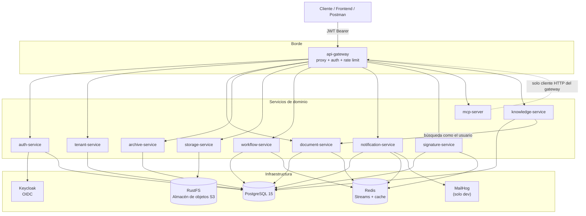
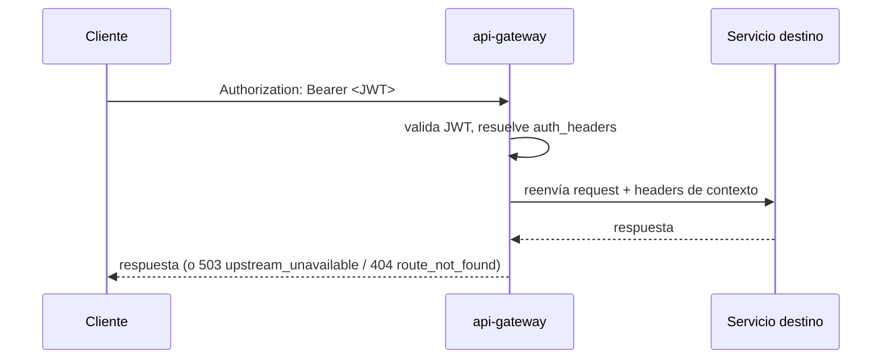
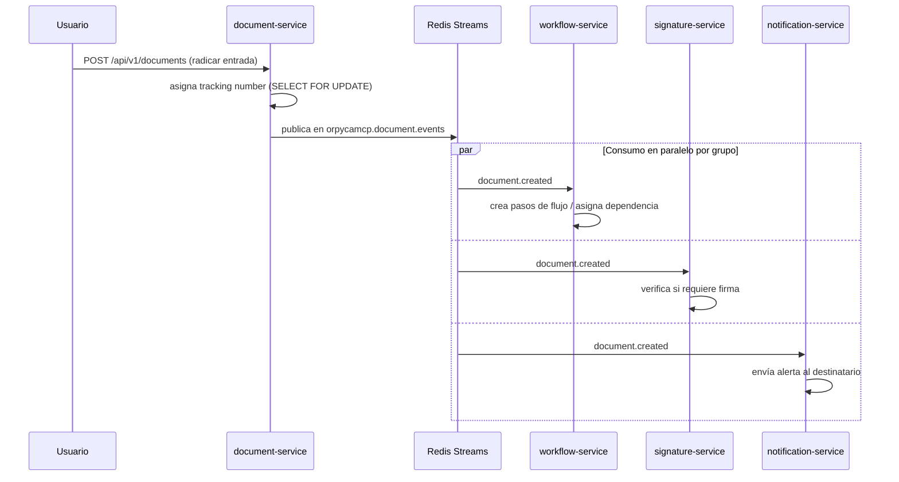
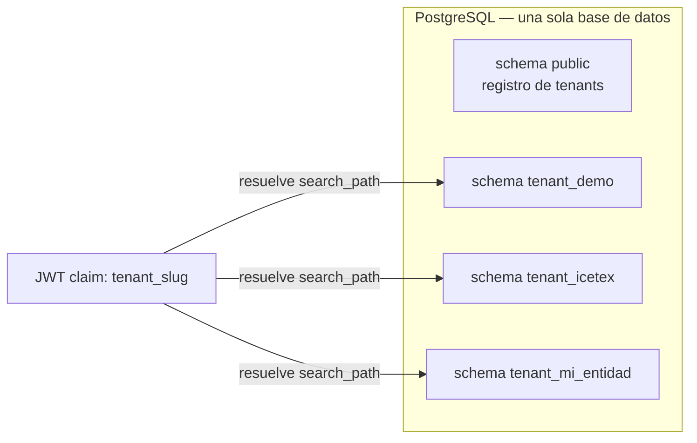

# Arquitectura

## Visión general

OrpycaMCP usa una arquitectura de **microservicios**, donde cada servicio es responsable
de un *bounded context* del dominio documental. Todos son aplicaciones **FastAPI**
independientes, con su propio schema de datos, que se comunican de dos formas:

- **Síncrona (HTTP/REST)**, siempre a través del `api-gateway` — nunca directo entre sí
  desde el cliente.
- **Asíncrona (Redis Streams)**, para eventos de dominio (un radicado creado, un flujo
  asignado, un documento firmado, etc.).



`mcp-server` es una **fachada fina** (ADR-019): no tiene base de datos propia ni lógica
de negocio — traduce llamadas del protocolo MCP en peticiones al `api-gateway`,
exactamente como lo haría cualquier otro cliente autenticado. Docuboto no llama a ningún
modelo de lenguaje ([ADR-046](adr/ADR-046-conocimiento-sin-modelos.md)): quien quiera actuar
con IA usa un cliente MCP externo, con el modelo que ese cliente elija.

El gateway firma la identidad que reenvía a cada servicio (HMAC con instante, método y ruta
canónica, [ADR-036](adr/ADR-036-identidad-atada-a-metodo-y-ruta.md)) y aplica el estado de la
entidad en el borde: una entidad `suspended` pierde la API autenticada y conserva en solo lectura
su portal público y la conservación de sus documentos
([ADR-035](adr/ADR-035-estado-de-la-entidad-cumplimiento-en-el-borde.md)).

## Servicios y puertos

| Servicio | Puerto interno (Docker) | Puerto publicado (host) | Responsabilidad |
|---|---|---|---|
| `api-gateway` | 8080 | **19080** | Proxy central, enrutamiento por prefijo, validación JWT, rate limiting |
| `auth-service` | 8001 | **19001** | Integración con Keycloak, emisión/validación de JWT, RBAC, clearance (RF-SEG-08) |
| `tenant-service` | 8002 | **19002** | Alta de instituciones/tenants, dependencias, catálogos, PINAR |
| `document-service` | 8003 | **19003** | Radicación E/S/I, anexos, respuestas, anulación, import/export, ingesta IMAP, OAI-PMH/CMIS |
| `archive-service` | 8004 | **19004** | Expedientes, TRD/CCD, índice electrónico, archivo físico, transferencias |
| `storage-service` | 8005 | **19005** | Subida/descarga de archivos en el almacén de objetos, preservación (WORM/Object-Lock) |
| `workflow-service` | 8006 | **19006** | Flujos de distribución, vistos buenos, reglas, dead-letter |
| `notification-service` | 8007 | **19007** | Correo/alertas, webhooks salientes, dead-letter |
| `signature-service` | 8008 | **19008** | Firma electrónica XAdES-B/T/LT/LTA verificable por terceros (ADR-034): personal, sello institucional del índice/acta y renovación del sello de archivo LTA |
| `mcp-server` | 8009 | **19009** | Capa Model Context Protocol para clientes externos (E18, ADR-019) |
| `knowledge-service` | 8011 | **19011** | Pasarela de conocimiento sin modelos: buscar y antecedentes por texto completo, como el usuario (ADR-046) |
| `frontend` | 3000 | **19300** | SvelteKit SSR — capa de presentación (E22) |
| PostgreSQL | 5432 | **15432** | Base de datos única, multi-schema |
| Redis | 6379 | **16379** | Streams de eventos + cache |
| RustFS | 9000 | **19900** | Almacén de objetos S3 (sustituye a MinIO, ADR-027). Sin consola web: se inspecciona con `aws-cli` |
| Keycloak | 8080 | **19180** | Identity Provider (OIDC) |
| MailHog | 1025 (SMTP) / 8025 (web) | 1025 / 8025 | Captura de correos en desarrollo |

> No hay salto de numeración por servicio "faltante": el rango 19xxx/15432/16379 evita
> chocar con otras pilas de desarrollo en la misma máquina; el puerto interno es el que
> ven los servicios entre sí dentro de la red `orpycamcp-net`.

## Inventario de recursos por servicio

Cada servicio sigue el layout estándar (`app/routers/`, uno por recurso). Resumen de
lo que expone cada uno:

### `auth-service`
| Router | Qué gestiona |
|---|---|
| `auth` | Login/token contra Keycloak |
| `clearance` | Niveles de seguridad (clasificación de usuarios/documentos) |
| `rbac` | Roles y permisos (admin) |
| `urd` | Gestión de usuarios (admin) |
| `context` | Contexto de sesión (tenant, roles, permisos del usuario actual) |
| `audit` | Consulta de `audit_log` (admin) |
| `totp` | Segundo factor TOTP |
| `signing_key` | Custodia de llaves de firma personal (Epic firma PKI) |

### `tenant-service`
| Router | Qué gestiona |
|---|---|
| `tenants` | Alta/consulta de instituciones (provisión de schema) |
| `dependencias` | Unidades organizacionales |
| `catalogos` | Catálogos generales (tipos documentales, etc.) |
| `pinar` | Plan Institucional de Archivos (Ac. 003/2015) |

### `document-service` (el más grande — núcleo de radicación)
| Router | Qué gestiona |
|---|---|
| `documents` | CRUD de radicados E/S/I, anexos |
| `anulacion` | Anulación de radicados |
| `respuesta` | Respuestas a radicados (antecedente E↔S) |
| `signatures` | Estado de firma del radicado |
| `borradores` | Borradores previos a radicar |
| `import_` / `export` | Interoperabilidad (E11 INT-01/INT-05) — paquetes ZIP con fixity |
| `ingest` | Ingesta por correo (IMAP) |
| `batch` | Operaciones masivas |
| `search` / `reports` | Búsqueda FTS y reportes |
| `public` | Endpoints de consulta pública (Ley 1712) |
| `metadata` / `metadata_elements` | Plantillas de metadatos documentales |
| `postal` | Envíos/operador postal (webhook entrante E20) |
| `cmis` / `oai` | Interoperabilidad CMIS y cosecha OAI-PMH |
| `internal` | Endpoints inter-servicio sellados con `X-Internal-Token` |

### `archive-service`
| Router | Qué gestiona |
|---|---|
| `expedientes` | Ciclo de vida del expediente (abrir/cerrar/transferir) |
| `indice` | Índice electrónico XML firmado (E15) |
| `fisico` | Archivo físico: ubicaciones, unidades de conservación, préstamos |
| `transferencias` | Transferencias documentales + FUID |
| `tipos_documentales` / `trd` | TRD/CCD (series, subseries, retención, disposición) |
| `metadata` | Plantillas de metadatos de expediente |
| `oai` | Cosecha OAI-PMH multinivel (fonds→series→file) |

### `storage-service`
| Router | Qué gestiona |
|---|---|
| `storage` | Subida (mediada) / descarga de anexos en el almacén de objetos |
| `preservacion` | WORM/Object-Lock, empaquetado AIP BagIt/PREMIS |

### `workflow-service`
| Router | Qué gestiona |
|---|---|
| `workflow` | Pasos de flujo, distribución, tracking |
| `visto_bueno` | Vistos buenos (cadena de aprobación) |
| `rules` | Reglas de enrutamiento de flujos |
| `admin_deadletter` | Inspección/replay/discard de eventos fallidos (DLQ) |

### `notification-service`
| Router | Qué gestiona |
|---|---|
| `notifications` | Envío de notificaciones (correo/alertas) |
| `webhooks` | Suscripción y entrega de webhooks salientes firmados (HMAC) |
| `admin_deadletter` | DLQ de notificaciones |

### `signature-service`
| Router | Qué gestiona |
|---|---|
| `signature` | Firma XAdES personal y sello institucional |
| `cadena` | Cadena/lote de firmas |
| `admin_deadletter` | DLQ de firma |

### `mcp-server`
| Router | Qué gestiona |
|---|---|
| `mcp` | Catálogo/protocolo MCP (**no** expuesto por el gateway) |

### `knowledge-service`
| Router | Qué gestiona |
|---|---|
| `knowledge` | `/search`, `/antecedentes`, `/rag` (503 sin proveedor) y `/availability` |

## Patrón de proxy del gateway

`api-gateway` expone un único endpoint catch-all:
`/api/v1/{path:path}` (todos los métodos HTTP). Una tabla ordenada de
`(prefijo, servicio_destino)` decide a dónde reenviar cada request — el primer
prefijo que hace match gana, por eso el orden importa (p. ej. `/public/archive/`
debe listarse antes que el `/public/` genérico de `document-service`).



Reglas de seguridad **por diseño** en el proxy (no accidentales):

- **Descarga de anexos mediada**: el gateway solo expone
  `POST /api/v1/storage/upload`. La descarga de bytes **siempre** pasa por
  `document-service` (`GET /api/v1/documents/{id}/anexos/{file_id}/download`), que
  revalida el clearance del usuario antes de pedirle el archivo a `storage-service` —
  nunca se llega directo al almacén de objetos desde afuera.
- **`mcp-server` acotado**: solo `/api/v1/mcp/` se enruta (catálogo, invocación,
  propuestas y el transporte streamable). Invocar una escritura por ahí devuelve una
  propuesta firmada; ejecutarla exige ese token, atado a la persona y a su ventana.
- **`knowledge-service` acotado**: solo `/search`, `/antecedentes`, `/rag` y
  `/availability` se enrutan.

## Orquestación asíncrona — Redis Streams

Patrón de nombre de stream: `orpycamcp.{servicio}.events`
(dead-letter: `orpycamcp.{servicio}.deadletter`). Cada worker consumidor usa un grupo
de consumidores Redis (`XREADGROUP`) y solo hace `XACK` tras procesar con éxito; si
falla, el mensaje permanece en la PEL para reintento y, tras agotar reintentos, se
mueve al stream de dead-letter (ADR-021).

Ejemplo real de punta a punta — **radicación de un documento de entrada**:



**Si un consumidor falla** (ej. `notification-service` no puede enviar el correo):
el mensaje permanece en su PEL, se reintenta con backoff y, si sigue fallando, se
mueve al stream `orpycamcp.notification.deadletter`. Un administrador con
`PERM_DLQ_ADMIN` puede inspeccionar, reintentar (`replay`) o descartar
(`discard`) esas entradas vía `admin_deadletter.py` de cada servicio (ADR-021).

## Multi-tenancy: aislamiento por schema



En cada request, el middleware de cada servicio cambia el `search_path` de la
conexión asyncpg según el claim `tenant_slug` del JWT — nunca se recibe el tenant
desde el body ni desde un header manipulable por el cliente. El almacén refleja la misma
separación con buckets prefijados: `orpycamcp-{slug}-documents`.

## Flujo de autenticación

```mermaid
sequenceDiagram
    participant U as Usuario/Frontend
    participant KC as Keycloak
    participant GW as api-gateway
    participant SVC as Servicio destino

    U->>KC: Authorization Code + PKCE
    KC-->>U: JWT (claims: tenant_slug, user_id, roles[], permissions[])
    U->>GW: request + Authorization: Bearer <JWT>
    GW->>GW: valida firma/issuer/kid del JWT (PyJWT)
    GW->>SVC: reenvía + claims resueltos
    SVC->>SVC: search_path = tenant_{slug}; valida permiso/clearance en BD
```

La autorización **no** se decide únicamente en el gateway: cada servicio revalida el
permiso y el nivel de clearance (RF-SEG-08) contra la base de datos en el momento del
request (ADR-013) — el gateway solo autentica.

## Comunicación entre servicios — resumen

| Tipo | Mecanismo | Cuándo se usa |
|---|---|---|
| Síncrona | HTTP/REST vía `api-gateway` | Operaciones de usuario que requieren respuesta inmediata |
| Asíncrona | Redis Streams (`orpycamcp.{servicio}.events`) | Eventos de dominio consumidos por uno o más servicios |
| Inter-servicio sellada | HTTP directo con `X-Internal-Token` | Endpoints `internal.py` que solo otro microservicio debe llamar (nunca expuestos al cliente vía gateway con solo un permiso — se sellan con token compartido) |

## Librería compartida — `orpycamcp_common`

Instalada en cada imagen (`pip install /shared`, build con contexto en la raíz del
repo). Provee dos módulos usados por todos los servicios que auditan o publican
eventos:

- **`audit.py`** — único punto de escritura de `public.audit_log`, con cadena de hash
  por tenant (ADR-008): `compute_hash`, `append`, `append_denial`, `verify_chain`.
- **`events.py`** — sobre canónico de eventos sobre Redis Streams (ADR-010):
  `build_event`, `publish`, `emit`, `ensure_group`, `trim_deadletter`,
  `reclaim_stale`.

## Ver también

- [Pantallas del sistema](pantallas.md) — cómo el frontend consume esta arquitectura.
- [Multi-tenancy](multi-tenancy.md) — detalle de aislamiento por schema.
- [Decisiones de arquitectura (ADRs)](adrs.md) — el porqué de cada decisión aquí resumida.
