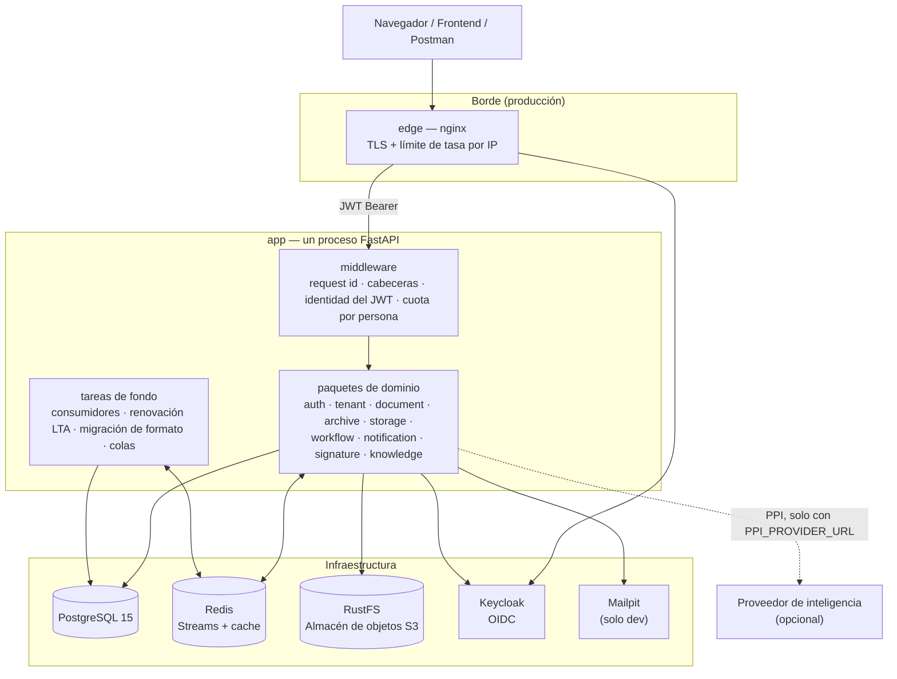
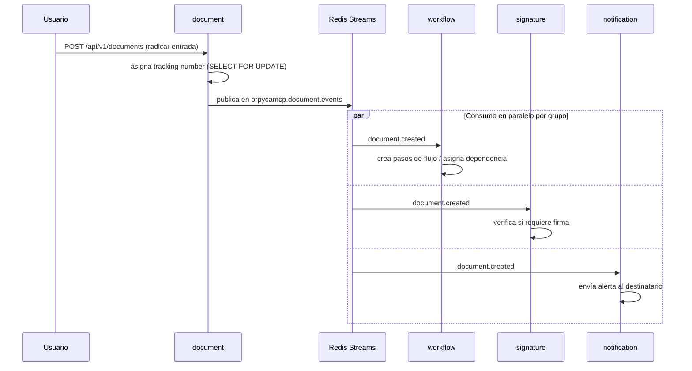
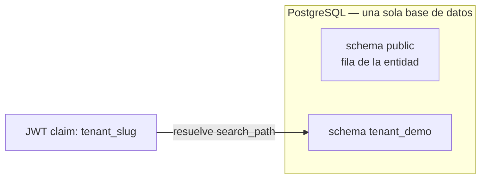

# Arquitectura

## Visión general

Docuboto es **un proceso** ([ADR-047](adr/ADR-047-un-proceso-y-cuatro-contenedores.md),
que enmienda a [ADR-001](adr/ADR-001-microservices-architecture.md)): una sola aplicación
**FastAPI**, el contenedor `app`, monta los routers de nueve paquetes de dominio, cada uno
responsable de un *bounded context*, y corre sus bucles de fondo. No hay `api-gateway` ni
contenedor `worker`. Los paquetes se hablan de dos formas:

- **Síncrona, por llamada a función**: cada paquete expone su puerta en `<paquete>/api.py` y
  los demás la importan. No hay saltos HTTP entre dominios.
- **Asíncrona (Redis Streams)**, para eventos de dominio (un radicado creado, un flujo
  asignado, un documento firmado, etc.).



El objetivo de ADR-047 son cuatro contenedores (`app`, `postgres`, `edge`, `frontend`).
**Todavía no se alcanza**: Keycloak, Redis y el almacén de objetos siguen en los manifiestos
hasta que los retiren [ADR-048](adr/ADR-048-identidad-emitida-por-docuboto.md),
[ADR-049](adr/ADR-049-eventos-en-postgresql-sin-redis.md) y
[ADR-050](adr/ADR-050-bytes-en-disco-y-archivo-sellado.md).

Docuboto no llama a ningún modelo de lenguaje
([ADR-046](adr/ADR-046-conocimiento-sin-modelos.md)) y **no es un servidor de herramientas
para agentes** ([ADR-051](adr/ADR-051-ppi-reducido-vive-en-la-app.md) §5): no hay capa MCP.
Un agente que deba actuar sobre Docuboto usa la API HTTP con una cuenta de servicio de
alcance acotado, o el proveedor por PPI. Que un cliente MCP externo (Claude Desktop, un IDE)
opere el SGDEA **no está disponible**.

La única salida hacia inteligencia es PPI v1.4.0 (contrato congelado en
`contracts/ppi/v1.4.0/`): el consumidor de ingesta arranca en el `lifespan` único de la app
solo con `PPI_PROVIDER_URL` fijado; vacío, no se registra nada y ninguna llamada sale. La
entidad empieza en `intelligence_provider = 'local'`, que no envía nada.

La identidad se resuelve **una vez por petición** en `UsuarioActualMiddleware`, contra el JWT,
y viaja en `request.state`; las cabeceras de identidad que mande el cliente se borran. Se
retiraron la identidad firmada con nonce, los `X-Internal-Token`, el registro de entidades por
HTTP, los estados de ciclo de vida de la entidad y su veto en el borde (ADR-047 §1 y §3).

## El proceso y sus contenedores

`services/docuboto/docuboto/` es la raíz de composición:

| Módulo | Qué hace |
|---|---|
| `main.py` | `create_app()`: único sitio con middleware y manejadores; monta los `DOMAIN_ROUTERS` de cada paquete, `/health` y `/metrics` |
| `config.py` | `CommonSettings` (base, pool, Redis, Keycloak, log) y una clase `Settings` por dominio; los nombres de las variables de entorno no cambian ni llevan prefijo |
| `core/lifespan.py` | Un pool de base de datos y el arranque de las tareas de fondo |
| `core/tasks.py` | `BackgroundTasks`: consumidores, renovación LTA, migración de formato y las colas `trabajo_fuera` (`app`, ligera; `worker`, pesada, que conserva el nombre en el esquema). Lo pesado toma plaza de `heavy_slot()`, un semáforo de `HEAVY_JOBS_CONCURRENCY` (1 por defecto) |
| `core/security.py` | `SecurityHeadersMiddleware` (`X-Request-Id`, `nosniff`, `DENY`, `no-referrer`) y `UserRateLimitMiddleware` (`RATE_LIMIT_PER_USER`, 120/min por persona) |

Los nueve paquetes viven al lado (`services/docuboto/<paquete>/`), con sus pruebas en
`services/docuboto/tests/<paquete>/`. El `main.py` de cada paquete solo exporta
`DOMAIN_ROUTERS`.

| Contenedor | Puerto interno (Docker) | Puerto publicado (host) | Responsabilidad |
|---|---|---|---|
| `app` | 8000 | **19000** (solo `127.0.0.1`) | El proceso: API, tareas de fondo, consumidores de eventos |
| `migrate-docuboto` | — | — | Aplica la cadena de migraciones (ADR-053) y termina; `app` lo espera |
| `frontend` | 3000 | **19300** | SvelteKit SSR — capa de presentación (E22) |
| PostgreSQL | 5432 | **15432** | Base de datos única, multi-schema |
| Redis | 6379 | **16379** | Streams de eventos + cache (hasta ADR-049) |
| RustFS (`minio`) | 9000 | **19900** | Almacén de objetos S3 (sustituye a MinIO, ADR-027; hasta ADR-050). Sin consola web: se inspecciona con `aws-cli` |
| Keycloak | 8080 | **19180** | Identity Provider (OIDC, hasta ADR-048) |
| Mailpit | 1025 (SMTP) / 8025 (web) | 1025 / 8025 | Captura de correos en desarrollo (perfil `dev`) |
| `edge` | 80 / 443 | 80 / 443 | Solo producción: nginx con TLS, límite de tasa por IP y proxy a `app`, `frontend` y Keycloak |

> El rango 19xxx/15432/16379 evita chocar con otras pilas de desarrollo en la misma máquina.

| Paquete | Responsabilidad |
|---|---|
| `auth` | Integración con Keycloak, validación de JWT, RBAC, clearance (RF-SEG-08), TOTP, custodia de llaves de firma |
| `tenant` | Configuración de la entidad de la instalación, dependencias, catálogos, PINAR |
| `document` | Radicación E/S/I, anexos, respuestas, anulación, import/export, ingesta IMAP, OAI-PMH/CMIS |
| `archive` | Expedientes, TRD/CCD, índice electrónico, archivo físico, transferencias, eliminación |
| `storage` | Subida y lectura de archivos en el almacén de objetos, preservación (WORM/Object-Lock) |
| `workflow` | Flujos de distribución, vistos buenos, reglas, dead-letter |
| `notification` | Correo/alertas, webhooks salientes, dead-letter |
| `signature` | Firma electrónica XAdES-B/T/LT/LTA verificable por terceros (ADR-034): personal, sello institucional del índice/acta y renovación del sello de archivo LTA |
| `knowledge` | Pasarela de conocimiento sin modelos: buscar y antecedentes por texto completo, como el usuario (ADR-046) |

## Inventario de recursos por paquete

Cada paquete sigue el layout estándar (`<paquete>/routers/`, uno por recurso). Resumen de
lo que expone cada uno:

### `auth`
| Router | Qué gestiona |
|---|---|
| `auth` | Login/token contra Keycloak |
| `clearance` | Niveles de seguridad (clasificación de usuarios/documentos) |
| `rbac` | Roles y permisos (admin) |
| `urd` | Gestión de usuarios (admin) |
| `context` | Contexto de sesión (tenant, roles, permisos del usuario actual) |
| `audit` | Consulta de `audit_log` (admin) |
| `totp` | Segundo factor TOTP |
| `signing_key` | Custodia de llaves de firma personal (Epic firma PKI). El certificado emitido offline se activa con `python -m auth.ops.activar_certificado` dentro del contenedor |

### `tenant`
| Router | Qué gestiona |
|---|---|
| `config` | Configuración de la entidad |
| `dependencias` | Unidades organizacionales |
| `catalogos` | Catálogos generales (tipos documentales, etc.) |
| `pinar` | Plan Institucional de Archivos (Ac. 003/2015) |

La entidad se da de alta con `scripts/init-tenant.sh`; no hay ruta HTTP para ello.

### `document` (el más grande — núcleo de radicación)
| Router | Qué gestiona |
|---|---|
| `documents` | CRUD de radicados E/S/I, anexos |
| `anulacion` | Anulación de radicados |
| `respuesta` | Respuestas a radicados (antecedente E↔S) |
| `signatures` | Estado de firma del radicado |
| `borradores` | Borradores previos a radicar |
| `import_` / `export` | Interoperabilidad (E11 INT-01/INT-05) — paquetes ZIP con fixity |
| `ingest` | Ingesta por correo (IMAP) |
| `batch` | Operaciones masivas |
| `search` / `reports` | Búsqueda FTS y reportes |
| `public` | Endpoints de consulta pública (Ley 1712) |
| `metadata` / `metadata_elements` | Plantillas de metadatos documentales |
| `postal` | Envíos/operador postal (webhook entrante E20) |
| `cmis` / `oai` | Interoperabilidad CMIS y cosecha OAI-PMH |

### `archive`
| Router | Qué gestiona |
|---|---|
| `expedientes` | Ciclo de vida del expediente (abrir/cerrar/transferir) |
| `indice` | Índice electrónico XML firmado (E15) |
| `fisico` | Archivo físico: ubicaciones, unidades de conservación, préstamos |
| `transferencias` | Transferencias documentales + FUID |
| `tipos_documentales` / `trd` | TRD/CCD (series, subseries, retención, disposición) |
| `metadata` | Plantillas de metadatos de expediente |
| `oai` | Cosecha OAI-PMH multinivel (fonds→series→file) |

### `storage`
| Router | Qué gestiona |
|---|---|
| `storage` | `POST /upload` (lo usa el frontend); la lectura de bytes es `storage/api.py`, sin ruta |
| `preservacion` | WORM/Object-Lock, empaquetado AIP BagIt/PREMIS |

### `workflow`
| Router | Qué gestiona |
|---|---|
| `workflow` | Pasos de flujo, distribución, tracking |
| `visto_bueno` | Vistos buenos (cadena de aprobación) |
| `rules` | Reglas de enrutamiento de flujos |
| `admin_deadletter` | Inspección/replay/discard de eventos fallidos (DLQ) |

### `notification`
| Router | Qué gestiona |
|---|---|
| `notifications` | Notificaciones (correo/alertas); el envío lo piden los demás paquetes por `notification/api.py` |
| `webhooks` | Suscripción y entrega de webhooks salientes firmados (HMAC) |
| `admin_deadletter` | DLQ de notificaciones |

### `signature`
| Router | Qué gestiona |
|---|---|
| `signature` | Firma XAdES personal (`/sign-personal`), verificación; el sello institucional solo es alcanzable por `signature/api.py` |
| `cadena` | Cadena/lote de firmas |
| `admin_deadletter` | DLQ de firma |

### `knowledge`
| Router | Qué gestiona |
|---|---|
| `knowledge` | `/search` y `/antecedentes` (texto completo, o delegados a PPI con la entidad en `ppi`) |
| `retorno` | Callback `content` de PPI: el proveedor pide el contenido de un documento |

## Enrutado y borde

El enrutado por prefijo lo hace el router del propio FastAPI: cada paquete monta sus rutas con
`include_router`. Lo que hacía el gateway se repartió así:

- **Límite de tasa por IP** → `edge` (nginx `limit_req`, sin Redis): general, login, altas
  anónimas de ventanilla/PQRS y cosecha OAI-PMH/CMIS, con los presupuestos que tenía el gateway
  (`infra/nginx/orpyca.conf.template`).
- **Cuota por persona** → `UserRateLimitMiddleware` en la app (`RATE_LIMIT_PER_USER`).
- **`X-Request-Id` y cabeceras de endurecimiento** → `SecurityHeadersMiddleware`, el más
  externo de la app.

Reglas de seguridad **por diseño** (no accidentales):

- **Descarga de anexos mediada**: la única ruta de storage es `POST /api/v1/storage/upload`.
  La descarga de bytes **siempre** pasa por `document`
  (`GET /api/v1/documents/{id}/anexos/{file_id}/download`), que revalida el clearance del
  usuario antes de leer el archivo por `storage/api.py` — nunca se llega directo al almacén
  de objetos desde afuera.
- **`knowledge` acotado**: solo expone `/search`, `/antecedentes` y el callback de PPI.

## Orquestación asíncrona — Redis Streams

Patrón de nombre de stream: `orpycamcp.{servicio}.events`
(dead-letter: `orpycamcp.{servicio}.deadletter`). Cada worker consumidor usa un grupo
de consumidores Redis (`XREADGROUP`) y solo hace `XACK` tras procesar con éxito; si
falla, el mensaje permanece en la PEL para reintento y, tras agotar reintentos, se
mueve al stream de dead-letter (ADR-021).

Ejemplo real de punta a punta — **radicación de un documento de entrada**:



**Si un consumidor falla** (ej. `notification` no puede enviar el correo):
el mensaje permanece en su PEL, se reintenta con backoff y, si sigue fallando, se
mueve al stream `orpycamcp.notification.deadletter`. Un administrador con
`PERM_DLQ_ADMIN` puede inspeccionar, reintentar (`replay`) o descartar
(`discard`) esas entradas vía `admin_deadletter.py` de cada paquete (ADR-021).

## Multi-tenancy: aislamiento por schema



Una instalación sirve a **una entidad** (ADR-047 §3), y esa entidad conserva su schema
`tenant_{slug}`. En cada request, `get_tenant_conn` (`orpycamcp_common.database`) fija el
`search_path` de la conexión asyncpg según el `tenant_slug` del JWT — nunca se recibe el tenant
desde el body ni desde un header manipulable por el cliente. `public.tenants` es la fila de
configuración de la entidad, sin estados de ciclo de vida. El almacén sigue usando buckets
prefijados por entidad (`orpycamcp-{slug}-documents`) hasta ADR-050.

## Flujo de autenticación

```mermaid
sequenceDiagram
    participant U as Usuario/Frontend
    participant KC as Keycloak
    participant MW as app — UsuarioActualMiddleware
    participant R as router del paquete

    U->>KC: Authorization Code + PKCE
    KC-->>U: JWT (claims: tenant_slug, user_id, roles[])
    U->>MW: request + Authorization: Bearer <JWT>
    MW->>MW: borra X-User-Id, X-Username, X-User-Roles, X-Canal, X-Tenant-Slug del cliente
    MW->>MW: valida el JWT en proceso; deja el usuario en request.state; repone X-Tenant-Slug
    MW->>R: request
    R->>R: search_path = tenant_{slug}; valida permiso/clearance en BD
```

La autorización se decide en cada ruta: el permiso y el nivel de clearance (RF-SEG-08) se
revalidan contra la base de datos en el momento del request (ADR-013), con los gates de
`orpycamcp_common.clearance` (`require_permission`, `require_actor_permission`,
`require_vetted_permission`). La misma comprobación (`enforce_permission`) vale para una ruta y
para una función de `<paquete>/api.py`.

## Comunicación entre paquetes — resumen

| Tipo | Mecanismo | Cuándo se usa |
|---|---|---|
| HTTP | API REST de la app | Operaciones de usuario que requieren respuesta inmediata |
| Llamada a función | `<paquete>/api.py` (argumentos por nombre, `tenant_slug` y actor explícitos) | Un paquete necesita algo de otro: bytes (`storage/api.py`, el único cliente del almacén), sello (`signature/api.py`), envío de correo (`notification/api.py`), días hábiles (`tenant/api.py`)… Un paquete solo puede importar el `api` de otro (`shared/tests/test_contrato_api.py`) |
| Asíncrona | Redis Streams (`orpycamcp.{servicio}.events`) | Eventos de dominio consumidos por uno o más paquetes |

## Librería compartida — `orpycamcp_common`

Instalada en la imagen de la app (`pip install /shared`, build con contexto en la raíz del
repo). Lo que más de un paquete necesita se define una sola vez aquí; entre otros:

- **`audit.py`** — único punto de escritura de `public.audit_log`, con cadena de hash
  por tenant (ADR-008): `compute_hash`, `append`, `append_denial`, `verify_chain`.
- **`events.py`** — sobre canónico de eventos sobre Redis Streams (ADR-010):
  `build_event`, `publish`, `emit`, `ensure_group`, `trim_deadletter`,
  `reclaim_stale`.
- **`database.py`** — un pool; `get_conn`, `get_vetted_conn`, `get_tenant_conn`,
  `acquire_tenant` para lo que corre fuera de una petición.
- **`clearance.py`** — los gates de permiso: `require_permission`,
  `require_actor_permission`, `require_vetted_permission`, `enforce_permission`.
- **`usuario.py`** — `UsuarioActualMiddleware`: el llamante, una vez por petición.

## Ver también

- [Pantallas del sistema](pantallas.md) — cómo el frontend consume esta arquitectura.
- [Multi-tenancy](multi-tenancy.md) — detalle de aislamiento por schema.
- [Decisiones de arquitectura (ADRs)](adrs.md) — el porqué de cada decisión aquí resumida.
